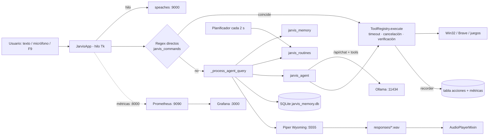

# PROJECT CONTEXT

> Documento de contexto para agentes de IA. Última revisión: 2026-11-05 (roadmap completo, puntos 1–6: seguimiento de acciones, consultas del sistema, automatizaciones, observabilidad, plugins/MCP y visión de pantalla).
> Convención: **[Verificado]** = comprobado leyendo código/config o ejecutando; **[Inferido]** = deducción razonable no confirmada.
> No hay README ni repositorio git: este archivo es la única documentación del proyecto.

---

## 1. Descripción general

- **Nombre:** J.A.R.V.I.S. — "Asistente local" (título de ventana en `jarvis_app.py`).
- **Propósito:** asistente personal de escritorio **en español**, controlado por texto o voz, que funciona 100 % en local: STT (Whisper), LLM (Ollama) y TTS (Piper) corren en contenedores/servicios locales.
- **Problema que resuelve:** controlar el PC por voz/texto (volumen, dispositivo de salida, navegador Brave, YouTube, lanzar juegos, ventanas), mantener conversaciones con memoria persistente y programar rutinas recurrentes, sin depender de la nube.
- **Tipo:** aplicación de escritorio Windows (Tkinter + icono de bandeja), empaquetable como `.exe` con PyInstaller. Existe además un modo CLI legado en `jarvis_core.py`.
- **Usuarios:** uso personal de un único usuario. [Inferido] Hay valores fijos del hardware/biblioteca del autor (auriculares *G533*, juegos concretos en `C:\Games` y Steam).

## 2. Stack tecnológico

| Área | Tecnología | Fuente |
|---|---|---|
| Lenguaje | Python ≥ 3.11 (usa `StrEnum`, `X | None`). Venv funcional: `.venv313` (Python 3.13) | `jarvis_tool_registry.py`, `.venv313/pyvenv.cfg` |
| GUI | Tkinter / ttk (**ventana única** con barra lateral y secciones Chat / Rutinas / Ajustes + diálogos de confirmación) | `jarvis_ui.py`, `jarvis_app.py` |
| Bandeja | `pystray` + `Pillow` | `jarvis_app.py` |
| Audio | `PyAudio` (captura 16 kHz mono y reproducción WAV) | `audio_capture.py`, `jarvis_player.py` |
| HTTP | `requests` (STT, Ollama, scraping de YouTube) | |
| Sistema | `psutil` (procesos, CPU, RAM, discos, batería; solo lectura). `listar_discos()` [2026-11-11]: unidades fijas y extraíbles con medio, con etiqueta del volumen; sin CD ni particiones de menos de 1 GB (arranque o recuperación con letra). La usan el panel de inicio y `get_system_status` | `jarvis_system_info.py` |
| Integraciones | SDK `mcp` 2.3 (cliente stdio; API en snake_case: `server_info`, `input_schema`, `read_only_hint`) y Node.js/npx para servidores MCP; Open-Meteo (clima, sin clave) | `jarvis_mcp.py`, `plugins/clima.py` |
| Métricas | `prometheus_client` (servidor en puerto 8000) | `jarvis_core.py` |
| Win32 | `ctypes` puro: COM Core Audio (volumen/dispositivo), `RegisterHotKey` (F9), enumeración de ventanas Brave | `jarvis_audio_devices.py`, `jarvis_hotkeys.py`, `jarvis_system.py` |
| BD | SQLite (`sqlite3` stdlib, SQL crudo, **sin ORM**) | `jarvis_core.py`, `init_db.sql` |
| STT | `speaches` (faster-whisper, API compatible OpenAI) modelo `Systran/faster-whisper-small`, en CPU con `WHISPER__TTL=-1` (modelo siempre cargado), `WHISPER__COMPUTE_TYPE=int8`, `WHISPER__CPU_THREADS=8`. Cada transcripción envía `prompt=STT_PROMPT` (vocabulario de órdenes: pausa, reanuda, mutea, desmutea, pestaña, YouTube, Brave, monitor, Spotify…); medido el 2026-11-07: acierta «desmutea» y «Spotify» sin más demora y con silencio no inventa texto. Mantenerla corta | `docker-compose.yml`, `jarvis_core.py` |
| Palabra de activación | openWakeWord (modelo `hey_jarvis`, ONNX en CPU, ~1,4 ms por bloque de 80 ms) | `jarvis_wakeword.py` |
| LLM | Ollama **nativo** (app de escritorio; debe estar abierta), modelo `qwen2.5-coder:14b`; visión: `qwen3-vl:8b-instruct-q8_0` (`MODEL_VISION`, ~10 GB, cabe entero en la GPU de 16 GB; elegido el 2026-11-07 tras compararlo en los monitores del usuario con `qwen3.6:27b`, que no cabía: ubicó 7/9 textos frente a 6/9, ~0,7 s por búsqueda frente a ~11 s y describió en ~4 s frente a ~23 s; sigue desplazando al principal mientras está cargado) | `jarvis_core.py` (`MODEL_LLM`); confirmado por el usuario |
| TTS | `wyoming-piper`, voz `es_ES-davefx-medium` (protocolo Wyoming por TCP) | `docker-compose.yml`, `jarvis_core.py` |
| Observabilidad | Prometheus + Grafana (docker-compose) | `prometheus.yml` |
| Build | PyInstaller (`Jarvis.spec`, modo ventana, sin consola) | |
| Tests | `unittest` + `unittest.mock` (64 tests) | `tests/` |

`requirements.txt` fija versiones exactas (probadas con Python 3.13; al actualizar una, pasar los tests y cambiarla en el mismo commit); `requirements-dev.txt` añade PyInstaller. Lista: Pillow, PyAudio, prometheus-client, pystray, requests, psutil, mcp, hidapi, openwakeword, pycaw, winrt-runtime, winrt-Windows.Foundation, winrt-Windows.Media.Control, uiautomation. Los modelos de openWakeWord no vienen con el paquete: `python -c "from openwakeword import utils; utils.download_models(model_names=['hey_jarvis'])"` (quedan en `site-packages/openwakeword/resources/models`; `Jarvis.spec` los incluye con `collect_data_files('openwakeword')`). Licencia de los modelos preentrenados: CC BY-NC-SA 4.0 (uso no comercial); no se suben al repo. Los servidores MCP por defecto necesitan Node.js (`npx`) en PATH. PyInstaller está instalado en `.venv313` pero no figura en requirements.

## 3. Arquitectura del proyecto

Monolito de escritorio con módulos planos en la raíz. Patrones clave:

- **`JarvisApp`** (`jarvis_app.py`) es el orquestador: hereda los mixins por tema `jarvis_app_*.py` (órdenes, voz, confirmaciones, rutinas, monitores, pantalla, celular, ajustes, juego, herramientas; ver §4), el de UI (`JarvisUIMixin`) y el reproductor (`AudioPlayerMixin`), y actúa como *host* de las herramientas (métodos `_tool_*`).
- **Hilos + cola de eventos:** el trabajo pesado (STT, LLM, TTS, Docker, rutinas, juegos) corre en hilos daemon; se comunican con el hilo de Tk **solo** vía `self.events: queue.Queue[tuple]`, consumida por `_poll_events()` cada 100 ms. Las confirmaciones desde hilos usan una `queue.Queue(maxsize=1)` de respuesta con *timeout* (120 s; 15 s para `tool_ui_request`).
- **Enrutamiento por capas** de cada entrada del usuario (texto o transcripción):
  1. Comandos directos por regex (`jarvis_commands.detectar_*`): audio on/off, dispositivo de salida, volumen, YouTube (búsqueda / resultado ordinal), nueva pestaña, navegación, ventanas, juegos. Se ejecutan **sin pasar por el LLM**.
  2. `_process_agent_query`: comandos de memoria (`jarvis_memory.procesar_comando`) → comandos de rutinas (`jarvis_routines.procesar_comando`) → creación de rutina por regex (`parsear_solicitud_creacion`) → **agente LLM con herramientas** (`jarvis_agent.procesar_con_herramientas`).
  3. Se guarda el turno en SQLite, se genera TTS y se reproduce.
- **Registro de herramientas** (`ToolRegistry`) con esquema JSON, validadores y nivel de riesgo (LOW / MEDIUM / HIGH) que determina las confirmaciones.
- **Ejecución supervisada:** **toda** acción (agente, comando directo, rutina) pasa por `ToolRegistry.execute`, que aplica cancelación, tiempo máximo por herramienta, verificación posterior opcional y registra el resultado (log, Prometheus, tabla `acciones`) mediante el `recorder`. Ver `jarvis_actions.py`.



## 4. Estructura de directorios

```
JARVIS/
├── jarvis_app.py            # Punto de entrada GUI (main). JarvisApp: arranque, bucle de eventos (_poll_events), bandeja, vigilantes, avisos y cierre; hereda de los mixins jarvis_app_*:
├── jarvis_app_ordenes.py    #   OrdenesMixin: enrutado (_send_text y _voice_worker), respuestas de la IA, acciones directas
├── jarvis_app_voz.py        #   VozMixin: micrófono, «Hey Jarvis», respuesta en vivo, interrupción, voces
├── jarvis_app_confirmaciones.py # ConfirmacionesMixin: planes, herramientas de riesgo, energía (botones y voz)
├── jarvis_app_rutinas.py    #   RutinasMixin: programadas, por frase y por evento, y su ejecución
├── jarvis_app_monitores.py  #   MonitoresMixin: cambios con «¿Mantener?», lotes, mover ventanas, escalado, barra de tareas
├── jarvis_app_pantalla.py   #   PantallaMixin: clic en pantalla y visión
├── jarvis_app_movil.py      #   MovilMixin: servidor y funciones de la app del celular
├── jarvis_app_ajustes.py    #   AjustesMixin: interruptores de ⚙ Ajustes
├── jarvis_app_juego.py      #   JuegoMixin: precarga del modelo, GPU libre al jugar, modo juego
├── jarvis_app_herramientas.py # HerramientasMixin: el resto de _tool_* (ventanas, navegador, tema, limpieza, resumen, deshacer, archivos, ayuda)
├── jarvis_deshacer.py       # «Deshaz lo último»: Historial de acciones reversibles (ganchos de ToolRegistry)
├── jarvis_modo_juego.py     # Modo juego: cerrar y reabrir los programas elegidos
├── jarvis_servicios.py      # VigilanteServicios: STT, TTS y Ollama caídos → aviso y reinicio de Docker
├── jarvis_buscar_archivos.py # Buscar y abrir archivos por voz (carpetas personales, sin programas ni scripts)
├── jarvis_tv.py             # Tele Google TV: buscar, vincular, teclas, apps, encender (androidtvremote2)
├── jarvis_app_tv.py         #   TvMixin: herramientas de la tele, página 📺 TELE, Ajustes y /api/tv
├── jarvis_ui.py             # JarvisUIMixin: ventana única (barra lateral con orbe compacto y secciones), burbujas de chat, estados
├── jarvis_player.py         # AudioPlayerMixin: reproducción WAV con PyAudio (play/pausa/stop, progreso)
├── jarvis_theme.py          # Temas (Cian, Mark, Claro): tokens de color y cambio en vivo
├── jarvis_monitor_view.py   # Vista de monitores de Ajustes (datos, disposición, acciones)
├── jarvis_windows.py        # Mover ventanas entre monitores
├── jarvis_markdown.py       # Markdown sencillo para las burbujas del chat
├── jarvis_cards.py          # Tarjetas de acción (icono, estado, detalle)
├── jarvis_comandos.py       # Guía «? COMANDOS» (cabecera): catálogo de comandos de voz, frases de tus rutinas y buscador
├── jarvis_floating.py       # Aviso flotante en la esquina (Jarvis en la bandeja)
├── jarvis_hardware.py       # Temperaturas y carga (LibreHardwareMonitor vía pythonnet)
├── jarvis_cleanup.py        # «Libera espacio»: medir y borrar lo que el usuario marca
├── jarvis_dashboard.py      # Datos del panel de inicio (en segundo plano)
├── jarvis_voices.py         # Catálogo de voces de Piper en español y elección
├── jarvis_games_watch.py    # Modo juego: detecta cuándo se abre y se cierra un juego
├── jarvis_botones.py        # Pulsar un botón por su texto en la ventana de un programa (UIA)
├── jarvis_gpu_tuning.py     # Mantener el undervolt de la GPU AMD (perfil de Adrenalin, ADL Overdrive 8)
├── jarvis_mobile.py         # Servidor para la app del celular (solo por Tailscale, con vinculación)
├── movil/                   # App nativa de Android (Kotlin, sin bibliotecas externas)
├── vendor/LibreHardwareMonitor/  # DLL de LibreHardwareMonitor 0.9.6 (MPL 2.0) y dependencias, con licencias
├── jarvis_core.py           # Config global, Docker, SQLite, STT/LLM/TTS, métricas, modo CLI legado
├── jarvis_agent.py          # Bucle agente Ollama /api/chat con tool-calling, planes multi-paso
├── jarvis_tool_registry.py  # ToolRegistry (ejecución supervisada), ToolDefinition, ToolRisk, excepciones
├── jarvis_tools.py          # crear_registro_herramientas(host, recorder, verificadores): las 12 herramientas
├── jarvis_actions.py        # Límites/cancelación (ejecutar_con_limites, CancellationToken), ResultadoAccion, registro y comandos de historial
├── jarvis_verifiers.py      # Comprobaciones posteriores (volumen real, ventana Brave, rutina guardada, audio Jarvis)
├── jarvis_system_info.py    # Solo lectura: ventanas abiertas (ctypes), procesos y estado del equipo (psutil)
├── jarvis_events.py         # HeadphonesWatcher: detecta conexión/desconexión de auriculares → ("device_event", disparador)
├── jarvis_headset.py        # Enlace del G533 vía HID++ (consulta de batería al receptor): encendido/apagado
├── jarvis_routines_panel.py # RoutinesPanel (sección incrustada, o Toplevel con incrustado=False): ver, pausar/reanudar, cambiar permiso y eliminar rutinas
├── jarvis_routine_form.py   # Formulario (Tk) para crear/editar rutinas y comandos personalizados sin dictarlos
├── jarvis_commands.py       # Detectores regex de comandos, normalizar_url_web, scraping YouTube, aprobaciones por voz
├── jarvis_memory.py         # Recuerdos (CRUD, origen usuario/automatica) + búsqueda mixta: significado (embeddings) y palabras
├── jarvis_embeddings.py     # Vectores con Ollama (embeddinggemma, /api/embed), prefijos consulta/documento
├── jarvis_aprendizaje.py    # Aprendizaje automático: extrae hechos de conversaciones inactivas y los guarda/actualiza
├── jarvis_voz_stream.py     # HabladorEnVivo: frases → Piper → reproducción en cola mientras el modelo escribe
├── jarvis_media.py          # Multimedia: GSMTC/winrt (play/pausa/siguiente/anterior, «¿qué está sonando?»), teclas multimedia de respaldo, volumen por app (pycaw)
├── jarvis_screen_actions.py # Clic/escritura en pantalla: busca el elemento por UI Automation (o visión, con permiso) y actúa tras confirmar
├── jarvis_reminders.py      # Temporizadores/alarmas/recordatorios: frases → set_reminder/list_reminders/cancel_reminder, tabla recordatorios, VigilanteRecordatorios (cada 1 s), sonido de alarma
├── jarvis_routines.py       # Rutinas programadas: parseo, validación, persistencia, reclamación
├── jarvis_system.py         # Brave (localizar, ventanas, pestañas) y lanzamiento de juegos
├── jarvis_audio_devices.py  # Volumen del sistema y cambio de dispositivo de salida (COM vía ctypes)
├── jarvis_integraciones.py  # Lee/crea integraciones.json (plugins activos y servidores MCP con herramientas permitidas)
├── jarvis_plugins.py        # GestorPlugins: carga plugins integrados (import estático para PyInstaller)
├── plugins/                 # Plugins integrados (clima.py, busqueda.py); ver plugins/__init__.py para el contrato
├── jarvis_displays.py       # Desactivar/extender/duplicar monitores (API CCD de Windows) con reversión
├── jarvis_vision.py         # Monitores (numeración de Windows), captura en memoria y análisis con MODEL_VISION
├── jarvis_ollama_gpu.py     # Al iniciar: si Ollama arrancó sin GPU (registro server.log solo con library=cpu), lo reinicia (máx. 3 veces, 60 s entre intentos)
├── jarvis_power.py          # Apagar/reiniciar (shutdown.exe con 10 s de margen), suspender (SetSuspendState) y bloquear (LockWorkStation)
├── jarvis_mcp.py            # GestorMCP: sesiones MCP en un hilo asyncio, permisos y registro de herramientas
├── jarvis_logging.py        # Registro rotativo logs/jarvis.log + captura de excepciones (hilos, Tk)
├── jarvis_health.py         # Diagnóstico: Ollama/STT/TTS, latencias por etapa, fallos 24 h
├── jarvis_single_instance.py # Instancia única: mutex con nombre + evento para mostrar la ventana existente
├── jarvis_hotkeys.py        # Hilo GlobalHotkeyListener (F9 global)
├── jarvis_wakeword.py       # Hilo DetectorPalabraActivacion («Hey Jarvis», openWakeWord) + SegmentadorVoz (fin de la orden por energía); la orden termina tras 1,3 s de silencio (máx. 25 s) y el ruido de fondo es el percentil 20 de los últimos 5 s (`estimar_ruido`: con la mediana, el propio «Hey Jarvis» subía el umbral y las órdenes largas se cortaban); una vez que se habló, el silencio también es relativo a la voz (`umbral_fin` = máx(umbral, 0,2 × mediana de la voz) [2026-11-11]: con sonido de fondo constante por encima del umbral fijo —un vídeo o juego que se cuela en el micrófono— la orden no terminaba y se grababan 25 s); cada orden deja en el log su duración y umbral, y las de 8 s o más los percentiles de energía, sin contenido
├── audio_capture.py         # GrabadorAudio (micrófono → WAV temporal), grabar_audio CLI
├── init_db.sql              # Esquema SQLite + datos iniciales (idempotente)
├── docker-compose.yml       # stt, llm, tts, prometheus, grafana
├── prometheus.yml           # Scrape de host.docker.internal:8000
├── Jarvis.spec              # Configuración PyInstaller
├── requirements.txt         # Versiones fijadas
├── requirements-dev.txt     # + PyInstaller
├── .github/workflows/tests.yml  # CI: tests en windows-latest con Python 3.13 en cada push/PR a main
├── assets/                  # icon.ico (ventana/bandeja/exe), icon.webp
├── tests/                   # unittest (sin __init__.py)
├── responses/               # Audios respuesta_*.wav; solo se conservan los 30 más recientes (ya no se crean .txt)
├── logs/                    # jarvis.log (1 MB × 5) y mcp_<servidor>.log (stderr de cada servidor MCP)
├── integraciones.json       # Se crea junto a la app (instalación: Desktop\Jarvis). Editable con Jarvis cerrado
├── jarvis_memory.db         # BD SQLite de runtime (datos personales; no tocar en tests)
├── piper-voices/            # Modelo ONNX de voz (volumen montado en tts)
├── whisper-models/          # Caché HF de faster-whisper base/small (volumen de stt)
├── ollama-data/             # Volumen del contenedor llm (vacío actualmente)
├── build/, dist/            # Artefactos PyInstaller (dist/Jarvis/Jarvis.exe)
├── .venv313/                # Venv Python 3.13 con todas las dependencias + PyInstaller
└── .venv/                   # Venv Python 3.15 incompleto (sin PyAudio/Pillow/pystray)
```

## 5. Módulos y funcionalidades

- **`jarvis_core.py`** — Constantes de configuración (URLs, modelo, rutas). `APP_DIR` = carpeta del exe si está congelado, si no la del script. Funciones: `iniciar_servicios_docker()` (espera `docker info` hasta 120 s, despausa y levanta **solo `stt` y `tts`**), `detener_servicios_docker()`, `inicializar_base_datos()` (una vez, con lock; migraciones ad hoc), `conexion_db()` (context manager con commit/rollback y `foreign_keys=ON`), conversación (`crear_conversacion`, `obtener_conversacion_actual`, `obtener_historial`, `guardar_turno`), `procesar_stt`, `precalentar_stt()` (envía 1 s de silencio tras levantar Docker para cargar Whisper; lo llama `_docker_start_worker`), `procesar_llm` (vía `/api/generate`, usado solo por el CLI), `guardar_respuesta`, `generar_audio_tts` (protocolo Wyoming manual), métricas Prometheus. Ejecutable como CLI: `--text-mode`, `--tts-test TEXTO`.
- **`jarvis_agent.py`** — `procesar_con_herramientas(texto, conversacion_id, registry, confirm, approve_plan=…, max_tool_rounds=3, max_tool_calls=5, cancel_token=None, max_total_seconds=300)`. La consulta a Ollama corre vía `ejecutar_con_limites` (se puede cancelar mientras espera; timeout 120 s + margen) y traduce conexión rechazada / timeout a mensajes claros («abre la aplicación de Ollama»). Si el usuario cancela devuelve «Cancelé la operación. Acciones ya completadas: …» sin volver a llamar al LLM. Los fallos de ejecución se añaden al final de la respuesta («Atención: «X» falló: …») para no depender de que el LLM los mencione. Construye *system prompt* (preferencias + recuerdos relevantes + reglas), añade historial (12 mensajes) y llama a `/api/chat`. Acepta tool calls nativas **o** JSON en el contenido (`{"name","arguments"}`, también en bloque ```). Heurística `_requested_action_count` (verbos de acción en español) para exigir planes completos; un único reintento si el modelo no devuelve herramientas. Planes con >1 paso requieren `approve_plan`; un fallo/cancelación detiene los pasos restantes. El *system prompt* incluye `INSTRUCCION_SEGUIMIENTO` [2026-11-10]: un seguimiento corto o ambiguo («¿qué más me puedes contar?», «sigue», «¿y eso?») continúa el tema de los mensajes anteriores; sin ella, qwen2.5-coder a veces respondía «¿sobre qué quieres saber?» aunque el historial le llegaba bien.
- **`jarvis_tool_registry.py`** — Registro con validación de esquema propia (tipos `string/integer/number/boolean`, `minLength/maxLength/minimum/maximum/enum`, `additionalProperties`). HIGH exige `requires_confirmation=True`. Cada herramienta tiene `label` (nombre en español para el usuario), `timeout_seconds` (por defecto 30) y `verifier` opcional. `execute(name, args, *, confirmed, origin, cancel_token)`, en orden: valida → si está cancelado lanza `ToolCancelledError` → si falta confirmación lanza `ToolConfirmationRequired` (no se registra) → ejecuta el handler en un hilo con tiempo máximo → verifica → registra. `record_result=False` hace que el recorder reciba `resultado=None` (se registra la ejecución, no su contenido). Errores: los del handler se **relanzan con su tipo original**; tiempo agotado → `ToolTimeoutError`, cancelación → `ToolCancelledError`, verificación negativa → `ToolVerificationError` (todas `ToolError`). Un verificador que falla internamente no hace fallar la acción (`Verificacion(ok=None)`). `ToolRegistry(recorder=None)`: sin recorder no se registra nada (así lo usan los tests).
- **`jarvis_actions.py`** — `CancellationToken`, `ejecutar_con_limites(func, timeout, descripcion, cancel_token)` (no puede matar el hilo: deja de esperar y el hilo termina en segundo plano; los mensajes lo advierten), `EstadoAccion` (`exito`, `error`, `tiempo_agotado`, `cancelada`, `no_verificada`), `Verificacion(ok: bool|None, detalle)`, `ResultadoAccion`, `registrar_accion()` (log + métricas `jarvis_tool_executions_total{herramienta,estado,origen}` y `jarvis_tool_duration_seconds{herramienta}` + fila SQLite), `listar_acciones()`, `procesar_comando()` para «qué acciones hiciste», «historial de acciones», «cuál fue la última acción».
- **`jarvis_system_info.py`** — Roadmap punto 2, **solo lectura** (no cierra procesos ni cambia nada). Recolección separada del formato para testear sin el sistema: `obtener_ventanas_abiertas()` (EnumWindows: visibles, sin propietario, sin `WS_EX_TOOLWINDOW`, no *cloaked*), `obtener_uso_procesos()` (psutil, agrupado por programa; CPU medida en 0,5 s y normalizada al total del equipo), `obtener_estado_equipo()`; `formatear_*` produce el texto en español; `consultar_*` son los handlers. `nombre_aplicacion()` traduce ejecutables a nombres legibles (`_NOMBRES_AMIGABLES`; `ApplicationFrameHost` usa el título; el propio proceso = «Jarvis»). Privacidad: por defecto solo nombres de programas; los títulos de ventana solo con `include_titles=true` (petición explícita), recortados a 80 caracteres. Las tres herramientas usan `record_result=False` y **no** están permitidas en rutinas.
- **`jarvis_integraciones.py`** — `cargar_integraciones()` lee `APP_DIR/integraciones.json` o lo crea con `configuracion_por_defecto()` (plugin `clima` y servidor MCP `archivos`: `npx -y @modelcontextprotocol/server-filesystem <Documents>`, solo `HERRAMIENTAS_ARCHIVOS_LECTURA`, `lecturas_sin_preguntar: true`). JSON inválido → ninguna integración y aviso en el chat.
- **`jarvis_plugins.py` + `plugins/`** — Contrato de plugin: `NOMBRE`, `DESCRIPCION`, `registrar(registry, contexto)`, opcionales `detectar_comando(texto)` (comando directo → herramienta) y `procesar_comando(texto, contexto)`. `ContextoPlugin` da `obtener_preferencia`/`guardar_preferencia` (tabla `preferencias`). Nuevo plugin = módulo en `plugins/` + entrada en `PLUGINS_DISPONIBLES` + activarlo en `integraciones.json`.
- **`plugins/busqueda.py` [2026-11-10]** — Herramienta LOW `web_search(query)`: el modelo (qwen2.5, entrenado hasta 2024) no conoce lo posterior y respondía «no tengo información» (p. ej. MCP). Proveedores: **Tavily** (`api.tavily.com/search`, `search_depth: basic` = 1 crédito, `include_answer`, 5 resultados; plan gratuito `CUPO_TAVILY` = 1000/mes) si hay clave, y **DuckDuckGo** (`html.duckduckgo.com/html/`, sin cuenta, `analizar_duckduckgo` saca enlaces y fragmentos, descarta anuncios `y.js` y desenvuelve `/l/?uddg=`) si no hay clave, se agotó el cupo o Tavily falla (401/403 clave, 429/432/433 cupo, timeout); `ErrorBusqueda` si ninguno responde. Clave en `TAVILY_API_KEY` (variable de entorno o `.env` junto a Jarvis.exe, leído por `leer_clave`; `.env` está en `.gitignore`, nunca en la BD ni en los logs). Uso del mes en `preferencias.busqueda_uso_mes` (JSON `{mes, tavily, duckduckgo}`, se reinicia al cambiar de mes); «¿cuántas búsquedas me quedan?» (`procesar_comando`) y una sección en Ajustes (`_build_search_settings`, se refresca al abrir Ajustes). `formatear` recorta cada resultado a 1200 caracteres, marca el contenido como datos y no instrucciones (inyección desde páginas web) y pide terminar con «Fuentes:». La descripción de la herramienta le dice al modelo cuándo buscar (pedido explícito, algo que no conoce o posterior a 2024) y cuándo no (conocimiento general: «¿qué es Python?» responde sin buscar). Sin frase directa: «busca en internet …» lo resuelve el agente, que necesita redactar la respuesta. `jarvis_integraciones._parsear` activa los plugins integrados nuevos aunque `integraciones.json` sea anterior (se desactivan con `"activo": false`). Medido: 8–14 s por respuesta con búsqueda. **Cuando el modelo dice que no sabe** (`jarvis_agent`, solo si `web_search` está registrada): el *system prompt* suma `INSTRUCCION_BUSQUEDA` (buscar antes de decir «no tengo información», aunque antes lo haya dicho); `_sin_respuestas_sin_saber` quita del historial los turnos que respondió «no tengo información…» (`_DICE_QUE_NO_SABE`) con su pregunta, porque el modelo los imitaba (3 de 3 con el historial real); y si aun así responde eso sin haber llamado herramientas, Jarvis busca él mismo la pregunta del usuario (llamada sintética a `web_search`, una sola vez) y el modelo responde con los resultados. Pedírselo con texto no servía: escribía la llamada como texto en vez de hacerla.
- **`plugins/clima.py`** — Herramienta LOW `get_weather(city?, day: today|tomorrow)` con Open-Meteo (geocoding + forecast, timeout 8 s). Frases directas («¿qué tiempo hace?», «clima en X», «¿va a llover mañana?»). Búsqueda de ciudad con pistas (`buscar_ciudad_con_alternativas`): prueba las primeras palabras como nombre y exige que el resto coincida con provincia/país (Open-Meteo solo busca por nombre). «mi ciudad es X» guarda en `preferencias.ciudad_clima` un JSON con nombre, provincia, país y coordenadas (no se vuelve a geocodificar); si hay homónimos avisa de las alternativas. Un valor antiguo en texto plano se geocodifica como antes. Solo envía a Open-Meteo el nombre de la ciudad.
- **Cierre por archivo** — Jarvis corre como administrador y no se puede cerrar desde un proceso sin elevar. `JarvisApp._check_close_request` revisa cada 2 s si existe `cerrar.solicitud` en `core.APP_DIR`; si está, lo borra y llama a `_close()` (igual que «Salir de Jarvis»). Sirve para instalar una compilación nueva: crear el archivo, esperar a que termine el proceso, copiar y volver a abrir `Jarvis.exe`.
- **`jarvis_displays.py`** — Control de monitores con la API CCD (`QueryDisplayConfig`/`SetDisplayConfig`, estructuras ctypes de 72/64 bytes verificadas con `assert`). `listar_pantallas(mapa)` devuelve `Pantalla` (nombre EDID, activo, número, fuente) y actualiza el **mapa número↔monitor físico** (clave = `monitorDevicePath`), guardado en `preferencias.mapa_monitores`, para poder reactivar un monitor apagado por su número (Windows solo numera los activos). **El número es fijo por monitor físico** (`asignar_numeros`): un monitor nuevo toma su `\\.\DISPLAYN` (o el número libre más bajo) y lo conserva para siempre, porque Windows reasigna los DISPLAYN al desactivar y volver a extender (la Smart TV pasaba a ser «monitor 2» y «extiende el monitor 2» fallaba). `numeros_por_gdi()` traduce DISPLAYN → número fijo para la visión, el clic y el vídeo. `planificar(accion, numeros, pantallas)`: `disable` (nunca deja 0 activos), `extend` (monitor apagado o duplicado → fuente propia), `duplicate`. Desactivar/extender usan `SDC_TOPOLOGY_SUPPLIED` (Windows elige resoluciones); **duplicar usa modos explícitos** (`_config_duplicado`: comparten la fuente con la resolución del monitor más pequeño del par) porque con topología el driver AMD devolvía error 31 en cualquier duplicado con el VX2428. `aplicar()` valida primero con **los mismos flags que la aplicación real** (`flags_para(FLAGS_*, solo_validar=True)`), guarda la configuración, valida también su restauración y aplica (`FLAGS_TOPOLOGIA` nunca lleva `SDC_SAVE_TO_DATABASE`: Windows devuelve 87; `FLAGS_EXPLICITO` sí lo lleva); `restaurar_configuracion()` reaplica exactamente la anterior. Si para duplicar hay que encender un monitor, se hace en dos pasos. `set_primary`: `_config_principal` desplaza todas las imágenes (modos de fuente) para que el monitor elegido quede en (0, 0) — en Windows el principal es el del origen — conservando la disposición relativa; solo permitido para `MONITORES_PRINCIPALES_PERMITIDOS = (1, 3)` (decisión del usuario); si está desactivado (p. ej. tras «modo gaming 2K»), desde el 2026-11-13 se hace en dos pasos: lo activa extendido y después lo mueve al origen («Activé el monitor 3… y ahora es el monitor principal»; antes daba error y cortaba «modo gaming 4K»).
  - App: comandos directos `detectar_comando_monitores` («desactiva/apaga el monitor 3», «extiende/activa el monitor 3», «duplica los monitores 1 y 3», «pon el monitor 3 como principal», «cambia el monitor principal al 1») → herramienta `configure_display(action: disable|extend|duplicate|set_primary, monitor, second_monitor?)` (HIGH, con confirmación si la pide el LLM; directa sin confirmación previa como el resto de comandos directos). `_tool_configure_display` aplica y publica `display_keep` → `_show_display_keep_dialog` (siempre visible, centrado sobre la ventana de Jarvis con `_center_over_jarvis` en coordenadas de Tk —no usar píxeles físicos: la TV tiene escala 300 % y el diálogo quedaba fuera de pantalla—, con aviso sonoro, cuenta atrás de `DISPLAY_KEEP_SECONDS` = 15; ENTER mantiene, ESC/cerrar/sin respuesta → `restaurar_configuracion`). Se registra como confirmación pendiente de tipo `display` (`_pending_plan_reply`/`_plan_dialog`), así que también se responde **por voz sin «Hey Jarvis»** con `detectar_decision_monitores` («sí», «mantenla», «déjala así» / «no», «revierte», «vuelve atrás»); si ya había otra confirmación abierta, solo queda con botones. El mapa de monitores se actualiza al arrancar (`_startup_checks_worker`). **Rutinas [2026-11-12]:** dentro de una rutina (por frase en `_phrase_routine_worker` o programada/automática en `_routine_worker`) los cambios de monitores no preguntan uno por uno: `_start_display_batch` abre un lote (`self._display_batch`), `_tool_configure_display` aplica y anota (guarda la configuración de antes del **primer** cambio) y al terminar `_confirm_display_batch` pregunta **una sola vez** «¿Mantener…?» con todos los cambios («Modo gaming 4K: … … …»); si no se confirma, restaura la configuración de antes de la rutina. `_ask_display_keep` es la pregunta común. Los planes de la IA siguen preguntando por cada cambio. **Desactivar una rutina de monitores [2026-11-12]:** al confirmar el lote se guarda en la preferencia `pantallas_antes_de_rutina` (`jarvis_displays.PREFERENCIA_BASE`, `base_a_texto`) la configuración de antes (copia exacta en base64 + monitores activos + principal con `numero_principal` + estado `despues`); si la rutina partía del estado en que dejó los monitores otra rutina (`despues` == estado de antes), se conserva la base de la primera (4K y luego 2K → se vuelve a lo de antes de 4K). «Desactiva / quita / sal del / apaga <frase de rutina>» (`jarvis_routines.frase_a_deshacer`) en `_find_phrase_routine` → `_find_undo_routine` crea una rutina sintética con `restore_display_config` (HIGH, también para el modelo: «vuelve los monitores a la normalidad») si esa rutina tiene `configure_display` y hay base guardada; `_tool_restore_display` → `volver_a_base` (copia exacta; si Windows ya no la acepta tras reiniciar, `extend` de los que estaban activos y `set_primary` del principal) y pregunta una vez «¿Mantener…?»; al mantener, se borra la base. **Cambios ya aplicados:** `planificar`/`_config_principal` lanzan `YaEstaAsi` (subclase de `ErrorPantalla`) para «ya está desactivado / extendido / duplicados / ya es el principal» y `_tool_configure_display` lo devuelve como resultado normal, sin preguntar: un plan o una rutina siguen. **Tarjeta del plan:** `_plan_step_row` muestra cada paso como «N  icono  Nombre · RIESGO ALTO/MEDIO/BAJO» y debajo el detalle en lenguaje llano (`jarvis_cards.describir_paso`: «Desactivar el monitor 2», «Silenciar: sí · Monitor: 3»), sin la descripción para el modelo ni JSON. Tests en `tests/test_desactivar_rutina_monitores.py`.
  - **Arreglar el escalado [2026-11-08]:** Windows 11 a veces dibuja mal la barra de tareas de la Smart TV (escala 300 %) tras cambiar monitores; no hay arreglo definitivo conocido. «Arregla el escalado (del monitor 3)» / «corrige la barra de tareas» → `fix_display_scaling(monitor?)` (MEDIUM, también disponible en rutinas) → `jarvis_displays.arreglar_escalado`: lee la escala con `DisplayConfigGetDeviceInfo` tipo -3 (`SOURCE_DPI_SCALE_GET`, valores relativos a la recomendada sobre `ESCALAS`), la pone al 200 % (`escala_intermedia`), espera 2 s y la devuelve a la original **siempre** (`finally`) con el tipo -4 (`SOURCE_DPI_SCALE_SET`), igual que Configuración > Pantalla. Sin número usa el monitor activo con más escala. Verificador `verificar_barras_de_tareas`: cada `Shell_TrayWnd`/`Shell_SecondaryTrayWnd` debe estar dentro de un monitor y pegada a su borde (`barra_bien_ubicada`).
  - App: comandos directos de energía `detectar_comando_energia` (frases completas: «apaga/reinicia/suspende/bloquea el equipo|la pc|el ordenador…», «pon el equipo en suspensión», «bloquea la sesión|pantalla», «cancela el apagado|reinicio», «no apagues el equipo»; «apaga el monitor 3» sigue siendo de monitores) → `power_control(action: shutdown|restart|sleep)` (HIGH; **siempre** confirma, también como comando directo: `_direct_tool_worker` —y `_request_tool_confirmation` si la propone el LLM— llaman a `_request_power_confirmation` → evento `power_confirmation` → `_show_power_confirmation`: diálogo con `jarvis_power.PREGUNTAS_CONFIRMACION`, botones SÍ/NO, ENTER/ESC y **voz** (F9 o «Hey Jarvis»; tipo de aprobación `power`, `detectar_decision_energia(texto, accion)`: «sí», «confirmo», «adelante» o el verbo de esa acción —«apágalo»—; lo que empiece por «no»/«cancela» rechaza)), `cancel_power_action` (LOW, `shutdown /a`; código 1116 = no había nada programado) y `lock_computer` (LOW). Apagar/reiniciar usan `shutdown /s|/r /t 10 /c <aviso>` (`ESPERA_APAGADO`) (código 1190 = ya había uno programado); suspender espera 3 s en un `threading.Timer` porque `SetSuspendState` no vuelve hasta despertar. En rutinas, `power_control` no pide aprobación sino que avisa con cuenta atrás (ver «Rutinas de energía»).
- **Temas [2026-11-08]** — `jarvis_theme.py`: `TEMAS` (cian, mark, claro) con los mismos `TOKENS` (BG, PANEL, CYAN…, más HOVER, BORDER, BORDER_STRONG, ACCENT_ACTIVE y los colores del orbe `ORB_*`); **dentro de un tema cada token tiene un color distinto** (lo exige `recolorear`, lo comprueba `test_temas`). **No escribas colores literales en la interfaz**: usa tokens. Los módulos los importan como constantes; `activar(nombre)` las reasigna en todos los módulos `jarvis_*` cargados (lo que se dibuje después, como el orbe, usa el tema nuevo) y devuelve el mapa viejo→nuevo, y `recolorear(root, mapa)` cambia los widgets existentes (opciones de color, ítems de Canvas y etiquetas de Text; los ttk se recolorean con `_configure_styles`). Los helpers de botones no usan colores como valor por defecto de argumentos (se fijarían al definirse). `JarvisApp._set_theme` (hilo de Tk) aplica, redibuja y guarda `preferencias.tema`; al arrancar se activa el tema guardado antes de `_build_layout`. Herramienta `set_theme(theme)` (LOW, vía `_request_tool_ui_action`), comando directo `detectar_comando_tema` («cambia al tema rojo», «pon el modo claro»), botones en Ajustes.
- **Chat enriquecido [2026-11-08]** — Las respuestas de Jarvis se dibujan con `_rich_text` (un `tk.Text` de solo lectura, del ancho de su línea más larga hasta 650 px; el alto se recalcula en `<Configure>` porque solo con el ancho real se sabe cuántas líneas ocupa): `jarvis_markdown.analizar` convierte encabezados, **negrita**, *cursiva*, `código`, bloques de código, listas, citas, tablas (alineadas en monoespaciado) y enlaces (solo http/https, se abren con `webbrowser`) en tramos con etiquetas. Los mensajes del usuario siguen siendo texto plano. La respuesta en vivo (`_show_live_answer`) es texto plano hasta que llega la final.
- **Tarjetas de acción [2026-11-08]** — Cada `action_result` (directo, agente, rutina, pantalla) se dibuja con `_add_action_card`: franja del color del estado, icono (`jarvis_cards.icono`), etiqueta, estado (`estado`: HECHO/VERIFICADA/FALLÓ/CANCELADA/TIEMPO AGOTADO/NO VERIFICADA), duración y origen (`resumen`); clic despliega parámetros, verificación y error (`detalle`). La respuesta de un comando directo va **dentro** de su tarjeta (`_show_direct_response` usa `_last_action_cards[herramienta]`, que `_start_direct_tool_action` limpia antes de empezar); si no hay tarjeta, se muestra como mensaje.
- **Confirmaciones en el chat (etapa 2) [2026-11-08]** — Ya no hay ventanas de confirmación (`tk.Toplevel`): plan, guardar rutina, clic/visión en pantalla, vista previa de visión, energía, cuenta atrás de energía, mantener monitores y autorizar herramienta (`_show_tool_confirmation`, antes un `messagebox`) son tarjetas creadas con `_confirmation_card(titulo, color, aprobar, rechazar, pista, …)` (devuelve tarjeta y cuerpo; registra `_plan_voice_button`/`_plan_approve_button`/`_plan_reject_button`; ENTER/ESC sobre la tarjeta; `_bring_chat_forward` muestra la ventana en el chat). `_plan_dialog` es la tarjeta y `_resolve_plan_approval` llama a `tarjeta.jarvis_resolver(aprobado)`: **la tarjeta se queda en el historial** con el resultado en lugar de los botones. La de energía y la de monitores ponen la ventana encima un instante (`-topmost` 1,5 s). `messagebox` solo queda como respaldo si llega una confirmación de herramienta con otra ya abierta. `_capture_hidden` solo oculta ventanas `Toplevel`.
- **Animaciones [2026-11-08]** — `_fade_in(raiz)`: el texto de etiquetas y `Text` se funde desde el color de su fondo en 6 pasos de 25 ms (mensajes, tarjetas, detalle desplegado, título de sección). Si el tema cambia a mitad, `jarvis_theme.traducir` termina con el color del tema nuevo. Se desactivan en Ajustes (`preferencias.animaciones` = "0").
- **Aviso flotante (etapa 3) [2026-11-08]** — `jarvis_floating.AvisoFlotante`: `Toplevel` sin borde, siempre encima, con `WS_EX_NOACTIVATE | WS_EX_TOOLWINDOW` (no roba el foco ni sale en la barra de tareas), abajo a la derecha del área de trabajo del monitor principal (`area_de_trabajo`, SPI_GETWORKAREA), con fundido de opacidad. `estado()` (te escucho / procesando), `usuario()`, `respuesta()` (se oculta sola tras `segundos_visible`: 4 s + 1 s cada 15 palabras, máx. 14 s), `pregunta(texto, al_si, al_no)` (queda hasta responder, con botones SÍ/NO) y `quitar_pregunta(resultado)`. Clic en el texto abre Jarvis. Solo actúa si la ventana principal está oculta (`_floating_active`: bandeja o modo compacto) y el usuario no lo desactivó (`preferencias.aviso_flotante`). Ganchos: `_add_message` (`_notify_floating`, el markdown pasa a texto plano), tarjetas de acción, cambios de modo del orbe en `_update_orb_mode` y `_confirmation_card`: **en la bandeja la confirmación va al aviso y no se abre la ventana** (salvo `necesita_ventana=True`: clic en pantalla y vista previa de visión, que necesitan ver la captura); `resumen=` da el texto corto de la pregunta. `_show_from_tray` lo oculta.
- **Modo compacto (etapa 3) [2026-11-08]** — `_enter_compact_mode`: `Toplevel` sin borde y siempre encima con el orbe (`compact_canvas`, 150 px; `_draw_orb` dibuja en todos los lienzos con `_draw_orb_on`) y el estado (`compact_status`); clic en el orbe habla, doble clic o «⤢» vuelve a la ventana completa, «✕» lo deja en la bandeja; se arrastra por la barra o el estado y recuerda la posición (`preferencias.compacto_pos`, por defecto arriba a la derecha). La ventana principal se oculta mientras tanto (los avisos flotantes siguen funcionando). Botón «▣ COMPACTO» en la cabecera del chat, opción del menú de la bandeja y herramienta `set_compact_mode(enabled)` (LOW) con frases `detectar_comando_compacto` («modo compacto», «ponte en modo mini», «vuelve a la ventana completa»).
- **Salud del equipo [2026-11-08]** — `jarvis_hardware`: `sensores` (`SensoresHardware`) carga `vendor/LibreHardwareMonitor/LibreHardwareMonitorLib.dll` (NuGet 0.9.6, .NET Framework 4.7.2, con sus dependencias descargadas de nuget.org) con `pythonnet` en el runtime `netfx`, de forma perezosa y bajo un lock; `interpretar` resume los sensores (CPU «Core (Tctl/Tdie)»/«CPU Package» y «CPU Total»; GPU «GPU Core», «GPU Hot Spot», «GPU Memory» y carga; memoria de video en MB `gpu_mem_usada`/`gpu_mem_total` de «GPU Memory Used/Total» (SmallData) o, si faltan, «D3D Dedicated Memory Used/Total»; con varias GPU, todo de la primera; `vram_pct`; `describir` la nombra). **0 °C = sin dato**: la temperatura de la CPU necesita el driver **PawnIO** (la biblioteca dejó WinRing0, que Defender marca como vulnerable); sin él se informa «hace falta instalar PawnIO». Si la DLL no carga, todo sigue sin temperaturas (`sensores.error`). `VigilanteSalud` (hilo, 10 s) guarda `ultimo` y emite `health_alert` (→ `_announce` con alarma) si CPU ≥ 90 °C, GPU ≥ 90 °C o punto caliente ≥ 105 °C en dos lecturas seguidas, como mucho cada 15 min. `consultar_estado_equipo` añade las líneas de `describir`. `Jarvis.spec` incluye la carpeta `vendor/LibreHardwareMonitor` y los datos/submódulos de `pythonnet`/`clr_loader`.
- **Limpieza [2026-11-08]** — Frases `detectar_comando_limpieza` («libera espacio», «haz una limpieza del disco», «vacía la papelera», «borra los archivos temporales», «limpia la caché de Brave») → `_start_cleanup`: `jarvis_cleanup.analizar()` en un hilo (con `os.scandir`, ~3 s; con `os.walk`+`lstat` tardaba ~45 s) mide temporales de más de 24 h (%TEMP% y Windows\Temp), papelera (`SHQueryRecycleBinW`), caché de Brave (Cache_Data, Code Cache, GPUCache, ShaderCache), Docker (imágenes sin etiqueta + caché de compilación; nunca las de los contenedores de voz) y cada modelo de Ollama que Jarvis no usa (sin marcar por defecto). `_show_cleanup_preview`: tarjeta de confirmación (tipo `cleanup`) con una casilla por categoría y el total seleccionado; al aprobar (botón o «sí»), `_on_cleanup_decision` ejecuta la herramienta `clean_disk(categories)` (HIGH, **`exposed=False`**: el modelo no puede borrar) → `limpiar` (archivos bloqueados se saltan, carpetas vacías se quitan, papelera con `SHEmptyRecycleBinW`, `docker image prune`/`builder prune`, `DELETE /api/delete`) y `describir_resultado` + espacio libre.
- **Pulsar botón en una ventana [2026-11-14]** — `jarvis_botones.pulsar_boton(programa, boton, espera)`, herramienta `press_window_button(program, button, wait_seconds?)` (MEDIUM, también en rutinas; «Pulsar botón en una ventana»): busca con UI Automation las ventanas cuyo ejecutable o título nombran el programa (`es_del_programa`), recorre sus controles (`WalkControl`, profundidad 40) y pulsa con `jarvis_media._pulsar` (Invoke/Toggle/acción por defecto, sin mover el mouse) el de texto igual o que lo contiene como palabras (`coincidencia`, `elegir`: igual antes que «contiene», botones primero); reintenta cada 1,5 s hasta `wait_seconds` (máx. `ESPERA_MAXIMA` = 110 s) porque el launcher tarda o se actualiza; busca y pulsa dentro de una sola `UIAutomationInitializerInThread`. Caso de uso: rutina «7ds» = abrir Netmarble Launcher + pulsar «Jugar». **Elevación:** Jarvis tiene que correr como administrador (tarea «Jarvis», `HighestAvailable`): así lo que abre (el launcher pide admin) no muestra el aviso de UAC, y UIA puede leer ventanas de programas elevados. Para reiniciarlo, `schtasks /Run /TN Jarvis` (con `Start-Process` desde una consola sin elevar queda sin elevar). `carpetas_juegos` incluye `Program Files\Netmarble\Netmarble Game` (7DS Grand Cross, `7dsgb\7dsgc.exe`): el modo juego lo detecta y libera la memoria de video. Tests en `tests/test_botones.py`.
- **Panel de inicio [2026-11-08]** — Primera página por defecto (`_show_page("inicio")`, decisión del usuario): hora y fecha (`_tick_home_clock`, cada segundo), saludo, clima (`plugins.clima.consultar_clima`, caché 30 min), accesos rápidos (hablar, liberar espacio, modo compacto), salud del equipo con barras (GPU, punto caliente, cargas, memoria de la GPU, CPU, RAM y una barra por disco instalado, rehechas si cambian los discos (`_render_home_disks`); en rojo al pasar el límite), próximos recordatorios y rutinas por hora (`proximas_rutinas`), lo que suena, batería del G533 (caché 2 min) y servicios (Ollama y modelos cargados, voz, sensores). Clima: caché de 30 min, y `plugins.clima.consultar_clima` (ciudad guardada, hoy) llama a `jarvis_dashboard.guardar_clima` [2026-11-14], así al preguntar «¿qué clima hace?» el panel muestra el mismo dato y su media hora vuelve a empezar. Diseño adaptable [2026-11-14]: `_layout_home` pone las tarjetas en dos columnas (y el clima al lado de la hora) si la página mide al menos `HOME_ANCHO_DOS_COLUMNAS` = 760 px y, si no, una debajo de otra; los textos (clima, próximo, sonando, nota de sensores) ajustan su `wraplength` al ancho real de su tarjeta; cada fila de la salud (`_home_bar_row`) muestra nombre y valor arriba y la barra a todo el ancho debajo (`_draw_home_bar`, se redibuja al cambiar el tamaño), así el valor no se corta en ventanas angostas. `jarvis_dashboard.recolectar` corre en un hilo cada 5 s (`_schedule_dashboard`) solo con la página a la vista y la ventana visible; cada fuente falla por separado; el resultado llega con el evento `dashboard_data` → `_render_home`.
- **Interrumpir con «Hey Jarvis» [2026-11-08]** — `_can_listen_for_wakeword`: mientras suena la voz de Jarvis (`_jarvis_speaking`: reproductor o `HabladorEnVivo` de la respuesta en vivo, guardado en `_live_speaker` y limpiado en `_set_idle`) solo se escucha si la interrupción está activada (`preferencias.interrumpir`) **y la salida predeterminada son los auriculares** (`_headphones_output`: `jarvis_audio_devices.salida_predeterminada` con pycaw, «G533»/«headset», en caché 3 s; decisión del usuario: por altavoces el micrófono oiría su propia voz). Al detectar la palabra, `_interrupt_speech` para el reproductor, cancela el hablador y el `cancel_token` de la respuesta en curso, y `_on_wakeword_command` espera hasta 10 s (`INTERRUPCION_ESPERA`, reintentos cada 250 ms) a que se libere el estado ocupado en vez de descartar la orden.
- **Voces de Piper [2026-11-08]** — `jarvis_voices.VOCES`: davefx (original), sharvard hombre/mujer (`speaker` M/F), ald, claude (México) y daniela (Argentina), descargadas de rhasspy/piper-voices a `piper-voices/` (no van al repositorio: `.gitignore`). Wyoming Piper carga la voz de cada petición: `core.generar_audio_tts(..., voz=, hablante=)` envía `_voz_wyoming` (por defecto `core.VOZ_PIPER`/`core.VOZ_HABLANTE`, que fija `jarvis_voices.aplicar`). En Ajustes (`_build_voice_settings`) se elige y se prueba (▶, `_test_voice`, evento `voice_sample`); por voz `detectar_comando_voz` («cambia tu voz a la argentina», «usa la voz de Daniela») → herramienta `set_voice` (LOW) → `_set_voice` (guarda `preferencias.voz` y dice la frase de prueba). Una voz sin sus archivos aparece desactivada.
- **Undervolt de la GPU [2026-11-10]** — Adrenalin vuelve a los valores de fábrica tras un pantallazo negro o algunos reinicios y no tiene comando para cargar perfiles (`cncmd.exe` no lo ofrece). `jarvis_gpu_tuning.py` usa la biblioteca oficial `atiadlxx.dll` (ADL, Overdrive 8; estructuras del SDK público GPUOpen display-library, `OD8_COUNT` = 77) con ctypes: `leer_estado()` (`ADL2_Overdrive8_Init_SettingX2_Get` / `Current_SettingX2_Get`, pasando 77 como número de ajustes: con 0 devuelve −9) y `aplicar(perfil, dev_id)` (`ADL2_Overdrive8_Setting_Set` con `requested=1` solo en los valores del perfil). `perfil_desde_xml` lee el perfil exportado (`Documentos/undervolt.xml`, o `preferencias.gpu_perfil_ruta`) con esta correspondencia, **comprobada contra el driver con el perfil aplicado**: FEATURE 12 → `OD8_OD_VOLTAGE` (37), FEATURE 5 → `OD8_UCLK_FMAX` (8), FEATURE 3 estado 0 → `OD8_POWER_PERCENTAGE` (9), FEATURE 22 estados 0–9 → curva de ventiladores (19–28). El «cero RPM» (15) no está identificado en el XML: se recuerda en `preferencias.gpu_perfil_extras` el valor visto con el perfil aplicado. Seguridad: solo valores del perfil, dentro de los límites del driver (`validar`) y con el mismo DevID que el XML. `VigilanteGPU` (hilo, primera revisión a los 90 s y luego cada 60 s): reaplica si la diferencia se ve en **dos revisiones seguidas**; **si se pierde 3 veces en una hora deja de reaplicar y avisa** (un undervolt inestable causa justamente pantallazos; reaplicarlo sin fin sería un bucle de cuelgues). Eventos `gpu_profile_applied` (mensaje) y `gpu_profile_warning` (aviso con alarma). Herramientas `apply_gpu_profile` (MEDIUM; también desbloquea el vigilante) y `get_gpu_profile_status`; frases `detectar_comando_gpu` («aplica el undervolt», «¿está aplicado el undervolt?»); interruptor en Ajustes (`preferencias.gpu_perfil`; activado por defecto si existe el archivo). Probado en vivo: se movió el límite de energía de −10 a −9 % y el vigilante restauró el perfil completo.
- **App del celular [2026-11-09]** — Decisiones del usuario: app **nativa de Android**, uso **también fuera de casa** y **texto y voz**.
  - **Servidor (`jarvis_mobile.py`)**: `ServidorMovil` (HTTP con `ThreadingHTTPServer`, puerto 8765) que **solo escucha en la IP de Tailscale** de la PC (`ip_tailscale()`, red 100.64.0.0/10; `iniciar` rechaza cualquier otra) y rechaza clientes fuera de esa red: nada se abre en el Wi-Fi ni en internet, y Tailscale ya cifra. **Desactivado por defecto** (`preferencias.movil` = "1" lo activa; Ajustes → «App del celular»). `Vinculacion`: código de 6 cifras que se muestra en la PC (5 minutos, 5 intentos, un solo uso) → token aleatorio; en `preferencias.movil_dispositivos` solo se guarda su SHA-256. Sin token válido todo responde 401. `RegistroEventos` (300 en memoria) alimenta `GET /api/events` con espera larga. Rutas: `/api/pair`, `/api/events`, `/api/message`, `/api/audio` (WAV → mismo camino que una orden de «Hey Jarvis»: Whisper de la PC), `/api/answer`, `/api/cancel`, `/api/question/<qid>/image`. El registro no guarda textos. Todo lo que toca Tk pasa por la cola `self.events` (`mobile_text`, `mobile_audio`, `mobile_answer`, `mobile_cancel`, `mobile_paired`).
  - **Integración**: una orden del celular entra como si se escribiera en la PC (`_on_mobile_text` → `_send_text`, conservando el borrador): mismas herramientas, permisos y confirmaciones. `_notify_mobile` publica mensajes y tarjetas (markdown a texto plano), `_update_orb_mode` el estado, y `_confirmation_card` publica cada confirmación (`_mobile_question`, con la captura en JPEG si se pasa `imagen=`: clic en pantalla y vista previa de visión) y su resultado; el celular responde con SÍ/NO y se llama al mismo callback que los botones. `_ensure_mobile_server` reintenta cada 30 s si Tailscale aún no está conectado.
  - **Respuesta en vivo [2026-11-10]**: mientras el modelo escribe, `_show_live_answer` llama a `_notify_mobile_live(texto acumulado)` → `ServidorMovil.en_vivo` publica un evento `live` con el texto completo hasta ahora (sin markdown), como mucho uno cada `INTERVALO_EN_VIVO` = 0,4 s (el primero sale enseguida). `RegistroEventos.publicar(..., reemplaza=("live",))` quita antes los `live` anteriores, y el mensaje final `assistant` también los quita: el historial no se llena de borradores. Texto vacío (nueva ronda del modelo) o `_clear_live_answer` (cancelada) → `fin_en_vivo()` publica `live` vacío para que la app quite la burbuja. En la app, `showLive` crea o actualiza una burbuja provisional y `assistant` la reemplaza por la definitiva (solo esa se lee en voz alta).
  - **Ver la pantalla [2026-11-10]** (solo ver, sin control; decisión del usuario: primero ver para dar órdenes sobre lo que ve): `GET /api/screens` → `{allowed, screens}` (`jarvis_vision.pantallas_para_movil`, numeración fija de monitores) y `GET /api/screen?n=&w=&q=` → JPEG (`jarvis_vision.captura_para_movil`; `n=0` = todos juntos; ancho acotado a 480–2560 y calidad a 25–85; un candado deja una captura a la vez; monitor inexistente → 404). Las funciones se inyectan en `ServidorMovil(pantallas=, captura=, pantalla_permitida=)`, así los tests no capturan nada. Activado salvo `preferencias.movil_pantalla` = "0" (botón «VER PANTALLA» en Ajustes → App del celular; desactivado → 403). Al llegar la primera captura tras `MIRANDO_SEGUNDOS` = 4 s sin capturas se registra y se publica `mobile_screen` en `self.events`: `_show_screen_badge` muestra un aviso siempre visible arriba en la PC («El celular está viendo la pantalla · clic para cortar», el clic apaga el ajuste) y `_check_screen_badge` lo quita cuando `mirando()` es falso. Captura con `mss` (`_captura_rapida`, sin CAPTUREBLT: ~35 ms en 2560×1440 frente a ~55 ms de `ImageGrab`, que queda de respaldo; «todos» = rectángulo que cubre todos los monitores) y reduce primero por un entero (`reduce`) antes de interpolar: ~40–70 ms por cuadro a 1600 px.
  - **Vídeo hasta 60 cuadros/s [2026-11-11]** (pedido del usuario: probar 60, si no 30, si no volver a imágenes): `GET /api/video?n=&fps=&w=&kbps=` es un flujo continuo (sin Content-Length, `Connection: close`, TCP_NODELAY) de paquetes H.264 Annex B con marco de 5 bytes (`>IB`: largo y 1 = cuadro clave). `_atender` reconoce un cuerpo invocable y lo deja escribir en `wfile`. Un vídeo a la vez (`_video_detener`); se corta si se apaga el ajuste, el servidor o el celular cierra; los errores de arranque salen como HTTP (monitor inexistente 404, `n=0` 400, sin codificador 501) porque se pide el primer paquete antes de responder. `jarvis_video_movil.transmitir` captura con `dxcam` (DXGI Desktop Duplication, ~3,5 ms en 2560×1440; `_salida_dxgi` relaciona cada salida con la numeración fija por su `\\.\DISPLAYn` y `jarvis_vision.numero_fijo`) y codifica con PyAV probando `h264_amf` (la RX 9070 XT del usuario), `h264_mf`, NVENC, QSV y x264; latencia ultrabaja, CBR, sin cuadros B, un clave cada 2 s. Siempre codifica el último cuadro a ritmo fijo (si la pantalla no cambia, el paquete es pequeño); si la red no da abasto, `write` bloquea y no se acumula retraso. Medido en la PC del usuario: 59,7 cuadros/s a 1920×1080 (~14 ms por cuadro, casi todo BGRA→NV12) y ~7–9 Mbps.
  - **Actualización y huella [2026-11-11]** (fase 1 del plan de la app; las 6 fases y las decisiones del usuario: actualización y huella → avisos y voz → pestañas Música/Equipo con FPS por PresentMon → touchpad, puntero, «¿Qué es esto?», audio → archivos solo de Descargas y Documentos, lo recibido va a Descargas → Wake-on-LAN solo en casa). **Compilar la app con `movil/compilar.ps1`** (no con gradlew a secas): pasa `-PjarvisVersionCode` = minutos desde 2026-01-01 UTC y `-PjarvisVersionName` = `1.AAAAMMDD.HHMM`, copia `movil/Jarvis.apk` y escribe `movil/Jarvis.apk.json` (con BOM: se lee con `utf-8-sig`). Al instalar Jarvis, copiar ambos a `movil/` junto a Jarvis.exe: `ServidorMovil(carpeta_app=core.APP_DIR / "movil")` los ofrece en `GET /api/app` ({versionCode, versionName, size, sha256}, recalculado si cambia el archivo) y `GET /api/app/apk`. La firma es la clave de depuración de la PC (`%USERPROFILE%\.android\debug.keystore`): si se pierde, hay que desinstalar la app una vez. En la app, `Updater` comprueba al abrir (como mucho cada 6 h; desde el menú, siempre), descarga, verifica el SHA-256 e instala con PackageInstaller (`InstallReceiver` abre la confirmación de Android; la primera vez hay que permitir «instalar apps desconocidas»). `Lock`: huella o bloqueo del teléfono (BiometricPrompt con DEVICE_CREDENTIAL; en Android 8–9, `createConfirmDeviceCredentialIntent`) al abrir y al volver tras 2 min en segundo plano (cuenta las pantallas iniciadas, así pasar de una a otra no bloquea); se apaga desde el menú, con huella. Las confirmaciones llevan `high` (`pregunta(alto_riesgo=)`; `_confirmation_card(alto_riesgo=)` por defecto = tarjeta roja, y la limpieza lo fuerza porque borra): el SÍ muestra 🔒 y pide huella antes de enviarse. Si el teléfono no tiene bloqueo de pantalla, no se pide nada y se avisa.
  - **Avisos y voz [2026-11-11]** (fase 2): `_announce` marca sus mensajes (`_add_message(aviso="alarm"|"info")` → `ServidorMovil.mensaje(..., aviso)` → evento `assistant` con `alert`), así recordatorios, alertas de temperatura, undervolt, batería de los auriculares y disco no llegan dos veces. `VigilanteSalud(discos=jarvis_system_info.listar_discos)` revisa cada 10 min y publica `disk_alert` por cada disco al 90 % o más, como mucho una vez al día por disco (sin sonido de alarma). `POST /api/tts` {text} → WAV de Piper con la voz elegida (`JarvisApp._tts_for_mobile`: `limpiar_para_voz`, identificador `movil_…` para no guardar la respuesta y se borra el archivo). En la app: `JarvisService` (servicio en primer plano `dataSync|microphone`, arranca al abrir la app, al encender el teléfono y al actualizarse; `BootReceiver`) con su propia escucha de eventos; si ninguna pantalla está a la vista (`Lock.visible`) notifica respuestas, avisos (canal de prioridad alta) y confirmaciones con SÍ / NO (`NotifyReceiver`; el SÍ de riesgo alto abre la app para la huella, `handleAnswerIntent`), y quita la notificación al resolverse. `Speaker` lee con Piper (`/api/tts`, MediaPlayer, USAGE_ASSISTANT) y si falla con la voz del teléfono; con la app cerrada lee si «leer» está activo o si la orden llegó por los auriculares en los últimos 3 min. Botón de los auriculares: `MediaSession` del servicio (PLAYING mientras habla, para recibir el botón); un pitido = grabando, dos = enviado a `/api/audio`. Android manda el botón a la última app que sonó: con música, el botón es de la música. El micrófono en el servicio solo vale si arrancó con la app a la vista; si arrancó al encender el teléfono, avisa que hay que abrir la app. Menú: avisar con la app cerrada y botón de los auriculares (ambos activados por defecto).
  - **Música, Equipo y juego [2026-11-11]** (fase 3): pestañas abajo (`Tabs`: Chat · Pantalla · Música · Equipo · Ajustes; `SettingsActivity` reúne lo que era el menú ⋮ —leer en voz alta, avisar con la app cerrada, botón de los auriculares, huella al abrir (cambiarla pide huella), versión y buscar actualización, cancelar, desvincular— y el ⋮ del chat ahora la abre; las pantallas nuevas heredan de `JarvisActivity`, que maneja la huella). `GET /api/media` (`JarvisApp._media_for_mobile`: `jarvis_media.estado_reproduccion`, `aplicaciones_con_audio`, volumen general y salida auriculares/parlantes), `GET /api/media/cover` (`portada_actual`, miniatura de GSMTC con `winrt-Windows.Storage.Streams`) y `POST /api/media` {tool, args}: solo `HERRAMIENTAS_MOVIL` (media_control, set_app_volume, set_system_volume, set_output_device, todas de riesgo bajo) por `tool_registry.execute(origin="celular")`; si salen bien no dibujan tarjeta en el chat de la PC (`action_result` con origen «celular»), solo quedan en el registro. **`jarvis_media._ejecutar` corre WinRT en un hilo propio** (con 15 s de límite): si el hilo ya usó COM con pycaw, WinRT se colgaba. `GET /api/status?fps=1` (`jarvis_dashboard.estado_movil`): temperaturas, cargas, RAM, memoria de la GPU (`gpuMem` {pct, used, total} en bytes, y su % en el historial), discos, límites e historial de `VigilanteSalud.historial` (ahora lee cada 3 s; 200 lecturas ≈ 10 min, con el % de RAM). FPS: `jarvis_fps.MedidorFPS` lanza `vendor/PresentMon/PresentMon.exe` (consola 2.6.0 de Intel, MIT, firmada; sesión `JarvisFPS`, sin ventana) solo mientras se consulta y lo detiene a los 20 s sin consultas; promedia `FrameTime` de los últimos 2 s del proceso de la ventana en primer plano (o el que más cuadros dibuja). En la app: `MusicActivity` (carátula, ⏮ ⏯ ⏭, volumen general, salida, volumen y silencio por app; cada 2 s), `StatusActivity` (valores y `ChartView`, con la tarjeta «Memoria GPU (VRAM)» con la línea de límite; discos; cada 3 s) y `GameActivity` (horizontal, FPS en grande verde/amarillo/rojo, temperaturas, cargas y VRAM; cada 1 s).
  - **Puntero, touchpad, «¿Qué es esto?» y audio [2026-11-11]** (fase 4). **Puntero**: `jarvis_vision.cursor_para_movil(n)` (GetCursorInfo con DPI por monitor; None si está oculto o fuera) → cabecera `X-Cursor` en `/api/screen` (`manejar` puede devolver un 4.º elemento con cabeceras) y paquete con bandera 2 en `/api/video` (solo si se movió); la app lo dibuja en `OverlayView` (flecha sobre la imagen o el vídeo, con el zoom). **Control**: desactivado por defecto (`preferencias.movil_control`, botón «CONTROL DESDE EL CELULAR» en Ajustes → App del celular). `POST /api/control {on:true}` publica `mobile_control_request` → tarjeta roja «¿El celular puede controlar la PC?» (en el celular, con huella) → al aprobar, herramienta **`mobile_remote_control`** (riesgo alto, `exposed=False`: el modelo no la ve) por `tool_registry.execute` → `ServidorMovil.activar_control(True)` publica el evento `control`. `POST /api/input` (solo con control activo) → `jarvis_input.aplicar` (SendInput: movimiento relativo, clics, arrastrar, rueda, texto Unicode, teclas con lista cerrada; límites de cantidad y tamaño). Se corta al cerrar la vista, con clic en el aviso de la PC (que pasa a rojo «CONTROLANDO»), al apagar el ajuste o tras 2 min sin usarlo ni mirar (`control_inactivo`). En la app, `OverlayView` en modo touchpad (un dedo mueve ×1,6, toque = clic, dos dedos = clic derecho o rueda, mantener = arrastrar) y `TouchpadSender` (lotes cada 25 ms, suma movimientos); fila de teclas ⌨ ⏎ ⌫ Esc Tab Alt+Tab ⊞. **«¿Qué es esto?»**: 🔍 → recuadro en `OverlayView` → fracciones del monitor (matriz inversa del zoom) → `POST /api/vision` → `mobile_vision` → `_start_mobile_vision` (la zona marcada hace de vista previa: decisión del usuario al pedir la función) → `capturar_zona` a resolución completa → `analizar_imagen` → respuesta normal (chat, celular, registro `screen_vision`). **Audio**: `jarvis_audio_movil.capturar` (PyAudioWPatch, loopback WASAPI con callback, PCM s16le en bloques de 20 ms; WASAPI no entrega nada en silencio) → con `audio=1` va dentro de `/api/video` (bandera 8 = formato, 4 = PCM; ~1,5 Mbps) → `AudioTrack` de baja latencia en `VideoPlayer`. Solo en los modos de vídeo.
  - **Archivos y portapapeles [2026-11-11]** (fase 5). `jarvis_archivos`: **Descargas y Documentos** (carpetas reales con `SHGetKnownFolderPath`) y, desde el mismo día por pedido del usuario, **los otros discos** («disco:D», «disco:E»: `raices()` con `listar_discos()` menos el del sistema; `GET /api/files/roots`; en la raíz de un disco se ocultan `$RECYCLE.BIN`, `System Volume Information` y archivos de paginación), `resolver` no deja salir (`..`, unidades, enlaces), `listar`, `nombre_seguro` + `destino_libre` («nombre (1).ext»), `guardar_subida` (por partes a un `.jarvis-parcial` y renombre; máx. 4 GB) y portapapeles de Windows con ctypes (`leer_portapapeles`/`escribir_portapapeles`, texto Unicode, solo a pedido). Servidor: `POST /api/share` (link → `navigate_browser` por `tool_registry.execute(origin="celular")`; otro texto → portapapeles de la PC), `POST /api/upload?name=` (lo atiende `_atender` antes de leer el cuerpo: `ServidorMovil.subir` comprueba Tailscale y token y escribe en Descargas por partes; evento `mobile_file_received` → mensaje en el chat), `GET /api/files` y `/api/files/download` (cuerpo invocable con Content-Length y Content-Disposition), `GET/POST /api/clipboard`. Herramientas `send_file_to_phone(path)` (solo de esas dos carpetas; publica el evento `file`) y `send_clipboard_to_phone()` (evento `clipboard`; `record_result=False` porque el texto puede ser privado). En la app: `ShareActivity` («Compartir → Jarvis (PC)», SEND/SEND_MULTIPLE de cualquier tipo, con progreso), `FilesActivity` (📁 en el chat: traer/enviar portapapeles, elegir archivos para subir, explorar las carpetas y bajar a «Descargas/Jarvis» del teléfono con MediaStore; subidas y descargas muestran `ProgressWindow`: porcentaje, velocidad, tiempo restante y «Cancelar», que corta la transferencia y borra el archivo a medias), `Transfers` (subida con Content-Length, copiando a la caché si no se conoce el tamaño) y en `JarvisService` las notificaciones «Jarvis te manda un archivo» (Bajar) y «Portapapeles de la PC» (Copiar, `NotifyReceiver.ACTION_COPY`), que se muestran aunque la app esté a la vista.
  - **Encender la PC (Wake-on-LAN) [2026-11-11]** (fase 6; solo en casa, decisión del usuario: sin aparato de relevo). `jarvis_encendido.diagnostico()` (caché 1 min): MAC de las placas físicas (`Get-NetAdapter -Physical`, incluye el puerto de cable aunque no tenga cable; sin las virtuales de Wi-Fi Direct, Hyper-V, VPN…), IP y difusión de la red de casa (placa por la que sale una IP privada que no sea de Tailscale), si es Wi-Fi, si Windows deja que esa placa despierte la PC (`powercfg /devicequery wake_armed`), el «inicio rápido» (`HiberbootEnabled`) y consejos. **Jarvis no cambia la configuración de Windows ni de la BIOS: solo la lee y explica.** `GET /api/wol`. En la app, `Wake` guarda esos datos (al conectar el servicio y al abrir Ajustes) y manda el paquete mágico (6×0xFF + 16×MAC) a la difusión, a 255.255.255.255 y a la IP, puertos 9 y 7, tres veces, solo si hay Wi-Fi o cable. Botón en Ajustes («ENCENDER LA PC», con lo que falta configurar), acción «⚡ Encender PC» (el símbolo ⏻ no se ve en el teléfono del usuario) en la notificación fija cuando no hay conexión y toque en «SIN CONEXIÓN» del chat. PC del usuario: Wi-Fi Realtek 8852CE (despierta solo desde suspender, S3) y puerto de cable Realtek sin usar.
  - **App (`movil/`)**: Kotlin nativo sin dependencias (AGP 9.2.1 con Kotlin integrado, Gradle 9.4.1, compileSdk 37, minSdk 26, targetSdk 34). `MainActivity` (vinculación, chat por eventos, tarjetas de confirmación con imagen, botón 🖥, menú: ver pantallas, leer respuestas con el TTS del teléfono, cancelar, desvincular), `ScreenActivity` (pantalla en vivo, gira con el teléfono: selector de monitor y «TODOS», calidad AUTO (60 FPS con Wi-Fi o cable, AHORRO con datos; se mira cada 5 s en todas las redes salvo la VPN, porque con Tailscale la red activa es la VPN; permiso ACCESS_NETWORK_STATE), 60 FPS y 30 FPS (vídeo: `VideoPlayer` lee el flujo, configura MediaCodec con el SPS/PPS del primer cuadro clave, KEY_LOW_LATENCY, y dibuja en una `ZoomTextureView` siempre presente debajo de la imagen, porque una TextureView oculta no crea su superficie; «TODOS» o un fallo del vídeo, 400/404/501 o del decodificador, pasan a FLUIDO), FLUIDO (imágenes sin pausa y con un segundo pedido en vuelo; los cuadros que llegan después de uno más nuevo se descartan), HD ~4 cuadros/s a 1600 px o AHORRO ~2 a 960 px, cuadros/s y KB/s; caja de texto y micrófono para dar órdenes; muestra la última respuesta y las confirmaciones como diálogo, por su propia escucha de eventos que salta el historial), `Zoomer` (zoom de dos dedos, arrastre, doble toque; un toque oculta las barras) usado por `ZoomImageView` y `ZoomTextureView` (que corrige el estirado de la TextureView con `preScale`), `Api` (HttpURLConnection; HTTP sin TLS porque va dentro de Tailscale; lee la respuesta entera y no llama a `disconnect()`, para reusar la conexión), `Recorder` (AudioRecord 16 kHz mono → WAV en memoria). Compilar: `cd movil` y `gradlew.bat assembleDebug` con `JAVA_HOME` en un JDK 17 (APK en `movil/app/build/outputs/apk/debug/`). Si Gradle falla con «Unable to establish loopback connection», definir `JAVA_TOOL_OPTIONS=-Djdk.net.unixdomain.tmpdir=Z:\noexiste` (fuerza TCP en vez de sockets Unix). Probado en el emulador contra un servidor de prueba: vincular, órdenes, confirmación y captura.
- **Pantalla completa del vídeo [2026-11-08]** — `jarvis_media.pantalla_completa(enabled, monitor?)`: pulsa con UI Automation (`Invoke`, sin mover el ratón) el botón del reproductor de la pestaña activa: «Pantalla completa (f)» / «Salir de pantalla completa (f)» (`_BOTON_PANTALLA_COMPLETA`/`_BOTON_SALIR_PANTALLA_COMPLETA`, también en inglés). `_botones_reproductor` recorre las ventanas Chromium de arriba abajo (o solo las del monitor); si no ve ningún reproductor (Brave aún no expuso la página) espera 1,5 s y repite. Idempotente: «ya está / no está en pantalla completa». Herramienta `video_fullscreen` (LOW, también en rutinas y en órdenes compuestas de `media_sequence`); frases en `jarvis_media` («pon el vídeo en pantalla completa», «pantalla completa», «agranda el vídeo», «sal de pantalla completa», «saca el vídeo de pantalla completa», «vuelve el vídeo a tamaño normal», con «… del monitor N»). Probado en vivo: salir y volver a entrar funciona. **[2026-11-11] Otros reproductores:** los nombres de botón ya no exigen el atajo entre paréntesis (Crunchyroll y similares ponen «Pantalla completa», «Enter fullscreen», «Reproducir»); `_BOTON_PLAY`/`_PAUSA`/`_PANTALLA_COMPLETA`/`_SALIR…` aceptan el atajo opcional (Twitch: «Fullscreen (f)», «Pause (space/k)»). **Pantalla completa verificada**: `pantalla_completa` comprueba que la ventana del navegador (`_ventana_navegador`: la de más arriba de `NAVEGADORES`, nunca Claude ni VS Code; la del monitor pedido si se indicó) de verdad cubre o deja de cubrir su monitor (`_en_pantalla_completa`, esperando hasta `ESPERA_CAMBIO` = 1,2 s) y escala: (1) `_pulsar` por accesibilidad (YouTube), (2) `_clic_real` en el centro del botón con `jarvis_screen_actions.hacer_clic`, devolviendo el puntero a su sitio (Twitch: el navegador solo deja entrar en pantalla completa con un gesto real del usuario; la pulsación por accesibilidad «funciona» sin efecto), (3) `_tecla_en` F o Esc (sin botón reconocible, o si lo anterior no bastó). Para salir no se hace clic (botón → Esc). Si nada cambia la ventana, lo dice en vez de dar por hecho que funcionó. **Los tests simulan ventana, clic y teclas** (`_ventana_navegador`, `_pulsar`, `_clic_real`, `_tecla_en`, `comprobar=`): dos versiones intermedias llegaron a traer al frente el Brave real durante los tests. **Pulsar botones** (`_pulsar`): cada web los expone distinto (YouTube admite Invoke; Twitch, solo la acción por defecto de LegacyIAccessible; otros, Toggle), así que se prueba Invoke → Toggle → `DoDefaultAction`, sin mover el ratón; si ninguno funciona, la pantalla completa pasa a F/Esc. Lo usan pantalla completa, pausar/reanudar por monitor y el menú de silenciar pestaña.
- **Menú de silenciar pestaña [2026-11-12]** — `_buscar_opcion_menu`: tras el clic derecho busca «Silenciar pestaña» / «Activar sonido de la pestaña» primero en la ventana del navegador de esa pestaña y luego en las demás Chromium, con `ESPERA_MENU` = 3 s y al menos una búsqueda completa; si no aparece, lo deja en el log. Antes recorría todas las ventanas (también la app de Claude) con 1,5 s y la primera orden tras arrancar Jarvis (carga de comtypes) no llegaba a ver el menú: «No encontré ninguna pestaña silenciada en el monitor 3» con la pestaña silenciada. Tests en `tests/test_menu_pestana.py`.
- **Órdenes compuestas con varios monitores [2026-11-12]** — `_DE_PESTANA` ya no deja que el nombre de la pestaña contenga «monitor», «pantalla» ni «y»: si una parte de la orden compuesta no se reconocía, la frase entera se tomaba como una sola orden («mutea la pestaña del monitor 3 y reproduzca el vídeo del monitor 1» silenciaba en el monitor 1 la pestaña «monitor 3 y reproduzca el vídeo»); ahora, si no se puede dividir, no hay orden directa. Además se aceptan formas de usted, que el STT confunde con el imperativo («reproduzca», «reanude», «pause», «silencie», «mutee», «desmutee»…). También «mutea / silencia / desmutea el monitor N» sin decir «pestaña» (`_SILENCIAR_MONITOR`/`_ACTIVAR_MONITOR`, también «la pantalla 2», «el segundo monitor»): antes iba al modelo, que en «mutea el monitor 3 y reproduce el vídeo del monitor 1» eligió `video_fullscreen` para «reproduce». Las descripciones de `media_control` y `video_fullscreen` ahora aclaran que reproducir/pausar no es pantalla completa. Tests en `tests/test_menu_pestana.py`.
- **Modo teatro / modo cine [2026-11-11]** — `jarvis_media.modo_teatro(enabled, monitor?)`, herramienta `video_theater` (LOW, también en rutinas y en `media_sequence`). Botones: YouTube «Modo cine (t)» → activo «Vista predeterminada (t)» (inglés «Theater mode»/«Default view»), Twitch «Theatre Mode (alt+t)» (`_BOTON_MODO_TEATRO`/`_BOTON_SALIR_MODO_TEATRO`, claves `theater`/`exit_theater`; `_botones_reproductor(zona, claves)` filtra las ventanas por esas claves). El estado sale del nombre del botón. Como no cambia el tamaño de la ventana, el cambio se comprueba con `_firma_teatro`: el nombre del botón o su posición (el reproductor se agranda y el botón se mueve). Escala igual que la pantalla completa: `_pulsar` → `_clic_real` → `_tecla_en(hwnd, VK_T, con_alt)` (Alt+T si el botón anuncia «alt»). Frases: «modo teatro», «modo cine», «pon el (vídeo en) modo teatro», «activa el modo teatro del monitor 2», «sal / quita / desactiva el modo teatro», «saca el vídeo del modo teatro». Tests en `tests/test_modo_teatro.py`, todo simulado.
- **Modo juego automático [2026-11-08]** — Disparadores de rutina nuevos `juego_abierto` / `juego_cerrado` (herramienta: `game_started` / `game_stopped`; formulario: «Al abrir un juego (modo juego)» / «Al cerrar el juego»; en `DISPARADORES_EVENTO`, así `rutinas_para_evento` y el permiso automático funcionan igual que con los auriculares). `jarvis_games_watch.VigilanteJuegos` (hilo, cada 5 s, `psutil`): un proceso es un juego si su ejecutable está en una carpeta de juego dentro de `carpetas_de_juegos()` (`GAME_DIRECTORIES` del lanzador, todas las bibliotecas de Steam de `libraryfolders.vdf`, Epic Games y C:\XboxGames); `juego_de` ignora Wallpaper Engine, Steamworks/SteamVR, informes de errores, antitrampas, instaladores y ejecutables sueltos en la raíz. Publica `game_started` al pasar de ningún juego a alguno y `game_stopped` al cerrarse el último, solo si se mantiene **dos revisiones seguidas**; un juego ya abierto al arrancar Jarvis no dispara nada. La app lo convierte en `_handle_device_event(juego_*, detalle=nombre)`. Frases para crearlas por voz (`_GAME_ROUTINE`): «cuando abra un juego, cambia la salida a auriculares», «cuando cierre el juego…», «cuando deje de jugar…» (con «abra/cierre» exige la palabra «juego»: «cuando abra Brave…» no cuenta).
- **Arreglo automático de la barra [2026-11-08]** — `jarvis_displays.VigilanteBarras` (hilo, cada 10 s): `revisar_barras()` comprueba con `barra_bien_ubicada` todas las barras de tareas (salvo si están en autoocultar, `barra_autoocultable`) y `monitor_de_barra_mal` indica el monitor. Solo avisa (`taskbar_misplaced`) si sigue mal en **dos revisiones seguidas** y como mucho una vez cada 120 s (evita bucles si el arreglo no funciona). `despertar()` adelanta la revisión tras un cambio de monitores confirmado. `JarvisApp._on_taskbar_misplaced` ejecuta `fix_display_scaling` como comando directo si Jarvis no está ocupado. Se desactiva en Ajustes (`preferencias.barra_auto` = "0").
- **Vista de monitores [2026-11-08]** — Ajustes es desplazable y empieza con un lienzo (`monitor_canvas`) que dibuja los monitores a escala y en su posición real (`jarvis_monitor_view.distribuir`; los apagados, con borde punteado, en una columna a la derecha), con número fijo, nombre y `describir()` (escala, resolución, principal). Clic → menú con `acciones()` (extender si está apagado; hacer principal si está permitido; arreglar escalado; desactivar), que se ejecutan con `_run_monitor_action` → `_start_direct_tool_action` (mismas herramientas y confirmación de 15 s que por voz). Se refresca al abrir Ajustes y tras `configure_display`/`fix_display_scaling`.
- **Mover ventanas [2026-11-08]** — `jarvis_windows.py` (desde el 2026-11-14 `elegir` devuelve la ventana principal de Jarvis si se la nombra —`PROPIAS`: «Jarvis», «J.A.R.V.I.S.»…—: «mueve Jarvis al monitor 2», «minimiza Jarvis»; «todo» y los demás nombres siguen sin arrastrarla): `listar_ventanas()` (EnumWindows: visibles, sin dueño, sin WS_EX_TOOLWINDOW, no «cloaked»), `elegir(ventanas, app, pid_propio)` (alias de programa → ejecutable, si no por título; «todo» = todas salvo Jarvis), `ventana_activa` («esta ventana»), `mover(ventana, monitor)` (maximizada: restaurar → `SetWindowPos` → maximizar; normal: `nuevo_rect` conserva la posición relativa en el área de trabajo y ajusta el tamaño) con DPI por monitor v2 en el hilo, y comprueba con `MonitorFromWindow` que quedó allí. Herramienta `move_window(app, monitor?, screen_name?)` (MEDIUM; `screen_name` «tv» → `_monitor_por_nombre`); frases en `detectar_mover_ventana` («manda Brave a la TV», «pon Discord en el monitor 2», «trae todo al monitor 1», «manda esta ventana al monitor 2»), dentro de `detectar_comando_monitores`. Sin verificador aparte: el handler ya comprueba el monitor de cada ventana.
- **Ventanas de cualquier programa y navegación de Brave [2026-11-11]** — `jarvis_windows.cambiar_estado(app, accion)` (mismas reglas de elección que mover: alias, título, «todo», «esta ventana»; nunca Jarvis; «traer al frente» solo la de más arriba) con `ShowWindow` y `enfocar` (Alt pulsado y soltado antes de `SetForegroundWindow`, para que Windows deje cambiar el foco con Jarvis de fondo). `navegar_historial(accion)`: la ventana de Brave al frente (o la última usada) y `SendInput` con Alt+←, Alt+→ o F5. Frases en `detectar_comando_ventanas` (cadena de comandos directos de `_send_text` y `_voice_worker`): «página anterior», «vuelve atrás», «página siguiente», «recarga la página», «F5», «minimiza/maximiza/restaura X», «trae X al frente», «cambia a la ventana de X», «muestra el escritorio». Solo verbos inequívocos: «muestra», «ve a» o «agranda» robaban otras órdenes («ve a youtube.com»). Brave y Jarvis conservan sus frases de `detectar_accion_ventana`. **«Abre X» [2026-11-11]**: `_execute_game_action` decide en otro hilo: si `localizar_ejecutable_juego` lo encuentra, `launch_game`; si no, y es una app del menú Inicio, `open_app`; si tampoco, `launch_game` con su error. Antes «abre WhatsApp» solo buscaba juegos, y con «¡Abre WhatsApp!» (signo de apertura, ahora se ignora) iba al modelo, que inventaba una ruta para `open_program` (su descripción ahora pide usar `open_app` si no conoce la ruta). La lista de apps se lee de fondo al arrancar. `_CORRECCIONES_VOZ`: «Initial/Inicial» al principio → «inicia»; `clave_fonetica`: «gua/hua» → «wa» («guasap» → WhatsApp). **Tolerancia a la transcripción [2026-11-11]**: Whisper escribe en español los nombres en inglés («Claude» → «Cloudy», «clau de», «Clouder»; «minimiza» → «Mini Mesa»). (1) `core.prompt_stt()` agrega a la pista fija `STT_PROMPT` los nombres del momento (`configurar_vocabulario_stt`; la app da `_stt_vocabulary`: fijos + programas abiertos con `jarvis_windows.nombres_para_voz` + nombres de rutinas, caché 30 s), con tope de 12 nombres y 300 caracteres porque una pista larga se cuela en la transcripción (con silencio sigue saliendo vacío). (2) `jarvis_windows.elegir` prueba al final `programa_parecido`: `clave_fonetica` (ou/ow/aw → au, y → i, letras dobles, sin -e/-i/-er/-el) y `SequenceMatcher` ≥ 0,8 contra los programas abiertos, sin adivinar si dos se parecen igual. (3) `detectar_comando_ventanas` une «mini mesa/mizza» → «minimiza» y «maxi mesa» → «maximiza» y acepta «precarga».
- **`jarvis_vision.py`** — `listar_monitores()` (EnumDisplayMonitors con DPI por monitor; `numero` = número fijo de `jarvis_displays`: `renumerar()` traduce el N de `\\.\DISPLAYN` con la función que `jarvis_app` registra con `configurar_numeracion(_numeracion_fija_monitores)`; si falla o hay choques, se usa el de Windows), `elegir_monitor(monitores, numero|None→principal)`, `capturar_monitor()` (PIL `ImageGrab`, `all_screens=True`, coordenadas físicas), `preparar_imagen()` (máx. 1920 px, JPEG en memoria), `analizar_imagen(jpeg, pregunta, cancel_token)` (`/api/chat` con `images`, `think: false`, `keep_alive` 5 min para liberar pronto la GPU, timeout 300 s, latencia `vision`). **No es una herramienta del LLM**: solo se captura por petición explícita.
  - Flujo en la app: `detectar_vision(texto)` («mira mi pantalla», «mira el monitor 2 y dime qué error sale») → `_start_vision_capture` → `_capture_hidden` (oculta las ventanas de Jarvis 400 ms) → `_show_vision_preview` (miniatura, monitor, botones MONITOR N para recapturar, campo de pregunta editable; se registra como aprobación de tipo `vision` reutilizando `_pending_plan_reply`/`_resolve_plan_approval`, así funcionan botones, ENTER/ESC, Cancelar y la voz con `detectar_decision_vision`: «analizar»/«cancelar») → `_vision_worker` (espera la decisión hasta 180 s; si se rechaza, descarta la imagen sin llamar al modelo; si se aprueba, analiza, guarda el turno, genera TTS y registra la acción `screen_vision` con solo el número de monitor).
- **`jarvis_mcp.py`** — `GestorMCP.iniciar(al_conectar)` lanza cada servidor por stdio (SDK `mcp`; resuelve `npx.cmd` y usa `CREATE_NO_WINDOW`; `errlog` a `logs/mcp_<servidor>.log` porque el .exe no tiene stderr) y mantiene la sesión en un hilo asyncio; `llamar()` usa `run_coroutine_threadsafe` con timeout 30 s. Solo registra herramientas de `herramientas_permitidas` como `mcp_<servidor>_<herramienta>`. Permisos (`riesgo_de`): `read_only_hint` + `lecturas_sin_preguntar` → LOW sin confirmación; `destructive_hint` → HIGH; resto → MEDIUM con confirmación. `record_result=False`; resultados recortados a 4000 caracteres. No están en `_ROUTINE_ALLOWED_TOOLS`.
- **`jarvis_logging.py`** — `configurar_registro(app_dir)` (llamado en `main()`) añade `logs/jarvis.log` rotativo e instala `sys.excepthook`/`threading.excepthook`; `capturar_errores_tk(root)` registra errores de callbacks de Tk. **Privacidad:** los mensajes de registro no incluyen texto del usuario ni respuestas (solo eventos, tiempos, longitudes y errores).
- **`jarvis_health.py`** — `consultar_diagnostico()` (herramienta LOW `get_jarvis_diagnostics`, comandos «diagnóstico», «estado de Jarvis», «¿funciona Ollama?»): comprueba Ollama (`/api/tags`, modelo descargado, `/api/ps` cargado), puertos STT 9000 y TTS 5555, latencias recientes (`core.resumen_latencias`), acciones fallidas 24 h, tamaño de BD y ruta del registro. Al arrancar, `_startup_checks_worker` avisa en el chat si Ollama no responde y limpia respuestas antiguas.
- **`jarvis_verifiers.py`** — `crear_verificadores(host)`: volumen (relee el volumen de Windows, tolerancia ±1), `set_jarvis_audio` (estado del host), herramientas de Brave (al menos una ventana visible de Brave en ≤5 s; comprobación básica), `schedule_routine` (existe en BD). Sin verificador a propósito: `set_output_device` (el handler ya verifica la salida predeterminada), `launch_game` (los lanzadores terminan enseguida → falsos negativos), `manage_window`, `power_control`/`cancel_power_action`/`lock_computer` (el handler comprueba el código de Windows y después no hay nada que comprobar).
- **`jarvis_tools.py`** — Herramientas registradas (el host es `JarvisApp`):

  | Herramienta | Riesgo | Confirmación |
  |---|---|---|
  | `set_system_volume(percentage 0-100)` | LOW | no |
  | `set_output_device(device: speakers\|headphones)` | LOW | no |
  | `set_jarvis_audio(enabled)` | LOW | no |
  | `open_new_browser_tab()` | LOW | no |
  | `navigate_browser(url)` | MEDIUM | sí |
  | `search_youtube(query, play_index?)` | MEDIUM | sí |
  | `schedule_routine(name, time, days?, steps_json)` | MEDIUM | sí |
  | `launch_game(name)` | HIGH | sí |
  | `manage_window(action)` | HIGH | sí |
  | `open_app(name)` [2026-11-11] | MEDIUM | no (app del menú Inicio por su nombre: `jarvis_system.apps_instaladas()` con `Get-StartApps`, caché 10 min, sin enlaces web ni desinstaladores; `buscar_app`: igual, luego que empiece/contenga, luego `programa_parecido`; abre `shell:AppsFolder\<AppID>`, también apps de la Tienda) |
  | `window_control(app, action)` [2026-11-11] | MEDIUM | no (minimizar, maximizar, restaurar o traer al frente; también en rutinas) |
  | `browser_history(action)` [2026-11-11] | LOW | no (Brave: back = Alt+←, forward = Alt+→, reload = F5) |
  | `list_open_applications(include_titles?)` | LOW | no (solo lectura) |
  | `list_top_processes(sort_by: memory\|cpu, limit 1-15)` | LOW | no (solo lectura) |
  | `get_system_status()` | LOW | no (solo lectura) |

  Regla: en un plan aprobado, las MEDIUM se ejecutan con `confirmed=True`; las HIGH siempre piden confirmación individual (`messagebox.askyesno`). **[2026-11-12] Cambio pedido por el usuario:** aprobar el plan completo (la tarjeta muestra cada paso con su riesgo) ya autoriza también sus pasos HIGH (`jarvis_agent.plan_cubre`), salvo `CONFIRMACION_PROPIA` (`power_control`, `clean_disk`, `mobile_remote_control`, `screen_click`) y las herramientas `mcp_*` destructivas, que siguen con su propia confirmación. `procesar_con_herramientas(plan_scope=…)` envuelve la ejecución de un plan aprobado: la app pasa `_plan_display_scope`, que abre un lote de pantallas (`_start_display_batch`) y al terminar pregunta **una sola vez** «¿Mantener…?» por todos los cambios de monitores (`_confirm_display_batch(…, recordar=False)`: los planes no cambian la base de «desactiva <rutina>»); si se revierte, el aviso se suma a la respuesta. La tarjeta «¿Autorizas esta acción?» (`_show_tool_confirmation`) usa la misma fila que el plan (`_plan_step_row`, sin número) y debajo `jarvis_cards.aviso` (qué implica, sin tecnicismos); `jarvis_cards.describir_paso` tiene frases propias para las acciones comunes (monitores, escalado, multimedia, pestañas, volumen, salida de audio, juegos, ventanas, navegador, energía, tema, liberar disco) y, si no, «Etiqueta: valor» con `ETIQUETAS_CAMPO`/`ETIQUETAS_VALOR`.
  Tiempos máximos: volumen 10 s; salida de audio, pestaña y navegación 15 s; audio de Jarvis y ventanas 20 s; juegos y YouTube 30 s; rutina 10 s.
- **`jarvis_autostart.py`** [2026-11-07] — Inicio con Windows con una **tarea programada «Jarvis» al iniciar sesión** (`schtasks /Create /XML`, principal = usuario actual, `HighestAvailable` si se crea desde un Jarvis elevado y `LeastPrivilege` si no; `IgnoreNew`, sin límite de tiempo, prioridad 4) que ejecuta `Jarvis.exe --autostart`. Antes se usaba la clave `HKCU\…\Run`, pero la entrada desapareció antes de un arranque y Windows no la ejecutó (no la borró Jarvis ni Defender); al activar o sincronizar se borra esa entrada antigua para no abrir dos veces. Solo con la versión instalada (desde el código fuente `activar` lanza OSError). Preferencia `inicio_windows` (por defecto activado); al abrir Jarvis.exe, `sincronizar` recrea la tarea si falta (aviso en el log) o si apunta a otra ruta. Con `--autostart` Jarvis empieza oculto en la bandeja, espera hasta 300 s a Docker Desktop (120 s a mano) y, si ya hay otra instancia, se cierra sin mostrarla. Se cambia con el botón «⏻ INICIO CON WINDOWS: SÍ/NO» de la cabecera del chat, la casilla «Iniciar con Windows» del menú de la bandeja, o por voz/texto (`detectar_comando_inicio_windows`: «inicia con Windows», «desactiva el inicio con Windows», «no te inicies con Windows»; evento `autostart_toggle`, enrutado en `_send_text` y `_voice_worker`). **Siempre como administrador [2026-11-07]:** sin elevación `SetCursorPos` falla sobre ventanas elevadas (clic en pantalla). No hay manifiesto `requireAdministrator` (pediría UAC en cada apertura): en `main()`, tras el mutex, si `debe_relanzar_como_administrador()` (Jarvis.exe, no elevado, sin `--autostart` ni `--sin-admin`) se suelta el mutex y `relanzar_como_administrador()` ejecuta la tarea **«Jarvis (administrador)»** (sin disparador, `HighestAvailable`, `Parallel`, `schtasks /Run`: sin UAC) o, si no existe, `ShellExecuteW runas` (UAC una vez); si se rechaza, sigue sin permisos. Un Jarvis elevado, en `sincronizar`, crea/actualiza esa tarea (`asegurar_tarea_admin`) y pasa la de inicio de sesión a `HighestAvailable`. Con `--autostart` no se relanza (evita UAC al encender). Desde el código fuente no se eleva.
- **`jarvis_commands.py`** — `detectar_consulta_sistema(texto) -> (herramienta, args) | None` (normaliza sin tildes; exige forma de pregunta; descarta frases con cerrar/matar/abrir/iniciar para que nunca actúe). Regex de comandos directos, `normalizar_url_web` (solo http/https), `limpiar_transcripcion_voz` (además corrige errores típicos de Whisper con `_CORRECCIONES_VOZ`: «y ya anuda» → «y reanuda», «deshutea» → «desmutea», «spoticia» → «Spotify», «30%» → «30 por ciento»…; solo frases sin otro sentido en una orden), detectores de decisión por voz («ejecutar plan» / «no ejecutar plan», «guardar rutina» / «no guardar rutina»), `obtener_primer_video_youtube` (scraping de `ytInitialData`).
- **`jarvis_memory.py`** — Comandos: «recuerda (que) …», «guarda en tu memoria …», «qué recuerdas (sobre X)», «olvida el recuerdo N», «actualiza el recuerdo N a …». Búsqueda por solapamiento de tokens normalizados (sin acentos, stopwords). Corrige transcripción «braiding» → «Brave» en contexto de preferencias.
- **`jarvis_routines.py`** — **Disparadores** (`rutinas.disparador`): `hora`, `auriculares_conectados`, `auriculares_desconectados` (la herramienta usa `time`/`headphones_connected`/`headphones_disconnected`; `_validate_trigger` acepta ambos). **Permisos** (`rutinas.modo_permiso`): `preguntar` o `automatica`; automática solo si todas las acciones son de riesgo LOW (`acciones_con_permiso`), comprobado al crear (`crear_rutina`), al cambiarlo (`cambiar_permiso_rutina`) y antes de cada ejecución (`puede_ejecutarse_sin_preguntar`). Rutinas de evento: «cuando conecte/desconecte los auriculares, <pasos> [automáticamente|sin preguntar]» (`_EVENT_ROUTINE`, nombre automático «Al conectar auriculares [N]», `hora=''`). Pasos reconocidos por regex: volumen, nueva pestaña, navegar y **cambiar la salida de audio** («cambia la salida a auriculares/parlantes»). Gestión: `listar_automatizaciones()` → `RoutineInfo`, `cambiar_estado_rutina`, `eliminar_rutina`, `rutinas_para_evento(disparador)`, `describir_disparador`. `RoutineCreationRequest.tool_arguments()` solo incluye `trigger`/`automatic` si no son los predeterminados. Creación por lenguaje natural (`parsear_solicitud_creacion`: «Programa una rutina llamada X a las HH:MM [días] [pasos]»; pasos soportados por regex: volumen, nueva pestaña, navegar) o vía herramienta `schedule_routine`. Comandos: listar, pausar/reanudar, eliminar. `reclamar_rutinas_vencidas()` marca `ultima_ejecucion` atómicamente para no repetir en el día; desactiva rutinas con JSON inválido. Máx. 5 pasos; herramientas permitidas en `_ROUTINE_ALLOWED_TOOLS`.
- **Vídeo de un monitor y silenciar pestañas [2026-11-06]:** `media_control` acepta `monitor`: «reanuda/pausa/dale play al vídeo del monitor 2 | de la segunda pantalla» (`_separar_monitor`, también ordinales). **Brave/Chrome exponen una sola sesión GSMTC** (la última que sonó), no una por pestaña, así que `_controlar_en_monitor` primero usa `_reproductor_en_monitor`: busca por UIA, en la ventana Chrome_WidgetWin_1 de ese monitor, el botón del reproductor de la **pestaña activa** (las de fondo no exponen su página) y lo pulsa con InvokePattern; `clasificar_boton` reconoce «Reproducir (k)», «Pausa combinación de teclas k» (YouTube), «Pause (space/k)» (Twitch), «Siguiente (Mayús+n)». Es idempotente («ya se está reproduciendo / ya está en pausa»). Si no hay reproductor, recurre a GSMTC solo si el título de la sesión aparece en una ventana de ese monitor y no en otro (`elegir_sesion`, sin adivinar con una sola sesión). Herramienta LOW `mute_browser_tab(mute, monitor?, match?)` (también en rutinas): «silencia/mutea/ponle mute a la pestaña (de youtube | del monitor 2 | que suena)», «silencia el vídeo», «mutea youtube», «quita el silencio / devuélvele el sonido a la pestaña | al vídeo». `elegir_pestanas`: al silenciar, **solo las pestañas cuyo nombre accesible incluye «Reproducción de audio»** (si se nombró una con `match` y ninguna suena, las que coinciden); al devolver el sonido, prioriza las marcadas «Audio silenciado». El botón de audio de la pestaña está **deshabilitado** en Brave y su nombre no cambia, así que se usa el **menú contextual** (clic derecho en la pestaña, el puntero vuelve; opción «Silenciar pestaña» / «Activar sonido de la pestaña»; si no está la pedida, Esc). Máx. 5 pestañas. Probado en el Brave del usuario. **Órdenes compuestas:** «pausa el vídeo del monitor 1 y reanuda el del monitor 2» se reconoce sin LLM (`detectar_secuencia`: partes unidas por «y», «y luego», «después»; 2–4 pasos, todos `media_control` o `mute_browser_tab`) y va a la herramienta LOW oculta `media_sequence(steps)` (exposed=False), que los ejecuta en orden. Motivo: el modelo a veces contestaba «Pausé… y reanudé…» sin llamar a ninguna herramienta.
- **Responder confirmaciones sin «Hey Jarvis» [2026-11-06]:** mientras hay una aprobación abierta (`_free_approval_listening`: `_pending_plan_reply` y sin grabación ni otra respuesta en curso), el detector de «Hey Jarvis» pasa a escucha libre (`escucha_libre`): cuando la energía supera `umbral_voz(ruido)` graba con ~0,3 s previos hasta 0,8 s de silencio (`_grabar_respuesta`) y solo publica `approval_utterance` si la voz dura entre 0,15 y 2,5 s y la grabación menos de 4 s (una conversación de fondo no cuenta). La app la transcribe en otro hilo (`_free_approval_worker`) y `_approval_decision` (quita un «hey/oye jarvis» inicial y usa el detector de cada tipo: «sí/no» en energía y pantalla, «ejecutar plan»/«guardar rutina»/«analizar» en los demás) decide; si no es una respuesta reconocida se ignora sin avisos, y si la confirmación ya se cerró (`free_approval_result` con otro `reply`) se descarta. El log solo anota la decisión, no lo dicho. F9 y «Hey Jarvis… sí» siguen funcionando. Todas las confirmaciones (plan, guardar rutina, visión, energía, pantalla) aceptan además un «sí» / «dale» / «no» / «cancela» a secas: `_approval_decision` usa `detectar_decision_energia(texto, "")` cuando el detector propio del tipo («ejecutar plan», «guardar rutina», «analizar»…) no decide. La pista dice «DI «SÍ» O «NO»».
- **Clic y escritura en pantalla [2026-11-06]:** frases «(analiza el monitor N y) haz clic en … (del monitor N)», «pulsa …», «escribe «texto» en el cuadro/campo/buscador … (del monitor N)» (`jarvis_screen_actions.detectar_comando`; escribir exige nombrar un campo o un monitor para no chocar con «escribe un poema en inglés»), enrutadas en `_send_text`/`_voice_worker` tras los comandos personalizados (evento `screen_action`). Flujo `_start_screen_action`: `_capture_hidden` captura el monitor sin las ventanas de Jarvis → `_screen_action_worker`: `buscar_por_accesibilidad` (UI Automation con `uiautomation`, contexto DPI por monitor, ventanas del monitor salvo las del propio proceso, hasta 6 s y 150 niveles —con 45 no llegaba a los títulos de la cuadrícula de YouTube—, descartando elementos de menos de 6 px —YouTube pone botones invisibles de 1×2 px junto al título—; tolera pequeñas diferencias de palabras (`_palabras_parecidas`) y el log anota cuántos elementos tenían nombre y la mejor coincidencia parcial en %, sin textos, `puntuar`: el nombre debe contener la consulta normalizada; prioriza coincidencia exacta, controles pulsables o editables y nombres cortos; `variantes` añade sinónimos como búsqueda→«busc»/«search»; ignora elementos fuera de pantalla). Si no lo encuentra, pide permiso (diálogo con la captura) antes de `buscar_por_vision` (modelo de visión con `format` JSON: x, y en 0–1000; sin esquema a veces devolvía listas). Siempre `_show_screen_approval` con la captura y una marca roja (y la caja del elemento si viene de accesibilidad), voz «sí/no» (tipo de aprobación `screen`). Al aprobar, `_execute_screen_action` oculta las ventanas de Jarvis 350 ms y ejecuta la herramienta `screen_click(x, y, text?)` (HIGH, `record_result=False`, **`exposed=False`**: nuevo campo de `ToolDefinition` que la oculta a `ollama_tools`, así el modelo no puede hacer clics), que mueve el puntero (`SetCursorPos` + `mouse_event`) y escribe con `SendInput` Unicode. El log no guarda textos de la pantalla (solo cantidades y origen). Probado: accesibilidad en Brave < 1 s por ventana; visión sobre una imagen sintética ubicó el elemento en ~5 s. `Jarvis.spec` incluye `uiautomation` y los módulos `comtypes.gen` ya generados. **Puntero multi-monitor [2026-11-07]:** `mover_puntero` prueba `SetCursorPos` y comprueba con `GetCursorPos`; si falla (pasó con el puntero en el monitor 2), mueve con `SendInput` absoluto + `MOUSEEVENTF_VIRTUALDESK` (`coordenadas_absolutas`, escala 0–65535 sobre el escritorio virtual) y registra el código de error. El clic también va por `SendInput`. **[2026-11-08]** El monitor también puede ir al principio («en el monitor 3 haz clic…», `_PREFIJO`; antes esa frase pasaba al modelo, que respondía «no encontré» sin buscar). Brave/Chromium solo expone la página tras la primera consulta de accesibilidad: si no hay coincidencias y en el monitor hay una ventana `Chrome_WidgetWin_1`, `buscar_por_accesibilidad` espera `ESPERA_CHROMIUM` (1,5 s) y repite (`_buscar_una_vez`). Sin monitor en la frase, si no está en el principal se busca en los demás monitores (y se captura el que lo tenga) antes de proponer la visión.
- **Comandos personalizados y formulario [2026-11-06]:** disparador `frase` (`DISPARADOR_FRASE`; columna `rutinas.frases` = lista JSON, migración condicional): la rutina se ejecuta al decir o escribir una de sus frases. `buscar_rutina_por_frase` compara con `normalizar_frase` (sin tildes ni signos y sin «hey/oye jarvis», «por favor» delante; coincidencia exacta) y solo rutinas activas. **[2026-11-12] Por sonido:** si no hay coincidencia exacta, `elegir_por_frase` compara `clave_sonido` (números en letras, sin espacios, c/qu/ka→k, z→s, v→b, sin h, ll→y) con `difflib`: acepta la mejor si se parece ≥ `PARECIDO_MINIMO` (0,85), mide ≥ 6 letras y supera a la segunda por `MARGEN_PARECIDO` (0,05); si no, no adivina (caso real: «Modulgaming DOSCA» → «Modo gaming 2K»). `frases_de_rutinas()` pasa las frases (además de los nombres) a la pista de vocabulario del STT (`_stt_vocabulary`). Tests en `tests/test_frases_parecidas.py`; `_validate_phrases` exige ≥ 3 caracteres y `_comprobar_frases_libres` impide repetir una frase entre rutinas. Se comprueba **antes que cualquier otro comando** en `_send_text` y `_voice_worker` (evento `phrase_routine`): las frases del usuario tienen prioridad. `_phrase_routine_worker` ejecuta los pasos como comando directo (`confirmed=True`, `origin='frase'`, sin aprobar el plan), salvo `power_control`, que muestra la confirmación de energía; se detiene en el primer fallo, guarda el turno y responde por voz (`answer`). Hasta `MAX_PASOS` = 10 pasos por rutina. `actualizar_rutina` reemplaza una rutina (edición). Nueva herramienta `open_program(target)` (MEDIUM, `os.startfile` de una ruta existente: .exe, .lnk, documento o carpeta; un .exe dentro de `Program Files/WindowsApps` —apps de la Tienda como WhatsApp— da WinError 5 si se ejecuta directo, así que `app_de_la_tienda` lo convierte en `shell:AppsFolder/<familia>!<Id>`: familia = nombre + editor de la carpeta del paquete (sin versión, sigue valiendo tras actualizar) e Id del `AppxManifest.xml`, o «App»). Formulario `RoutineForm` (botones «+ NUEVA» y «✎ EDITAR» del panel): nombre; cuándo (frase/s separadas por comas, hora+días+«solo una vez», auriculares); acciones elegidas de `herramientas_disponibles` (las de `_ROUTINE_ALLOWED_TOOLS`), con campos generados del esquema (`enum` → lista con `ETIQUETAS_VALOR`, `integer` → número, `boolean` → casilla, texto; «Examinar…» en `open_program`), reordenables; «sin preguntar» solo si todo es riesgo bajo y no es frase. Contenido desplazable y botones fijos abajo (hacían falta ~835 px). `_ROUTINE_ALLOWED_TOOLS` incluye también `cancel_power_action`, `open_program`, `configure_display`, `set_reminder` y consultas sin datos sensibles (fecha/hora, batería, qué suena, estado del equipo, diagnóstico, clima); `list_open_applications`/`list_top_processes` siguen fuera (títulos de ventanas).
- **Rutinas de energía y acciones nuevas [2026-11-06]:** `_ROUTINE_ALLOWED_TOOLS` incluye además `media_control`, `set_app_volume`, `lock_computer` y `power_control`; `_ROUTINE_STEP` reconoce «pausa/reanuda la música», «siguiente canción», «pon el volumen de Spotify al 20», «bloquea el equipo» y «apaga/reinicia/suspende el equipo» (y «los sábados»/«los martes y jueves» en los días: `_FRASE_DIAS`). Atajo `_POWER_SHORTCUT` → `_parsear_atajo_energia`: «apaga el equipo a las 2» crea una rutina **de una sola vez** (`rutinas.una_vez = 1`, `days` = el día que toca; `reclamar_rutinas_vencidas` la desactiva al ejecutarla) y «… todos los días / de lunes a viernes / los sábados a las 23:30» una recurrente; la hora se interpreta con `jarvis_reminders.CUANDO_ABS`/`momento_de`; nombre automático «Apagado 02:00» (`_nombre_libre`); si sobra texto en la frase, no es atajo. `schedule_routine` acepta `once`. Ejecución: si `requiere_cuenta_atras(pasos)` (hay `power_control`), `_routine_worker` no pide aprobación del plan: `_request_power_countdown` → evento `power_countdown` → `_show_power_countdown` (ventana siempre encima con «Apagaré el equipo en 60 s», `CUENTA_ATRAS_RUTINA`; CANCELAR/ESC, HACERLO YA/ENTER, voz con el tipo de aprobación `power` —«cancela», «sí»— y aviso hablado con alarma vía `_announce`); si llega a 0 se ejecuta, y `power_control` se lanza con `confirmed=True` (la aprobación fue al guardar la rutina, cuyo diálogo dice que avisará con cuenta atrás; `shutdown /t 10` deja además 10 s para «cancela el apagado»). Si hay otra aprobación abierta, la cuenta atrás no se muestra y la rutina no apaga. Nunca puede ser `automatica` (riesgo alto). En el panel se ve «⏳ CUENTA ATRÁS».
  - **Energía «dentro de X» [2026-11-12]:** `_parsear_atajo_energia` acepta además «apaga / suspende / reinicia el equipo en / dentro de <duración>» (`jarvis_reminders.DURACION` y `segundos_de`): calcula la hora de llegada al segundo (desde 2026-11-13: ver «Mejoras rápidas») y crea la misma rutina de una vez (`once`) con su confirmación de guardado y su aviso de 60 s. Con «todos los días» o con más cosas en la frase no es atajo. Antes el modelo lo resolvía con `set_reminder` y decía que el equipo se suspendería sin hacerlo; la descripción de `set_reminder` ahora aclara que solo avisa y que para energía use `schedule_routine` con `once=true`. Tests en `tests/test_rutinas_energia.py`.
- **`jarvis_app.py`** — Ciclo de vida (Docker al iniciar/cerrar, bandeja, cierre → minimizar a bandeja), grabación (botón MIC o F9), palabra de activación (`_start_wakeword`/`_stop_wakeword`; preferencia `palabra_activacion` ≠ "0" → activa por defecto; «activa/desactiva la palabra de activación», «deja de escucharme» → `detectar_comando_escucha` → `_execute_wakeword_toggle`; botón **HEY JARVIS ON/OFF** junto a «AUDIO ON» (`wakeword_button`, `_refresh_wakeword_indicator`, al pulsarlo `_toggle_wakeword_button`) que siempre muestra si la escucha está activa; `_can_listen_for_wakeword` —leído desde el hilo del detector— ignora el audio mientras graba, está ocupado o reproduce su voz, salvo si hay una aprobación pendiente; `wakeword_command` → `_on_wakeword_command` usa `_voice_worker` igual que F9, como orden o como respuesta a la aprobación pendiente), workers, diálogos de aprobación de planes (botones o voz), planificador de rutinas (cada 15 s, una rutina a la vez, cola `_pending_routines`), handlers `_tool_*`, nueva conversación.
  - Comandos directos (volumen, consultas de sistema, salida, juego, pestaña, navegación, YouTube) → `_start_direct_tool_action` → `_direct_tool_worker` → `tool_registry.execute(..., confirmed=True, origin="directo")` → eventos `direct_action_done` / `direct_action_error`. El audio on/off y las acciones de ventana directas siguen su ruta propia (operan sobre Tk).
  - Automatizaciones: `HeadphonesWatcher` (hilo, sondeo cada 2 s, 2 lecturas estables, sin disparo al arrancar; lee `auriculares_en_uso()`: salida de audio del G533 presente **y** auricular encendido según `jarvis_headset.auricular_encendido()`; si HID++ no responde o falta hidapi, solo cuenta la salida de audio) → evento `device_event` → `_handle_device_event` encola en `_pending_routines` las rutinas activas de ese evento → `_routine_worker` las ejecuta sin preguntar si `puede_ejecutarse_sin_preguntar`, si no muestra la aprobación del plan. Sección **⏱ RUTINAS** de la barra lateral → `_show_page("rutinas")` → `_load_routines_page` (crea el panel incrustado la primera vez y lo refresca al volver); `_show_routines_panel` muestra la ventana y esa sección.
  - Cancelación: `_start_busy` crea un `CancellationToken` nuevo (`self.cancel_token`) que los workers reciben al arrancar; el botón **✕ CANCELAR** (visible solo mientras está ocupado) o **Esc** llaman a `_cancel_current_operation` (cancela el token y rechaza un plan pendiente).
  - `_record_action` es el `recorder` del registro: publica `("action_result", resultado)` (barra de estado: «AJUSTAR VOLUMEN · 0.1 S · VERIFICADA» o «…: TIEMPO AGOTADO») y llama a `jarvis_actions.registrar_accion`.
  - Orígenes registrados: `agente`, `directo`, `rutina`, `comando` (creación de rutina por lenguaje natural).
- **`jarvis_system.py`** — Busca `brave.exe`, interactúa con su ventana (nueva pestaña / navegar / min-max); si falla, lanza Brave por `subprocess`. Juegos: busca carpetas en `carpetas_juegos()` [2026-11-11] (las fijas de `GAME_DIRECTORIES`, la carpeta «Games» del usuario [2026-11-13: `Path.home() / "Games"`, p. ej. el emulador Hookshot], todas las bibliotecas de Steam, Epic de Program Files y, en cada disco, `GAME_FOLDERS_PER_DISK`: «Games», «Epic Games», «XboxGames», «SteamLibrary\steamapps\common»; la usa también el modo juego) con alias (`GAME_NAME_ALIASES`) y ejecutable preferido (`GAME_EXECUTABLE_PREFERENCES`). Si hay varios .exe y ninguno preferido, `_ejecutable_principal` descarta los secundarios (`GAME_EXECUTABLE_SECONDARY`: guía, artbook, banda sonora, ajustes, EAC, launcher, «-Shipping», «protected»…) y elige el que coincide con la carpeta o sus iniciales («Pro Evolution Soccer 2018» → PES2018.exe); si no hay uno claro, avisa. El mismo juego en dos lugares (Garry's Mod en el Steam de C: y en D:\SteamLibrary) usa el primero en ese orden. `GAME_EXECUTABLE_IGNORED_NAME` ignora además los .exe «update» (paquetes de actualización). **Página 🎮 JUEGOS [2026-11-11]** (`_build_games_page` en `jarvis_ui`, entre Rutinas y Ajustes): `jarvis_system.listar_juegos()` (mismas carpetas y prioridad que el lanzador, sin `CARPETAS_NO_JUEGO`; `JuegoEncontrado` con el .exe o el problema) se lee en otro hilo (evento `games_list`) al abrir la página por primera vez o con ⟳ ACTUALIZAR; buscador, una fila por juego con su carpeta y .exe y ▶ JUGAR (`_play_game` → `launch_game` directo), y abajo las carpetas sin un juego claro con el motivo.
- **`jarvis_audio_devices.py`** — `cambiar_volumen_sistema`, `obtener_volumen_sistema` (ambas sobre `_operar_volumen_maestro`, COM `IAudioEndpointVolume` índices 7/9), `cambiar_dispositivo_salida` (fragmentos de nombre: «high definition audio device» = speakers, «g533 gaming headset» = headphones).
- **`jarvis_ui.py` / `jarvis_player.py` / `jarvis_theme.py`** — Presentación; sin lógica de negocio. [2026-11-07] **Ventana única**: `_build_layout` crea la barra lateral (`_build_sidebar`: marca, orbe compacto de 210 px —sin el texto «TOCA PARA HABLAR» si el radio < 130—, `orb_status`, navegación) y las secciones en `self._pages` (`chat`, `rutinas`, `ajustes`), que se alternan con `_show_page(nombre)` (tkraise, título en `page_title`, «Nueva conversación» solo en Chat). `self.chat_window` **es** `self.root` (compatibilidad: ya no hay ventana de chat aparte). Ajustes (`_build_settings_page`, desplazable) reúne la vista de monitores, `audio_toggle_button`, `wakeword_button`, `autostart_button`, `taskbar_button` y los botones de tema, más `settings_info` (modelos y si corre como administrador, `_refresh_settings_info`). El formulario de rutinas se abre **incrustado** (`RoutineForm(..., incrustado=True)`: Frame con `place` que cubre la sección; «← VOLVER» lo cierra). La rueda del ratón: `_on_mousewheel` (bind_all) desplaza el chat o, si un ancestro del widget tiene el atributo `jarvis_scroll`, ese lienzo. Etapa 3 hecha: aviso flotante y modo compacto (ver más abajo).
- **Guía de comandos de voz [2026-11-12]** — Botón «?  COMANDOS» en la cabecera (`self.commands_button`, visible en todas las secciones) → `JarvisUIMixin._show_commands_help`: ventana aparte (una sola; si ya está abierta, la trae al frente; Esc la cierra) con un buscador y tarjetas por tema. El contenido sale de `jarvis_comandos.py` (sin Tk): `CATALOGO` (secciones `Seccion(icono, titulo, comandos)` con `Comando(frase, para_que)` en lenguaje llano), `tus_comandos(listar_automatizaciones())` (primera sección «Tus comandos»: frases de las rutinas activas por frase y sus pasos con `jarvis_cards.describir_paso`, más «Desactiva <frase>» si cambian monitores) y `filtrar` (todas las palabras, sin tildes ni mayúsculas; si coincide el título, la sección entera). **Al agregar o cambiar un comando directo, actualiza `CATALOGO`**: `tests/test_guia_comandos.py` comprueba que las frases de las secciones directas las entienda algún `detectar_*`.
- **Fecha y hora de los mensajes [2026-11-12]:** cada burbuja del chat muestra «TÚ / JARVIS   12/11 14:22» (`jarvis_cards.hora_mensaje`, con el año si no es el actual; `_bubble_header` en `jarvis_ui.py`, también en la respuesta en vivo) y las tarjetas de acción suman la hora a su línea de duración. Los mensajes del historial usan la columna `mensajes.creado` (UTC en SQLite) con `core.obtener_historial_con_fecha`, que la pasa a hora local; `guardar_turno` guarda los dos mensajes del turno al terminar, así que la pregunta del historial lleva la hora de la respuesta. En el celular, `MainActivity.addBubble` muestra la hora del campo `ts` (segundos Unix) que ya llevaba cada evento de `ServidorMovil.publicar`. Tests en `tests/test_hora_mensajes.py`.
- **Precarga del modelo de lenguaje [2026-11-13]** — Medido: cargar `qwen2.5-coder:14b` en la GPU tarda ~11 s y con el modelo cargado responde en ~0,2 s; los casos lentos (15 s hasta el primer texto) eran cargas tras vencer el `keep_alive` de 30 min o tras usar el modelo de visión (no caben juntos). `jarvis_agent`: `KEEP_ALIVE = "2h"` y `NUM_CTX = 8192` en `_request_chat` (y `"2h"` en `jarvis_aprendizaje`; un num_ctx distinto recarga el modelo entero), `modelo_cargado()` (`/api/ps`), `precargar_modelo()` (`/api/generate` sin prompt con el mismo num_ctx: solo carga) y `descargar_modelo()` (`keep_alive: 0` al modelo de chat y al de visión). `JarvisApp._preload_llm(motivo)` lo precarga en un hilo al arrancar (si Ollama responde), al detectar «Hey Jarvis», al pulsar el micrófono y al escribir en el chat, como mucho una vez por `PRECARGA_INTERVALO` (60 s) y nunca con un juego abierto; `_free_gpu_for_game` descarga los modelos al recibir `game_started` (dejan ~10 GB de la GPU libres para el juego; vuelven a cargarse al preguntar). Tests en `tests/test_buenos_dias_y_precarga.py`.
- **Voz a texto en la GPU [2026-11-13]** — `jarvis_stt_gpu.py`: Whisper large-v3-turbo (ONNX de `onnx-community/whisper-large-v3-turbo`) con ONNX Runtime + DirectML, porque speaches solo usa NVIDIA y con la RX 9070 XT transcribía en el procesador. Medido con 84 órdenes sintetizadas por Piper (3 voces, con y sin ruido): small actual 20,0 % de palabras mal y 1,7 s; turbo en procesador (speaches) 12,6 % y 6,8 s (descartado); **turbo con codificador fp16 en la GPU y decodificador fp32 en el procesador: 13,2 % y 0,53 s** (codificador 0,13 s). Descartados: decodificador «merged» en DirectML (la rama con caché devuelve basura tras el primer token), fp16 en procesador (emulado, 2,2 s) e int8 (65 % con ruido). El espectrograma log-mel está hecho con numpy (`filtros_mel` Slaney, `log_mel`; igual a `WhisperFeatureExtractor` con diferencias < 4e-6) para no depender de `transformers`; tokenizador con `tokenizers`. Decodificación voraz con la pista de `prompt_stt()` tras `<|startofprev|>`, español, sin marcas de tiempo, `MAX_TOKENS` = 96. Archivos en `APP_DIR/whisper-onnx` (`core.CARPETA_STT_GPU`: `onnx/encoder_model_fp16.onnx` 1,2 GB, `onnx/decoder_model_merged.onnx` 656 MB, `tokenizer.json`; fuera de git). `core.procesar_stt` prueba primero la GPU («⏱️ STT (GPU)») y si `transcribir` devuelve None (sin modelo, sin DirectML, audio > 29,5 s o error) usa speaches como siempre; tras un error de dispositivo deja de intentarlo hasta reiniciar. Se carga (~3 s) en `_startup_checks_worker`, salvo que ya haya un juego abierto. **Juegos [2026-11-13]:** ocupa 1.544 MB de memoria de video (medido con el contador «GPU Process Memory»; al liberarlo baja a 23 MB). Al recibir `game_started`, `_free_gpu_for_game` llama a `jarvis_stt_gpu.liberar()` (suelta las sesiones y marca `_pausado`: `cargar` no vuelve a cargarlo solo y la voz usa speaches en el procesador mientras dure el juego) y a `jarvis_agent.descargar_modelo()`; con `game_stopped` (se cerró el último juego), `_restore_gpu_after_game` llama a `reanudar` y precarga el modelo de lenguaje. **Dependencias:** `requirements-gpu.txt` (`onnxruntime-directml` reemplaza al `onnxruntime` que trae openwakeword —misma carpeta, no conviven; incluye el modo procesador y «Hey Jarvis» sigue igual— y `tokenizers`); el CI usa el onnxruntime normal y los tests simulan las sesiones. `Jarvis.spec` incluye `collect_dynamic_libs('onnxruntime')` (DirectML.dll). Tests en `tests/test_stt_gpu.py`.
- **Resumen «Buenos días» [2026-11-13]** — `jarvis_buenos_dias.py`: `detectar` («buenos días», «buen día», «resumen del día», «¿cómo viene el día?»; «activa/desactiva el resumen de la mañana» → `automatic`) enrutado al principio de `system_query` en `_send_text` y `_voice_worker` → herramienta LOW `morning_briefing(automatic?)` (`_tool_morning_briefing`, hablada como las consultas cortas). `generar` reúne los datos con `jarvis_dashboard.recolectar` + `jarvis_reminders.pendientes` y `componer` (sin hardware ni red, probado) arma: saludo, día y hora, clima, avisos de las próximas 24 h, rutinas de hoy, avisos de disco ≥ `LIMITE_DISCO` y de temperatura (`jarvis_hardware.alertas`) o «el equipo está bien», y batería de los auriculares si están encendidos. **Automático:** `_check_morning_brief` cada 60 s; `toca_automatico` = entre las 5 y las 12, no dado hoy (`preferencias.resumen_matutino_ultimo`), no apagado (`resumen_matutino` = "0") y estás usando la PC (`segundos_inactivo` con `GetLastInputInfo` ≤ 90 s); además Jarvis libre, sin confirmación pendiente ni juego abierto. Interruptor en Ajustes («Resumen de la mañana», se refresca al abrir Ajustes).
- **Mejoras rápidas [2026-11-13]** — (1) **«¿Qué puedes hacer?»**: `jarvis_comandos.detectar_ayuda` («¿qué puedes hacer?», «¿qué comandos tienes?», «ayuda», «muéstrame los comandos», «… con los monitores/la música…»; si el tema no es una sección conocida —`seccion_de_tema` con `_TEMAS`— devuelve None y lo responde la IA) enrutado en `system_query` de `_send_text` y `_voice_worker` → herramienta LOW `show_commands_help(topic?)` (`_tool_show_commands_help`, hablada): `respuesta_ayuda` (temas, o 5 ejemplos del tema, más tus frases de rutinas) y evento `show_commands_help` → `_open_commands_help` abre la guía ya filtrada (`_show_commands_help(buscar=…)`), salvo con Jarvis en la bandeja. (2) **Hora exacta de tus mensajes**: `guardar_turno` se llama al terminar la respuesta; `_add_message` (mensajes nuevos del usuario) llama a `core.marcar_mensaje_usuario(conversation_id, texto)` y `guardar_turno` usa esa hora (`_MOMENTOS_USUARIO`, máx. 50, con cerrojo) para el mensaje del usuario y `_ahora_sqlite()` para la respuesta. (3) **Al segundo**: `_validate_time` acepta `HH:MM:SS`; «… dentro de X» crea la rutina a `objetivo − CUENTA_ATRAS_RUTINA` (mínimo ahora + 2 s) con hora `HH:MM:SS`, para que la cuenta atrás de 60 s termine justo al cumplirse (nombre «Suspensión 14:32:40»); `reclamar_rutinas_vencidas` busca por `substr(hora,1,5)` en los últimos 3 minutos y dispara si `0 ≤ ahora − momento_programado ≤ MARGEN_VENCIDA` (59 s: las `HH:MM` salen durante su minuto como antes y nunca después; pasada la medianoche cuenta el día anterior); `_check_scheduled_routines` revisa cada 2 s (antes 15 s). El formulario edita las `HH:MM:SS` como `HH:MM`. (4) **Correcciones de voz**: `_CORRECCIONES_VOZ` suma los errores vistos en la comparación de modelos («Con el vídeo» → «Pon el vídeo», «Ausa el…», «ranuda», «Supende», «Arela/Regla/Árguela el escalado», «discorda»/«minimiza disco» → Discord, «despoticida» → «de Spotify», «Modo gamintosca/Camin 2K/Modogaming/gaming tosca» → «modo gaming 2K»), útiles sobre todo jugando (voz en el procesador). Tests en `tests/test_rapidas_ayuda_voz.py`, `tests/test_hora_mensajes.py` y `tests/test_rutinas_energia.py`.
- **Mejoras medianas [2026-11-13]** — (5) **Modo juego** (`jarvis_app_juego.py`, `jarvis_modo_juego.py`): con `game_started`, `_on_game_started` libera la GPU (Ollama y voz a texto), activa `_game_quiet` (preferencia `modo_juego_silencio`, activa por defecto) y en un hilo cierra los programas de `modo_juego_cerrar` («Discord, Brave»; `nombres_de` quita los `PROTEGIDOS` como explorer, Steam, Ollama o Docker): WM_CLOSE a sus ventanas visibles, `ESPERA_CIERRE` = 5 s y `terminate()` a lo que siga abierto (p. ej. se esconde en la bandeja); con `game_stopped`, `_on_game_stopped` recarga la GPU, reabre los ejecutables (`reabrir`) y anuncia «Mientras jugabas: …» con hasta 5 avisos guardados. Silencio: `_announce` sin `alarm` solo deja el texto en el chat (`_quiet_message`: sin voz, sin notificación de Windows ni burbuja flotante, `_floating_muted`) y lo guarda en `_quiet_backlog`; alarmas y temperaturas suenan igual. Windows 11 ya activa «No molestar» al jugar en pantalla completa y el undervolt lo mantiene `jarvis_gpu_tuning`, así que no se tocan. Tarjeta «Modo juego» en Ajustes (`_build_game_mode_settings`). (6) **«Deshaz lo último»** (`jarvis_deshacer.py`): `ToolRegistry` tiene ganchos `antes_de_ejecutar(nombre, args, origen)` y `tras_exito(contexto)` (un fallo del gancho nunca frena la acción); `Historial.capturar` usa `inverso` (lógica pura con lectores del estado: volumen del equipo y por app, salida, tema, configuración de monitores) para volumen, `set_app_volume`, salida de audio, `mute_browser_tab`, pausa/play, pantalla completa, modo teatro, tema, minimizar/maximizar y `configure_display` (restaura la configuración exacta guardada); se anota solo si salió bien, pila de 10, caduca a los 30 min, y lo ejecutado con origen `deshacer` no se anota. Frases: «deshaz lo último», «deshazlo», «revierte eso», «déjalo como estaba», «control z» → `undo_last_action` (MEDIUM). (7) **Avisos anticipados**: `jarvis_hardware.alertas_sostenidas` (CPU o GPU ≥ 85 °C o RAM ≥ 92 % durante `VENTANA_SOSTENIDA` = 120 s con lecturas que cubren la ventana) → `health_notice` (no urgente, respeta el silencio al jugar); el disco avisa por nivel (`disk_alert` con clave «D::lleno» al 90 % o «D::critico» al 97 %) y la app recuerda el día en `preferencias.avisos_disco` (antes se repetía en cada arranque); `jarvis_servicios.VigilanteServicios` revisa cada 60 s (tras 180 s de arranque) voz a texto, texto a voz y Ollama con `jarvis_health`: 2 fallos seguidos → intenta `iniciar_servicios_docker` (una vez cada 30 min) y si sigue caído `service_alert`; al volver, `service_recovered`. (8) **Archivos por voz** (`jarvis_buscar_archivos.py`): «abre el PDF de la factura de la luz», «busca las fotos de ayer», «¿dónde está el Excel del presupuesto?» → `find_files(query, kind, days, open_best)` (LOW, sin guardar resultados en el historial de acciones) que recorre Escritorio, Documentos, Descargas, Imágenes, Vídeos, Música y OneDrive por nombre (sin tildes; omite node_modules, AppData y ocultas; tope 60.000 archivos; medido 0,2–1,3 s; el índice de Windows tardaba ~4 s y fallaba con consultas solo por tipo); con `open_best` abre el resultado si es claro (`elegir_para_abrir`) por `open_file` (MEDIUM, `os.startfile`, nunca `.exe`, scripts ni accesos directos: `NO_ABRIR`); «abre el segundo» durante 10 min (`_file_choice`). Tests en `tests/test_medianas.py`.
- **Tele (Google TV) [2026-11-13]** — `jarvis_tv.py` + `jarvis_app_tv.py` (TvMixin). Protocolo Android TV Remote v2 (el de la app «Google TV») con `androidtvremote2` 0.3.3 y búsqueda por mDNS (`_androidtvremote2._tcp`, `zeroconf`). La TV del usuario: TCL 55V6C «TV de Habitación» (192.168.1.101). `ControlTV` corre un bucle asyncio en el hilo «JarvisTV» y expone métodos síncronos con `TIEMPO_MAXIMO`: `elegir(host)`, `iniciar_vinculacion()` (la TV muestra 6 caracteres) y `terminar_vinculacion(código)` (guarda MAC y `vinculada`), `conectar()` (si no responde en su IP, `redescubrir()` la busca por nombre por mDNS y guarda la IP nueva: el router le cambió la .101 por la .102 y la .101 quedó para la PC; + `keep_reconnecting`; si la TV deja de reconocer el certificado, `_autorizacion_perdida` pide volver a vincular), `tecla(nombre, veces)` con `TECLAS` (power, volumen, multimedia, flechas, OK, inicio, atrás, entradas, `hdmi1..4`; comprobado con la TCL el 2026-11-13: ignora SETTINGS, TV_INPUT, MENU, SLEEP y las teclas HDMI, así que `settings` e `input` dejan INICIO presionado `DURACION_LARGA` = 1,5 s (`TECLAS_LARGAS`, START_LONG/END_LONG: abre el panel lateral de Google TV con Configuración y Entradas) y `hdmi1..4` abren su entrada con `ENTRADAS`, enlaces `content://android.media.tv/passthrough/com.tcl.tvinput…TvPassThroughService/HW<id>` (HDMI 1 = 1413744128, +256 por entrada; abren `com.tcl.tv`)), `abrir_app` (`_resolver_app`: clave o nombre de `APPS`, nombre o paquete de una app aprendida, o un paquete; si no la conoce, error «ábrela una vez con el control»), **apps aprendidas [2026-11-13]**: el protocolo no lista las apps instaladas, así que `_aprender_app` guarda en `tv.json` (`apps`: {paquete: nombre}, nombre con `nombrar` = `jarvis_app_tv.nombre_app`) cada app que la tele informa como abierta, salvo las del sistema (`es_app_de_usuario`, `_SISTEMA`: launcherx, dreamx, `com.tcl.`…) y las que ya están en `APPS` (por nombre, `_clave_nombre`); `apps()` = fijas + aprendidas, usado por la página TELE (`_render_tv_apps`, se rehace en `_refresh_tv_views`), `/api/tv` y el formulario de rutinas (`jarvis_routine_form.SUGERENCIAS['tv_open_app']`, que registra JarvisApp); `olvidar_app`; frase `_app_libre` «abre <nombre> en la tele»; **ADB [2026-11-13]** (`jarvis_adb.py`, `vendor/adb`: adb.exe 37.0.1 de platform-tools, Apache 2.0, en `Jarvis.spec`): la TCL rechaza abrir paquetes por el protocolo del control (`market://launch`, `intent:`, `android-app://`, probado con una app instalada fuera de Play Store y con YouTube), así que con «Depuración por USB» activada en la tele (en las TCL también abre el puerto 5555 por la red; la tele pregunta una vez si permite la PC, clave en `%USERPROFILE%\.android\adbkey`) `ControlTV(adb=jarvis_adb.ADB())` hace `_revisar_adb` al conectarse (hilo «JarvisTVADB», cada 10 min como mucho): `adb connect`, estado en `EstadoTV.adb` (mostrado en Ajustes → Televisor con `jarvis_adb.describir`) y `instaladas` en `tv.json` (`cmd package query-activities` con LEANBACK_LAUNCHER, sin las del sistema); con esa lista `apps()` muestra solo las fijas instaladas más el resto. `abrir_app`: enlace web → protocolo del control; paquete → `adb shell monkey -p <paquete> -c LEANBACK_LAUNCHER 1` (si falla, se intenta por el control); `_resolver_app` usa el paquete instalado con el mismo nombre (Paramount+ es `com.cbs.ca`, Flow `ar.com.flow.androidtv`). `detener` hace `adb kill-server` para no dejar adb.exe abierto (bloquearía la carpeta al actualizar). Tests con un ADB falso (`ADBTests` y `test_adb_lists_and_opens_apps_without_link`)., `encender` (comprobado con la TCL del usuario el 2026-11-13: en «Red en Espera» la tele ignora las teclas WAKEUP y POWER que llegan por el protocolo del control —llegan, pero sigue «apagada»—, pero se enciende con un pedido de Chromecast, como hace Google Home: 1) Wake-on-LAN, 2) `_esperar_red` hasta `TIEMPO_DESPERTAR` = 15 s, con búsqueda por nombre a la mitad, 3) conexión del control, 4) `lanzar_cast` —Cast v2 mínimo hecho a mano, sin librerías: CastMessage protobuf con JSON sobre TLS al puerto 8009, `CONNECT` + `LAUNCH` de YouTube (`CAST_APP_DESPERTAR` = 233637DE; medido: pantalla encendida a los 2,5 s)—, 5) `_esperar_encendida` hasta `TIEMPO_ENCENDER` = 20 s, por `is_on` o por `estado_cast` (`isStandBy` falso: el aviso del control a veces no llega) y 6) `_volver_al_inicio`: espera `ESPERA_APP_CAST` = 4 s a que la app de Cast termine de abrir (si se cierra antes queda encima: una pantalla gris), `cerrar_cast` (STOP de la sesión, como «dejar de transmitir») y tecla INICIO; si no enciende, WAKEUP como último intento y error; `hablar_cast`/`leer_mensajes_cast` leen los mensajes enmarcados; `tv_control` tiene 75 s; `pychromecast` no se usa), `apagar` (KEYCODE_POWER, que alterna, así que solo si está encendida según `is_on` o `estado_cast`; si no, o si no responde en la red, «ya está apagada»); antes de encender o apagar `_sigue_viva` comprueba que la tele acepte conexiones (al pasar a reposo no siempre cierra la conexión y Jarvis decía «encendí» sin hacer nada); Wake-on-LAN a todas las MAC conocidas (`macs()`: la que informa al vincular, a menudo la del Wi-Fi, más las que `_aprender_mac` lee por ARP con `mac_de_ip` al conectarse —la del cable, que es la que suele despertar—) y a la difusión de la red de la tele (`destinos_despertar`: 192.168.1.255, además de 255.255.255.255, que en Windows puede salir por otra placa), 3 veces; `_check_tv_connection` (cada 60 s) llama a `intentar_en_segundo_plano` para reconectarse sin avisar si la tele se prendió con su control, `fijar_volumen` (pasos según `volume_info`). Certificado, clave y `tv.json` (host, nombre, MAC, vinculada) en `APP_DIR/tv` (en `.gitignore`; nunca en la BD). Herramientas `tv_control(action, steps?, level?)` (acciones `ACCIONES`, en el orden del formulario; «power», «wakeup» y «sleep» quedan internas) y `tv_open_app(app)` (`examples` = claves de `APPS`: el formulario de rutinas muestra una lista editable) (LOW desde el 2026-11-13, para que las rutinas por horario las usen sin preguntar; en rutinas con etiquetas propias en `jarvis_routine_form.ETIQUETAS_POR_HERRAMIENTA` / `etiqueta_valor`: «Encender», «Entrada HDMI 1», «Atrás»…) y `tv_status` (LOW, hablada). Frases (`jarvis_tv.detectar`, solo con «tele/TV/televisor»; se revisa antes que volumen y multimedia en `_send_text` y `_voice_worker`): «prende/apaga la tele», «sube/baja el volumen de la tele (N)», «pon el volumen de la tele al N», «silencia la tele», «pausa/dale play en la tele», «abre Netflix en la tele», «pon la tele en HDMI 2», «inicio/atrás en la tele», «¿qué está pasando en la tele?». Página 📺 TELE (`_build_tv_page`: tarjeta de estado —nombre, píldora ENCENDIDA/APAGADA/SIN CONEXIÓN y qué muestra, pintada por `_paint_tv_status` con `resumen_estado`/`etiqueta_app`, que traduce paquetes como `dreamx` a «Protector de pantalla»—, control con Prender/Apagar, cruz con OK, Atrás/Inicio/Panel, volumen y reproducción, y a la derecha entradas HDMI, apps y frases) y tarjeta «Televisor» en Ajustes (`_build_tv_settings`: BUSCAR, VINCULAR, código + CONFIRMAR, OLVIDAR); los botones van por `_tv_button` → `tool_registry.execute` (origen «control»); los cambios llegan como evento `tv_state`. Celular: `GET/POST /api/tv` (estado; `{action}` o `app:<id>`, validado con regex) → `_tv_for_mobile` / `_tv_action_from_mobile`; pestaña «Tele» (`TvActivity.kt`) con la misma tarjeta de estado y el mismo control (botones con onda, OK redondo), estado cada 3 s. Tests en `tests/test_tele.py` (tele falsa).

Dependencias: `jarvis_core` es base de todo; `jarvis_tools` → `jarvis_routines`, `jarvis_commands`; `jarvis_agent` → `jarvis_core`, `jarvis_memory`, `jarvis_tool_registry`; `jarvis_app` importa todos.

## 6. Base de datos

- **Motor:** SQLite, archivo `APP_DIR/jarvis_memory.db`. Acceso con `sqlite3` y SQL parametrizado; siempre mediante `core.conexion_db()`.
- **Esquema** (`init_db.sql`, ejecutado completo en cada arranque, idempotente con `IF NOT EXISTS` / `INSERT OR IGNORE`):
  - `recordatorios(id, tipo temporizador|alarma|recordatorio, texto, vence 'YYYY-MM-DD HH:MM:SS' hora local, estado pendiente|avisado|cancelado, creado)` + índice `(estado, vence)`. Se crea con `CREATE TABLE IF NOT EXISTS` en `init_db.sql` (no hace falta migración). El texto es dato personal: no se escribe en logs (solo ids).
  - `preferencias(clave PK, valor, actualizado)` — semillas: `idioma`, `tono`, `unidad_temperatura`. Se inyectan en el prompt.
  - `conversaciones(id TEXT uuid PK, titulo, creado, actualizado)` — la "actual" es la de `actualizado` más reciente. Título = primeros 60 caracteres del primer mensaje.
  - `mensajes(id, conversacion_id FK → conversaciones ON DELETE CASCADE, rol 'user'|'assistant', contenido, creado)` + índice `idx_mensajes_conversacion`.
  - `memorias(id, contenido UNIQUE COLLATE NOCASE, creado, origen 'usuario'|'automatica')` — 3–500 caracteres. `origen` se añade con migración condicional en `inicializar_base_datos`.
  - `memorias_vectores(memoria_id PK → memorias ON DELETE CASCADE, modelo, vector BLOB float32 normalizado)`.
  - `rutinas(id, nombre UNIQUE, hora 'HH:MM', accion JSON de pasos, activa 0|1, dias_semana '1,…,7' (1=lunes), ultima_ejecucion 'YYYY-MM-DD')` + índice `idx_rutinas_programacion` (creado en código).
  - `permisos(recurso PK, nivel, requiere_confirmacion)` — [Verificado] solo se siembra; **ningún código lo lee**.
  - `rutinas` ganó `disparador TEXT DEFAULT 'hora'`, `modo_permiso TEXT DEFAULT 'preguntar'`, `una_vez INTEGER DEFAULT 0` y `frases TEXT DEFAULT '[]'` (migración con `ALTER TABLE` en `inicializar_base_datos`). El planificador horario filtra `disparador = 'hora'`.
  - `acciones(id, herramienta, etiqueta, origen, estado, argumentos JSON, resultado, error, verificacion, duracion_ms, creado)` — historial de ejecuciones. Se conservan las últimas `MAX_ACCIONES_GUARDADAS` (500); textos recortados a 300 caracteres y argumentos a 1000 (privacidad). `verificacion` = `ok: …` / `fallo: …` / `sin_comprobar: …`.
- **Migraciones:** no hay sistema formal. Se hacen en `inicializar_base_datos()` (`ALTER TABLE` condicional para `dias_semana`/`ultima_ejecucion`, desactivación de la rutina legada `buenos_dias`). Para cambios de esquema: actualizar `init_db.sql` **y** añadir migración condicional ahí.
- Fechas en texto con `strftime('%Y-%m-%d %H:%M:%f','now')` (UTC de SQLite); `ultima_ejecucion` usa fecha local.

## 7. API e integraciones

No expone API propia salvo `/metrics` (Prometheus, puerto 8000). Consume:

| Servicio | Endpoint | Uso |
|---|---|---|
| speaches (STT) | `POST http://localhost:9000/v1/audio/transcriptions` (`model`, `language=es`, archivo WAV) | `core.procesar_stt` |
| Ollama (app nativa) | `POST http://localhost:11434/api/chat` (con `tools`, `num_ctx 8192`, `num_predict` = `MAX_TOKENS_RESPUESTA` 1024 [2026-11-10; con 256 las explicaciones se cortaban a mitad de frase; si Ollama informa `done_reason: length` la respuesta termina con `AVISO_CORTADA`, «dime cuéntame más» (no «sigue», que solo es reanudar el vídeo)], `temperature 0.2`, `keep_alive 30m`) | `jarvis_agent._request_chat` (un reintento tras 3 s si Ollama responde 5xx: con ROCm su motor a veces se cae al cargar, `_post_con_reintento`) |
| Ollama | `POST …/api/generate` | solo CLI (`core.procesar_llm`) |
| Piper (Wyoming) | TCP `127.0.0.1:5555`, evento `synthesize` → `audio-start/chunk/stop` | `core.generar_audio_tts` |
| YouTube | `GET https://www.youtube.com/results?search_query=…` (scraping HTML) | `obtener_primer_video_youtube` |
| Docker CLI | `docker info`, `docker compose ps/unpause/up -d/stop stt tts` | arranque/cierre |

- **Autenticación:** ninguna (todo local).
- **Respuesta en vivo [2026-11-06]:** `procesar_con_herramientas(..., on_text=)` pide `/api/chat` con `stream: true` solo en las rondas que pueden ser la respuesta final (si se pidió una acción y aún faltan llamadas no se transmite, porque esa respuesta se descartaría para reintentar); `on_text(None)` marca cada ronda nueva y `_CompuertaTexto` calla el texto que empieza por `{`, `[` o ``` ` ``` (llamadas en JSON). En la app, `_new_live_speaker` crea un `jarvis_voz_stream.HabladorEnVivo` (si el audio está activo) y `_live_text_callback` lo alimenta y publica `answer_delta` (burbuja provisional `_show_live_answer`, que se quita al llegar `answer`). Las frases (≥12 caracteres; si no hay punto en 140, corta en una coma) se convierten con Piper en un hilo y se reproducen en otro; `terminar` dice lo que falte (p. ej. avisos de fallos), espera, une los fragmentos en el WAV de la respuesta y borra los fragmentos; ese WAV va a `_spoken_audio` para no repetirlo. Medido: primer texto a ~0,25 s frente a ~2,2 s de respuesta completa.
- **Memoria por significado [2026-11-06]:** `embeddinggemma` vía Ollama (14/15 aciertos con preguntas dichas con otras palabras frente a 4/15 de la búsqueda por palabras; ~17 ms; `qwen3-embedding:0.6b` empató pero confundió temas sin relación). `buscar_recuerdos` combina similitud coseno (umbral `UMBRAL_RELEVANCIA` = 0,35; relevantes ~0,5, sin relación < 0,27) + 0,05 × palabras en común; sin modelo, solo palabras. Los vectores se guardan al crear/actualizar y `sincronizar_vectores` completa los que falten (lo llama el primer ciclo de aprendizaje). En `python -m unittest` los embeddings se desactivan (`_en_tests`, mira `sys.argv`, no `sys.modules`: la app importa unittest indirectamente).
- **Aprendizaje automático [2026-11-06]:** cada minuto (`_check_learning`, si no está ocupado) `procesar_pendientes` revisa conversaciones con mensajes sin revisar y 10 min sin actividad (`aprendizaje_progreso` guarda el último id revisado por conversación). Paso 1, `extraer_hechos`: el modelo devuelve JSON (`format` con esquema) con hechos duraderos que dijo el usuario. Paso 2, por hecho: filtro `_SENSIBLE` (contraseñas, banco, documentos, salud); si hay un recuerdo con similitud ≥ 0,85 se ignora (ya lo sabía); si hay parecidos ≥ 0,55, `decidir_reemplazo` pregunta al modelo si lo corrige (solo puede tocar los ids mostrados) y lo actualiza; si no, guarda con `origen='automatica'`. Aviso en el chat «🧠 Aprendí (N): …» / «Actualicé el recuerdo N: …» (evento `learned`). Comandos: «¿qué aprendiste de mí?», «activa/desactiva el aprendizaje automático» (preferencia `aprendizaje_automatico`). Los logs solo anotan cuántos cambios hubo. Se pidió la extracción en dos pasos porque en uno el modelo omitía los hechos nuevos cuando veía recuerdos existentes.
- **Control multimedia:** `detectar_comando_multimedia` → `jarvis_media.detectar_comando` (frases completas: «pausa (la música)», «para la canción», «reanuda», «continúa», «quita la pausa», «siguiente canción», «pasa», «otra canción», «la anterior», «¿qué canción es esta?», «¿qué está sonando?», «pon el volumen de Spotify al 30», «baja el volumen del navegador a 20», «silencia Discord», «quita el silencio de Discord»; «reproduce X» sigue siendo búsqueda en YouTube, «silencia tu voz» el audio de Jarvis y «pon el volumen al 30» el del sistema). Herramientas LOW: `media_control(action play|pause|toggle|next|previous|stop)` sobre la sesión multimedia actual de Windows (GSMTC vía `winrt`, `asyncio.run` en el hilo de la herramienta; pausa/reanuda explícitos; sin sesión, pausar/reanudar responde «No hay nada reproduciéndose» y saltar usa las teclas multimedia `keybd_event`), verificador `verificar_reproduccion` (estado pausado/reproduciendo); `get_now_playing` (título/artista/app, `record_result=False`, respuesta hablada; el título no va a los logs); `set_app_volume(app, percentage?, mute?)` con pycaw (`comtypes.CoInitialize` por hilo; alias: navegador/YouTube → brave, música → spotify; si no hay audio de esa app lista las que sí suenan), verificador `verificar_volumen_app`. Van en la cadena de comandos directos después de recordatorios y batería.
- **Temporizadores, alarmas y recordatorios:** `jarvis_reminders.detectar_comando` (frases completas; normaliza con mapa de índices para recuperar el texto original con tildes): «pon un temporizador de 10 minutos [para X]», «avísame en 5 minutos», «recuérdame en 20 minutos X» / «recuérdame X a las 18:30» / «recuérdame mañana a las 9 X», «pon una alarma (para mañana) a las 7», «despiértame a las 7 de la mañana», «¿qué recordatorios tengo?», «¿cuánto falta?», «cancela el temporizador | el recordatorio 3 | todas las alarmas». Duraciones en cifras o palabras (hasta «noventa», «media hora», «hora y media», «X y medio»). Hora sin día ni franja → la próxima vez que llegue (a las 13:42, «a las 6» = 18:00; «a las 7» para una alarma = 19:00 hoy: la respuesta dice el momento exacto). Herramientas LOW: `set_reminder(kind timer|reminder|alarm, text?, delay_seconds | at 'AAAA-MM-DD HH:MM')` (verificador `verificar_aviso_guardado`), `list_reminders`, `cancel_reminder(kind?, id?, all?)`. Máx. 60 días; recordatorio exige texto. `VigilanteRecordatorios` reclama vencidos atómicamente (`estado='avisado'`) y publica `reminder_due` → `JarvisApp._announce(texto, alarm=True)`: chat, notificación de la bandeja (`tray_icon.notify`), sonido (`reproducir_alarma`, 3 pitidos dobles) y voz (`announce_audio`), sin tocar el estado ocupado. Los vencidos con Jarvis cerrado se avisan al abrirlo («Jarvis no estaba abierto»).
- **Batería del G533:** `jarvis_headset.porcentaje_bateria(mV)` (curva Li-ion aproximada 4186 mV = 100 % … 3500 mV = 0 %, múltiplos de 5; no es la cifra exacta de G HUB), herramienta LOW `get_headset_battery`, frase directa `detectar_consulta_bateria` («¿cuánta batería tienen los auriculares?»). `HeadsetBatteryWatcher` (cada 120 s) publica `headset_battery_low` una vez al bajar del 15 % sin cargar; se rearma al cargar o superar el 25 %. Las consultas HID++ se serializan con `_bloqueo_consulta`. Respuestas directas habladas: `_DIRECT_SPOKEN_TOOLS` (fecha/hora, batería y avisos).
- **Fecha y hora:** el modelo no tiene reloj. `jarvis_agent` añade `jarvis_system_info.contexto_fecha_hora()` («Fecha y hora actuales: viernes 6 de noviembre de 2026, 13:42.») al prompt de sistema en cada consulta, y existe la herramienta LOW `get_current_datetime(what: date|time|both)` (`consultar_fecha_hora`, nombres de días/meses propios, sin depender del locale). Comando directo `detectar_consulta_fecha_hora` («¿qué hora es?», «¿qué día es hoy?», «dime la fecha y la hora»; «¿qué hora es en Japón?» va al modelo). Es la única respuesta directa que también se dice en voz alta: `JarvisApp._DIRECT_SPOKEN_TOOLS` → `_direct_tool_worker` genera TTS y publica `answer`.
- **Ollama y la GPU [Verificado 2026-11-06]:** si Ollama se inicia con Windows antes de que el driver de AMD esté listo, solo detecta el procesador (respuestas de 5–11 s en vez de ~0,3–1,5 s con la RX 9070 XT: 43 tok/s qwen2.5-coder:14b, 87 tok/s gpt-oss:20b). `JarvisApp._ollama_gpu_worker` → `jarvis_ollama_gpu.asegurar_gpu()` lee el último arranque de `%LOCALAPPDATA%\Ollama\server.log` (`msg="Listening on` + líneas `msg="inference compute" library=…`) y, si solo hay `cpu`, mata `ollama app.exe`/`ollama.exe` y vuelve a abrir la app; avisa en el chat del resultado (evento `ollama_gpu_notice`).
- **Procesos automáticos:** planificador de rutinas (cada 15 s mientras la app está abierta; siempre pide aprobación antes de ejecutar), arranque/parada de contenedores STT/TTS, hotkey global F9, escucha local de «Hey Jarvis» (el audio de escucha solo vive en memoria; solo la orden posterior va a un WAV temporal que se borra tras transcribirla).

## 8. Configuración y variables de entorno

- **No se usan variables de entorno ni `.env`** [Verificado]. Toda la configuración son constantes en código:
  - `jarvis_core.py`: `STT_URL`, `STT_MODEL`, `LLM_URL`, `TTS_HOST`, `TTS_PORT`, `VOZ_PIPER`, `MODEL_LLM`, `MAX_CONTEXT_MESSAGES`, `DB_PATH`, `RESPONSES_DIR`; puerto de métricas 8000 en `iniciar_metricas`.
  - `jarvis_system.py`: `GAME_DIRECTORIES`, alias y ejecutables de juegos.
  - `jarvis_audio_devices.py`: nombres de dispositivos de salida.
  - `jarvis_hotkeys.py`: tecla global (`VK_F9`).
- `docker-compose.yml` define una contraseña de administrador de Grafana en claro (variable `GF_SECURITY_ADMIN_PASSWORD`); conviene moverla a un `.env` si el proyecto se comparte.
- `prometheus.yml` apunta a `host.docker.internal:8000` (en Linux sería `localhost:8000`).

## 9. Ejecución del proyecto

**Qué NO está en el repositorio (ver `.gitignore`) y cómo obtenerlo al clonar:**
- `.venv*/`: crear con `python -m venv .venv313` e instalar `requirements.txt`.
- `whisper-models/`: caché de Hugging Face que usa el contenedor `stt` (modelo `Systran/faster-whisper-small`).
- `piper-voices/`: voz `es_ES-davefx-medium` (`.onnx` + `.onnx.json`, de `rhasspy/piper-voices` en Hugging Face) que monta el contenedor `tts`.
- `.env`: copiar `.env.example` como `.env` (contraseña de Grafana).
- Se generan solos en tiempo de ejecución y contienen datos personales: `jarvis_memory.db`, `responses/`, `logs/`, `integraciones.json`.
- `build/` y `dist/`: se regeneran con PyInstaller.
- Modelos de Ollama: `ollama pull qwen2.5-coder:14b` (y el de visión, `qwen3-vl:8b-instruct-q8_0`).

**Requisitos:** Windows (funciones Win32), Python 3.13 (usar `.venv313`), Docker Desktop en PATH, Brave instalado (para herramientas de navegador), **la app de escritorio de Ollama abierta** (sirve `localhost:11434`) con `qwen2.5-coder:14b` descargado, micrófono.

```bash
.venv313/Scripts/python.exe -m pip install -r requirements.txt
```

```bash
.venv313/Scripts/python.exe jarvis_app.py
```
(La app ejecuta `docker compose up -d stt tts` por sí misma. **No** levanta `llm`, `prometheus` ni `grafana`.)

Ollama corre de forma nativa (confirmado por el usuario); el servicio `llm` de `docker-compose.yml` no se usa y `ollama-data/` está vacío. Para la observabilidad:
```bash
docker compose up -d prometheus grafana
```

Modo CLI legado (sin herramientas, memoria ni rutinas):
```bash
.venv313/Scripts/python.exe jarvis_core.py --text-mode
```

**Build:**
```bash
.venv313/Scripts/pyinstaller.exe Jarvis.spec
```
Genera `dist/Jarvis/Jarvis.exe`. Incluye `assets/icon.ico` e `init_db.sql`.

**Instalación que usa el usuario [Verificado 2026-11-05]:** los accesos directos (escritorio y menú Inicio) abren `%USERPROFILE%\Desktop\Jarvis\Jarvis.exe`, **no** `dist/`. Esa carpeta tiene su propia `jarvis_memory.db`, `responses/`, `docker-compose.yml` y enlaces simbólicos a `piper-voices`/`whisper-models` del proyecto. Tras cada cambio de código hay que: compilar con PyInstaller, cerrar Jarvis y copiar `dist/Jarvis/Jarvis.exe` y `dist/Jarvis/_internal` a `Desktop\Jarvis` (y, si se recompiló la app del celular, `movil/Jarvis.apk` y `movil/Jarvis.apk.json` a `Desktop\Jarvis\movil`, para que se actualice sola) (sin tocar su `jarvis_memory.db`). Si no, el usuario sigue probando la versión anterior. `Desktop\Jarvis actualizado\` es una copia antigua sin uso.
El `.exe` usa siempre el `init_db.sql` empaquetado (`_MEIPASS`), no el que haya suelto junto a él (`core.inicializar_base_datos`). Ojo: en modo congelado `APP_DIR` es la carpeta del exe, y allí deben existir `docker-compose.yml` (no se empaqueta) y se crearán `jarvis_memory.db` y `responses/`.

**Tests** (177, todos pasan a 2026-11-05):
```bash
.venv313/Scripts/python.exe -m unittest discover -s tests
```
`tests/` no tiene `__init__.py`, por eso `-s tests` sin `-t .`. Los tests mockean Ollama/TTS y usan BD temporales (`tempfile` + `patch` de `core.DB_PATH`).

**Debugging:** logs `logging` a INFO con latencias por etapa (`⏱️ STT/LLM/TTS`); métricas en `http://localhost:8000`, Prometheus `:9090`, Grafana `:3000`.

## 10. Convenciones y buenas prácticas

- **Idioma:** nombres de funciones de dominio en español (`procesar_stt`, `guardar_recuerdo`); métodos internos de la app/registro en inglés (`_send_text`, `validate_arguments`). Mensajes al usuario, errores y logs **en español**. Mantener esa mezcla según el módulo que se edite.
- Privados con `_`; regex precompiladas como constantes de módulo `_NOMBRE` o `NOMBRE_PATTERN`; dataclasses `frozen=True, slots=True` para valores (`PlannedAction`, `Routine`, `RoutineStep`).
- Tipado moderno en todas las firmas (`list[...]`, `X | None`, `Protocol` para hosts: `ToolEventHost`, `RoutineHost`).
- **Errores:** las capas de dominio lanzan `ValueError` (validación) / `ToolError` / `RuntimeError` con mensaje en español apto para mostrar; los workers capturan, registran con `logging.exception` y publican un evento `("error", msg)`. STT devuelve `""` en fallo; `procesar_llm` devuelve `None`; TTS relanza.
- **Validación:** todo argumento de herramienta pasa por `ToolRegistry.validate_arguments` (esquema + validador). URLs siempre por `normalizar_url_web`. Rutinas revalidan pasos al guardarlas **y** al ejecutarlas.
- **Hilos:** nunca tocar widgets Tk desde un hilo secundario; publicar en `self.events` y manejar en `_poll_events`. Toda espera de confirmación debe tener *timeout* y devolver `False` por defecto.
- **BD:** siempre `with core.conexion_db() as c:`; SQL parametrizado.
- `subprocess` siempre con lista de argumentos y `shell=False`; `CREATE_NO_WINDOW` para Docker.
- Añadir una herramienta nueva: método `_tool_x` en `JarvisApp` (y en el `Protocol` `ToolEventHost`), `registry.register(...)` en `jarvis_tools.py` con riesgo adecuado, **`label` en español, `timeout_seconds` realista y `verifier=verificadores.get("x")`**; si se puede comprobar el efecto, añadir la función a `jarvis_verifiers.crear_verificadores`. Añadir a `_ROUTINE_ALLOWED_TOOLS` si procede, y tests en `tests/test_tool_registry.py` / `test_agent_tool_calls.py` / `test_jarvis_actions.py`.
- Nunca ejecutar un handler directamente desde la app: usar `tool_registry.execute` para que quede registrado, limitado en tiempo y cancelable.
- Los workers reciben el `CancellationToken` como argumento al arrancar (no leer `self.cancel_token` más tarde: `_start_busy` lo reemplaza).

## 11. Estado actual del proyecto

**Terminado y cubierto por tests [Verificado]:** registro de herramientas, bucle agente con planes multi-paso y confirmaciones, memoria explícita, rutinas (creación, listado, pausa, eliminación, ejecución con aprobación), aprobación de planes por voz, enrutamiento de memoria en la app, **seguimiento de acciones (roadmap punto 1): tiempo máximo, cancelación, verificación, registro en BD/métricas, historial por comando, tiempo total del agente y mensajes de error de Ollama**. La GUI del punto 1 se probó con una prueba de humo (comando directo de volumen verificado contra Windows y cancelación desde el botón), no con tests automáticos. El usuario confirmó que el historial de acciones funciona en su instalación.
**Control de monitores [Verificado con validación de Windows, tests y prueba de GUI; NO aplicado en el equipo real]:** todos los escenarios (desactivar 1/2/3, duplicar 1+2, 1+3, 2+3, extender un monitor apagado o duplicado, restaurar) se comprobaron con `SDC_VALIDATE` contra el driver real sin cambiar la configuración. Monitores: 1 = KG271U N3 (DisplayPort, 2560×1440, principal), 2 = VX2428-FHD (HDMI, 1920×1080), 3 = Smart TV Pro (HDMI, 3840×2160). La aplicación real la prueba el usuario.
**Visión de pantalla (roadmap punto 6) [Verificado con tests y prueba de GUI con el modelo real]:** en la prueba se sustituyó solo la captura por una imagen sintética (no se analizó la pantalla real del usuario); el resto fue real: 3 monitores detectados (KG271U 2560×1440 principal, VX2428 1920×1080 y Smart TV 3840×2160 cuando está encendida), vista previa, cambio de monitor, cancelación sin llamar al modelo y análisis correcto en ~42 s en frío. Ninguna imagen se escribe en disco; el texto del análisis sí se guarda en el historial como cualquier respuesta.
**Plugins e integraciones (roadmap punto 5) [Verificado con tests y prueba de GUI con Ollama y MCP reales]:** plugin de clima y servidor MCP de archivos (lectura de Documentos). En la prueba, el agente usó `mcp_archivos_list_directory` por sí solo y respondió en 4,6 s; leer fuera de Documentos lo bloquea el propio servidor. `ToolRegistry` es seguro entre hilos (lock) y valida tipos `array`, `object`, `null`, uniones de tipos y esquemas sin `type` (anyOf). El agente usa `num_ctx` 8192 (las ~19 herramientas ocupan ~1.700 tokens). Verificado también en el `.exe` instalado (registro: «MCP archivos conectado: 5 herramientas permitidas»).
**Observabilidad y robustez (roadmap punto 4) [Verificado con tests y prueba de GUI]:** registro en archivo sin datos privados; métricas `jarvis_stage_seconds{etapa=stt|llm|tts|total, estado}` + resumen en memoria; diagnóstico por comando; aviso de Ollama al iniciar; transcripción de voz y texto a voz con tiempo máximo (90 s / 60 s) y cancelables (si el TTS falla o se cancela, la respuesta se muestra sin audio); `_poll_events` aislado por evento. **Rendimiento:** las URLs de Ollama/STT usan `127.0.0.1` (con `localhost` cada petición a Ollama tardaba ~2 s más por el intento IPv6). **Privacidad:** sin `.txt` de respuestas, solo 30 audios (`core.limpiar_respuestas`), comando «borra el historial de conversaciones» con confirmación (`core.borrar_historial_conversaciones`: borra mensajes, conversaciones y audios; conserva recuerdos, rutinas y acciones). El historial de conversaciones se conserva por decisión del usuario.
**Automatizaciones (roadmap punto 3) [Verificado con tests y prueba de GUI]:** rutinas por conexión/desconexión de auriculares, permiso automático según riesgo y panel. En la prueba de GUI el cambio de salida real se sustituyó por uno falso. **Hardware:** el endpoint de audio del G533 sigue activo con el auricular apagado (solo desaparece al quitar el receptor), por eso el detector también consulta el enlace por HID++ (`jarvis_headset.py`: informe largo `11 FF 07 01` en la interfaz usage page 0xFF43/usage 0x0202; respuesta con voltaje = encendido, error HID++ `11 FF FF 07 01 …` o voltaje 0 = apagado; protocolo tomado de HeadsetControl, sin copiar código GPL). Verificado en el equipo con el auricular encendido (4099 mV); **pendiente de verificar** la respuesta con el auricular apagado.
**Consultas del sistema (roadmap punto 2) [Verificado]:** «¿qué aplicaciones tengo abiertas?», «¿qué consume más memoria/CPU?», «¿cómo está el equipo?» por comando directo (texto y voz) o vía agente; probadas en la GUI con datos reales del equipo y con tests.

**Roadmap del usuario (orden previsto):** 1) verificación y seguimiento ✅ · 2) conciencia del sistema de solo lectura (apps, procesos, recursos) ✅ · 3) rutinas y automatizaciones por evento con permisos configurables ✅ (evento implementado: auriculares; el usuario no pidió apps/inicio/umbrales) · 4) observabilidad y robustez (Ollama sin bloquear la UI, minimizar datos privados) ✅ · 5) plugins/integraciones modulares, evaluar MCP con permisos y aprobación ✅ (clima + archivos; decisión: lecturas MCP sin preguntar) · 6) visión de pantalla bajo demanda con controles de captura ✅ (pantalla completa por monitor, vista previa obligatoria). **Roadmap completo.**

**Implementado sin tests específicos:** control de volumen/dispositivo, Brave, YouTube, juegos, hotkey F9, bandeja, reproductor, gestión de Docker, UI.

**Problemas conocidos / deuda técnica [Verificado salvo indicación]:**
- **Confirmaciones de comandos directos [Verificado]:** las acciones que pasan por el LLM piden confirmación por voz o con un clic según su riesgo, pero los comandos directos por regex («abre <juego>», «navega a…», «busca en YouTube…», volumen, ventanas) se ejecutan **sin** confirmación (`confirmed=True` en `_direct_tool_worker`; `_execute_window_action` no pregunta). **Decisión del usuario (2026-11-05): se deja así.** Un comando directo ya es una petición explícita, así que no pide confirmación ni siquiera para herramientas HIGH. No cambiarlo sin que el usuario lo pida.
- Un timeout o una cancelación **no detiene** el handler (Python no puede matar hilos): Jarvis deja de esperar y lo informa; la acción podría completarse más tarde.
- Lógica de enrutamiento duplicada entre `_send_text` y `_voice_worker` (`jarvis_app_ordenes.py`).
- `_poll_events` (`jarvis_app.py`) sigue siendo un `if/elif` de ~600 líneas por tipo de evento. [2026-11-13] El resto de `JarvisApp` (antes ~5.100 líneas en un archivo) está repartido en mixins `jarvis_app_*.py` sin cambiar comportamiento; `jarvis_app.py` quedó en ~1.430.
- `responses/` acumula `.txt`/`.wav` sin limpieza.
- Tabla `permisos` sin uso; `core.procesar_llm`/`ciclo_interactivo` solo los usa el CLI legado (no tiene herramientas ni memoria).
- Configuración *hardcoded* (modelo, puertos, rutas de juegos, nombres de dispositivos); sin `.env`.
- `.venv` (3.15) incompleto.
- **Modelo del agente [Medido 2026-11-06, con GPU]:** 23 frases de prueba con las herramientas reales: `qwen2.5-coder:14b` 20/23 aciertos (mediana 0,5 s); `gpt-oss:20b` 11/23 con `num_predict` 256 (gasta los tokens razonando y responde vacío) y 19/23 con `think: "low"` (mediana 0,5 s, pero falla planes de varios pasos, anida mal los argumentos y pide confirmación en vez de llamar a la herramienta). Se mantiene `qwen2.5-coder:14b`. Fallos conocidos de qwen: a veces devuelve la rutina como JSON en el texto y ante «cuéntame un chiste» llamó a `set_jarvis_audio`.
- Imágenes Docker con tag `latest` (no reproducible).
- Scraping de YouTube frágil ante cambios de HTML.
- Sin control de versiones (no es repo git) y sin README.

**Próximas tareas:** no hay TODOs ni roadmap documentados en el código.

## 12. Consideraciones importantes para futuras IAs

- **Antes de modificar…**
  - confirmaciones / riesgo de acciones → `jarvis_tool_registry.py`, `jarvis_tools.py`, `jarvis_agent.py` (líneas de ejecución del plan), `JarvisApp._routine_worker`, `JarvisApp._direct_tool_worker`.
  - tiempos, cancelación, verificación o historial → `jarvis_actions.py`, `jarvis_verifiers.py`, `ToolRegistry.execute`.
  - automatizaciones → `jarvis_routines.py`, `jarvis_events.py`, `jarvis_routines_panel.py`, `JarvisApp._handle_device_event` / `_routine_worker`.
  - monitores → `jarvis_displays.py`, `detectar_comando_monitores`, `JarvisApp._tool_configure_display` / `_show_display_keep_dialog` / `_tool_fix_display_scaling`.
  - energía (apagar, reiniciar, suspender, bloquear) → `jarvis_power.py`, `detectar_comando_energia`, `_registrar_energia` en `jarvis_tools.py`, confirmación en `JarvisApp._direct_tool_worker`.
  - visión → `jarvis_vision.py`, `detectar_vision`/`detectar_decision_vision` en `jarvis_commands.py`, `JarvisApp._start_vision_capture` / `_show_vision_preview` / `_vision_worker`, `_APPROVAL_PHRASES`.
  - plugins/MCP → `jarvis_integraciones.py`, `jarvis_plugins.py`, `plugins/`, `jarvis_mcp.py`, `JarvisApp._on_mcp_connected` / `_integration_checks`.
  - consultas del sistema → `jarvis_system_info.py`, `detectar_consulta_sistema` en `jarvis_commands.py`, `_registrar_consultas_sistema` en `jarvis_tools.py`.
  - comandos de voz/texto → `jarvis_commands.py` **y** ambos enrutadores en `jarvis_app_ordenes.py` (`_send_text`, `_voice_worker`), en el mismo orden de prioridad.
  - esquema de BD → `init_db.sql` + `core.inicializar_base_datos()` (migración condicional) + `Jarvis.spec` si cambian archivos de datos.
  - prompt del agente → `procesar_con_herramientas` (el texto del *system prompt* contiene reglas de negocio).
- **Comportamientos que no deben alterarse:**
  - Las herramientas HIGH **siempre** requieren confirmación (el registro lo impone).
  - Un plan con >1 paso se muestra y aprueba completo antes del primer paso; si un paso falla o se rechaza, el resto se cancela; si el plan propuesto es incompleto o inválido, no se ejecuta nada.
  - Las rutinas piden aprobación en cada ejecución y solo corren con la app abierta; una por día y hora (`ultima_ejecucion`).
  - Los recuerdos son contexto, **no instrucciones** (se indica explícitamente al LLM).
  - Orden de enrutamiento: regex directos → memoria → rutinas → creación de rutina → agente.
  - Toda interacción con Tk desde el hilo principal.
  - Solo una instancia: `main()` usa `SingleInstance` (mutex `Local\JarvisAsistenteLocal_Instancia`). Una segunda ejecución activa el evento `Local\JarvisAsistenteLocal_Mostrar` (la primera publica `tray_show`) y termina. Afecta también a `python jarvis_app.py`: no se puede ejecutar a la vez que el `.exe`.
  - `_poll_events` maneja cada evento dentro de su propio `try`; si uno falla, `_recover_from_event_error` responde «no» a su confirmación, cierra el diálogo pendiente y avisa, y el `finally` reprograma siempre el bucle. (Antes un error en un manejador congelaba la app: pasó con el diálogo de guardar rutinas de evento, que leía `arguments['time']`.) Al cambiar argumentos de una herramienta, revisar también los diálogos que los muestran.
  - Toda acción pasa por `ToolRegistry.execute`; los errores del handler conservan su tipo (el agente distingue `ToolError` de otras excepciones).
  - Un fallo al registrar (BD/métricas) o al verificar nunca debe hacer fallar la acción.
  - No registrar en `logging` texto del usuario, transcripciones ni respuestas (el archivo de registro persiste en disco). No volver a escribir `.txt` de respuestas.
  - Mantener `127.0.0.1` en `STT_URL`/`LLM_URL` (no `localhost`).
  - Monitores: todo cambio debe validarse antes con `flags_para(..., solo_validar=True)` (mismos flags que al aplicar; validar con otros flags dio un falso «válido» y luego error 87), guardar la configuración previa y revertirse si el usuario no lo confirma en el diálogo; nunca dejar 0 monitores activos. Al probar, no aplicar cambios reales en el equipo del usuario sin que él lo haga.
  - Visión: nunca capturar sin petición explícita ni enviar al modelo sin la confirmación de la vista previa; no guardar capturas en disco; no exponer la captura como herramienta del LLM (decisión del usuario).
  - MCP: nunca registrar herramientas fuera de `herramientas_permitidas`; las de escritura del servidor de archivos no deben añadirse a la configuración por defecto. Solo las de solo lectura pueden ir sin confirmación (decisión del usuario).
  - Una rutina solo se ejecuta sin preguntar si es `automatica` **y** todas sus acciones son LOW en el momento de ejecutarse; nunca relajar esta regla (decisión del usuario: «según el riesgo»).
  - Los detectores de eventos solo publican eventos; nunca ejecutan acciones directamente.
  - Las consultas del sistema son de solo lectura: no añadir cierre de procesos ni cambios de configuración sin que el usuario lo pida (decisión del roadmap). No mostrar títulos de ventana salvo petición explícita.
- **Dependencias críticas:** contrato de Ollama `/api/chat` con `tools` (y el *fallback* de JSON en el contenido para modelos sin tool-calling nativo); protocolo Wyoming de Piper implementado a mano; API compatible OpenAI de speaches.
- **Efectos secundarios:** abrir la app arranca contenedores Docker y al salir (menú de bandeja) los detiene; cerrar la ventana solo oculta en la bandeja. Las herramientas actúan sobre el sistema real (volumen, procesos). Los tests de app instancian `JarvisApp` con mocks: **no** ejecutar código que use `jarvis_memory.db` real en tests.
- `jarvis_memory.db` contiene conversaciones y datos personales del usuario: no leer/volcar su contenido salvo necesidad.

## 13. Glosario

- **Herramienta (tool):** acción registrada en `ToolRegistry` invocable por el LLM.
- **Riesgo LOW/MEDIUM/HIGH:** nivel que decide confirmaciones (`ToolRisk`).
- **Plan:** conjunto de llamadas a herramientas devueltas en un lote por el LLM (`PlannedAction`).
- **Host:** objeto que implementa los handlers `_tool_*` (en producción `JarvisApp`).
- **Recuerdo / memoria:** dato explícito guardado por el usuario (tabla `memorias`); distinto del historial de conversación.
- **Rutina:** secuencia de 1–5 pasos de herramientas programada a una hora y días (1 = lunes … 7 = domingo).
- **Reclamar rutina:** marcarla como ejecutada hoy antes de lanzarla para evitar duplicados.
- **Comando directo:** frase reconocida por regex que se ejecuta sin LLM (pero sí por `ToolRegistry.execute`).
- **Origen:** quién disparó una acción registrada: `agente`, `directo`, `rutina` o `comando`.
- **Verificación:** comprobación posterior del efecto real de una acción (`Verificacion`); distinta de la confirmación previa del usuario.
- **Disparador:** qué activa una rutina: una hora o un evento (auriculares conectados/desconectados).
- **Automatización / rutina automática:** rutina con `modo_permiso = 'automatica'`; se ejecuta sin aprobación si todas sus acciones son de riesgo bajo.
- **Plugin:** módulo de `plugins/` que añade herramientas y comandos propios.
- **MCP (Model Context Protocol):** estándar para conectar asistentes con servidores externos de herramientas; Jarvis actúa como cliente.
- **Recorder:** función que recibe cada `ResultadoAccion` (en la app, `JarvisApp._record_action`).
- **STT / LLM / TTS:** voz→texto (speaches/Whisper), modelo de lenguaje (Ollama), texto→voz (Piper).
- **Wyoming:** protocolo de eventos JSON + payload binario usado por Piper.
- **Orbe:** visualizador animado del estado de Jarvis en la UI (`idle`, grabando, procesando…).
- **G533:** auriculares Logitech del usuario (dispositivo `headphones`).
