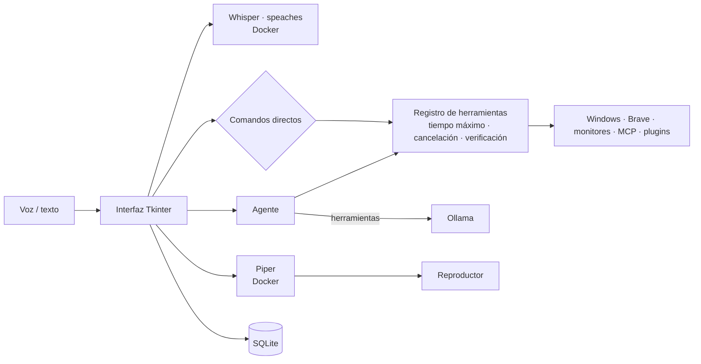

# J.A.R.V.I.S. — Asistente local por voz y texto

Asistente de escritorio para **Windows**, en **español**, que funciona **100 % en tu equipo**: la voz se transcribe con Whisper, las respuestas las genera un modelo de [Ollama](https://ollama.com) y la voz sintetizada la produce Piper. Nada de lo que dices se envía a la nube.

Puedes hablarle (F9 o el botón del micrófono) o escribirle, y además de conversar controla el equipo: volumen, salida de audio, navegador, YouTube, juegos, monitores, rutinas automáticas y más.

## Funciones

| Área | Ejemplos |
|---|---|
| **Conversación con memoria** | «Recuerda que prefiero Brave», «¿qué recuerdas sobre mi navegador?» |
| **Control del equipo** | «Sube el volumen al 30 %», «cambia la salida a auriculares», «abre una pestaña», «busca en YouTube…», «abre Sekiro» |
| **Consultas del sistema** (solo lectura) | «¿Qué aplicaciones tengo abiertas?», «¿qué consume más memoria?», «¿cómo está el equipo?» |
| **Rutinas y automatizaciones** | «Programa una rutina llamada Inicio a las 09:00 de lunes a viernes y pon el volumen al 30 %», «cuando conecte los auriculares, cambia la salida a auriculares automáticamente» |
| **Monitores** | «Desactiva el monitor 3», «extiende el monitor 3», «duplica los monitores 1 y 3», «pon el monitor 3 como principal» |
| **Visión de pantalla** | «Mira el monitor 2 y dime qué error sale» (con vista previa y confirmación) |
| **Integraciones** | Clima (Open-Meteo, sin cuenta) y lectura de archivos de Documentos vía [MCP](https://modelcontextprotocol.io) |
| **Diagnóstico** | «Diagnóstico», «historial de acciones», «¿cuál fue la última acción?» |

## Seguridad y privacidad

- **Todo local**: Whisper, Ollama y Piper corren en tu PC. Solo el plugin de clima consulta un servicio externo (envía únicamente el nombre de la ciudad).
- **Permisos según el riesgo**: las acciones delicadas (navegar, abrir juegos, gestionar ventanas o monitores) piden confirmación cuando las propone el asistente; los planes de varios pasos se aprueban completos antes de ejecutarse.
- **Automatizaciones**: solo pueden ejecutarse sin preguntar si todas sus acciones son de riesgo bajo.
- **Cambios de monitores**: se validan antes de aplicarse y se revierten solos a los 15 s si no los confirmas.
- **Visión**: solo captura cuando lo pides, muestra una vista previa y la imagen nunca se guarda en disco.
- **Archivos (MCP)**: solo lectura y solo dentro de la carpeta configurada.
- **Seguimiento**: cada acción tiene tiempo máximo, se puede cancelar (botón *Cancelar* o Esc), se verifica cuando es posible y queda en un historial.
- **Datos mínimos**: los registros no guardan lo que dices; solo se conservan los últimos 30 audios y puedes borrar el historial con «borra el historial de conversaciones».

## Arquitectura



## Requisitos

- Windows 10/11
- Python 3.13
- [Docker Desktop](https://www.docker.com/products/docker-desktop/) (servicios de voz a texto y texto a voz)
- [Ollama](https://ollama.com) abierto, con los modelos:
  ```bash
  ollama pull qwen2.5-coder:14b
  ```
  ```bash
  ollama pull qwen3.6:27b
  ```
  (el segundo solo es necesario para la visión de pantalla)
- [Node.js](https://nodejs.org) (para el servidor MCP de archivos)
- Opcional: navegador Brave para las funciones web

## Instalación

1. Clonar el repositorio y crear el entorno virtual:
   ```bash
   git clone https://github.com/Ezequiel-Sale/Jarvis-asistente-local.git
   ```
   ```bash
   cd Jarvis-asistente-local
   ```
   ```bash
   python -m venv .venv313
   ```
   ```bash
   .venv313/Scripts/python.exe -m pip install -r requirements.txt
   ```
2. Copiar `.env.example` como `.env` y elegir una contraseña para Grafana.
3. Colocar la voz de Piper `es_ES-davefx-medium` (`.onnx` y `.onnx.json`, de [rhasspy/piper-voices](https://huggingface.co/rhasspy/piper-voices)) en `piper-voices/`.
4. El contenedor de voz a texto ([speaches](https://github.com/speaches-ai/speaches)) usa `whisper-models/` como caché de modelos de Hugging Face; Jarvis pide el modelo `Systran/faster-whisper-small`.

## Uso

```bash
.venv313/Scripts/python.exe jarvis_app.py
```

Jarvis inicia solo los contenedores de voz con Docker, aparece en la bandeja del sistema y solo permite una instancia abierta. Pulsa **F9** para hablar o escribe en la ventana de chat. El botón **⏱ RUTINAS** abre el panel de automatizaciones.

Las integraciones se configuran en `integraciones.json`, que se crea solo al arrancar.

## Tests y compilación

```bash
.venv313/Scripts/python.exe -m unittest discover -s tests
```

```bash
.venv313/Scripts/pyinstaller.exe --noconfirm Jarvis.spec
```

El ejecutable queda en `dist/Jarvis/Jarvis.exe`.

## Documentación técnica

La arquitectura, los módulos, la base de datos, las convenciones y las decisiones de diseño están en [PROJECT_CONTEXT.md](PROJECT_CONTEXT.md).
