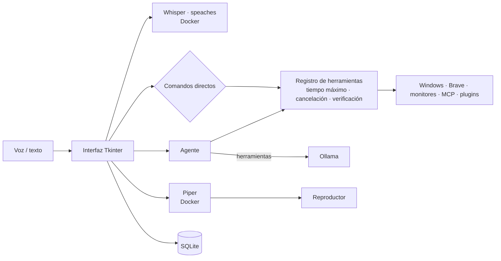

# J.A.R.V.I.S. — Asistente local por voz y texto

[](https://github.com/Ezequiel-Sale/Jarvis-asistente-local/actions/workflows/tests.yml)

Asistente de escritorio para **Windows**, en **español**, que funciona **100 % en tu equipo**: la voz se transcribe con Whisper, las respuestas las genera un modelo de [Ollama](https://ollama.com) y la voz sintetizada la produce Piper. Nada de lo que dices se envía a la nube.

Puedes hablarle (diciendo «Hey Jarvis», con F9 o con el botón del micrófono) o escribirle, y además de conversar controla el equipo: volumen, salida de audio, navegador, YouTube, juegos, monitores, rutinas automáticas y más.

## Funciones

| Área | Ejemplos |
|---|---|
| **Conversación con memoria** | «Recuerda que prefiero Brave», «¿qué recuerdas sobre mi navegador?». Busca recuerdos por significado y **aprende solo** de las conversaciones («¿qué aprendiste de mí?», «desactiva el aprendizaje automático») |
| **Control del equipo** | «Sube el volumen al 30 %», «cambia la salida a auriculares», «abre una pestaña», «busca en YouTube…», «abre Sekiro» |
| **Consultas del sistema** (solo lectura) | «¿Qué hora es?», «¿qué día es hoy?», «¿Qué aplicaciones tengo abiertas?», «¿qué consume más memoria?», «¿cómo está el equipo?» (incluye temperaturas de la GPU y la CPU; avisa solo si algo se calienta demasiado) |
| **Limpieza** | «Libera espacio», «vacía la papelera», «borra los archivos temporales»: muestra cuánto ocupa cada cosa (temporales, papelera, caché de Brave, Docker, modelos de Ollama sin usar) y borra solo lo que marques tras confirmar |
| **Buenos días** | «Buenos días», «resumen del día», «¿cómo viene el día?»: clima, avisos y rutinas de hoy, cómo está el equipo y la batería de los auriculares. Sale solo la primera vez que usas la PC por la mañana (se apaga en **⚙ Ajustes** o con «desactiva el resumen de la mañana») |
| **Panel de inicio** | Primera página: hora, clima, salud del equipo (con el espacio de cada disco), próximos recordatorios y rutinas, lo que suena, batería de los auriculares y estado de los servicios |
| **Multimedia** | «Reanuda el vídeo del monitor 2», «pausa el vídeo del monitor 1 y reanuda el del monitor 2», «dale play al vídeo de la segunda pantalla», «pon el vídeo en pantalla completa», «sal de pantalla completa del monitor 3», «modo teatro», «sal del modo cine», «silencia la pestaña que suena», «mutea YouTube», «devuélvele el sonido al vídeo», «Pausa la música», «siguiente canción», «la anterior», «¿qué está sonando?», «pon el volumen de Spotify al 30», «silencia Discord» |
| **Temporizadores y recordatorios** | «Pon un temporizador de 10 minutos», «recuérdame en 20 minutos sacar la ropa», «recuérdame mañana a las 9 pagar la luz», «pon una alarma a las 7», «¿qué recordatorios tengo?», «cancela el temporizador» |
| **Auriculares G533** | «¿Cuánta batería tienen los auriculares?»; aviso automático cuando baja del 15 % |
| **Comandos personalizados** | Desde ⏱ RUTINAS → «+ NUEVA»: elige una frase propia («modo juego») y las acciones (abrir un programa, cambiar la salida, pausar la música, volumen por app, monitores, apagar…); luego basta con decirla |
| **Rutinas y automatizaciones** | «Programa una rutina llamada Inicio a las 09:00 de lunes a viernes y pon el volumen al 30 %», «apaga el equipo a las 2», «suspende el equipo todos los días a las 23:30», «programa una rutina llamada Noche a las 23:00, pausa la música y bloquea el equipo», «cuando conecte los auriculares, cambia la salida a auriculares automáticamente» (detecta cuando enciendes o apagas el G533, sin quitar el receptor), **modo juego**: «cuando abra un juego, cambia la salida a auriculares», «cuando cierre el juego, reanuda la música» (detecta los juegos de Steam, Epic, Xbox y C:\Games) |
| **Energía** | «Apaga el equipo», «reinicia la PC», «suspende el equipo», «suspende el equipo dentro de 10 minutos», «apaga la PC en media hora», «bloquea la pantalla», «cancela el apagado» |
| **Monitores** | «Desactiva el monitor 3», «extiende el monitor 3», «duplica los monitores 1 y 3», «pon el monitor 3 como principal», «arregla el escalado del monitor 3» (si la barra de tareas de la TV se ve mal: baja la escala al 200 % y la vuelve a subir; también lo hace solo tras cambiar monitores), «manda Brave a la TV», «pon Discord en el monitor 2», «trae todo al monitor 1». En **⚙ Ajustes** hay un esquema de los monitores: clic en uno para desactivarlo, extenderlo, hacerlo principal o arreglar su escalado |
| **Juegos** | Página 🎮 JUEGOS: los juegos que reconoce Jarvis (en «Games», «Epic Games» y «SteamLibrary» de cada disco y en Steam), con buscador, el .exe que abre y ▶ JUGAR; también «abre Elden Ring» |
| **Abrir aplicaciones** | «Abre WhatsApp», «inicia Discord», «abre la calculadora»: cualquier app del menú Inicio por su nombre, también las de la Microsoft Store; primero busca entre tus juegos (en las carpetas «Games», «Epic Games» y «SteamLibrary» de todos los discos y en Steam) y si no es un juego, la abre como aplicación |
| **Ventanas y navegador** | «Minimiza Discord», «maximiza Spotify», «restaura el explorador», «trae WhatsApp al frente», «muestra el escritorio»; en Brave: «página anterior», «página siguiente», «recarga la página» o «F5». También como pasos de rutinas |
| **Clic en pantalla** | «Haz clic en el vídeo que dice Me enamoré del monitor 1», «pulsa Aceptar en el monitor 2», «escribe "hola" en el buscador del monitor 3» (siempre muestra dónde va a hacer clic y espera tu «sí») |
| **Visión de pantalla** | «Mira el monitor 2 y dime qué error sale» (con vista previa y confirmación) |
| **Integraciones** | Búsqueda en internet con fuentes cuando le preguntas algo reciente o que no conoce ([Tavily](https://tavily.com), plan gratuito, clave `TAVILY_API_KEY` en el `.env`; DuckDuckGo de respaldo), clima (Open-Meteo, sin cuenta) y lectura de archivos de Documentos vía [MCP](https://modelcontextprotocol.io) |
| **Voz** | «Hey Jarvis… sube el volumen», «desactiva la palabra de activación», «deja de escucharme». Con los auriculares puestos, decir «Hey Jarvis» mientras habla lo interrumpe. Seis voces (España, México y Argentina) para elegir en **⚙ Ajustes** o con «cambia tu voz a la argentina» |
| **Apariencia** | Temas Cian, Mark (rojo y dorado) y Claro: «cambia al tema rojo», «pon el modo claro» o desde **⚙ Ajustes**. Cada mensaje muestra su fecha y hora (también en el celular). Las respuestas muestran negritas, listas, código, tablas y enlaces; cada acción aparece como una tarjeta con su estado, y las confirmaciones aparecen dentro del chat. Con Jarvis en la bandeja, una burbuja en la esquina muestra lo que entendió y la respuesta (y las confirmaciones con SÍ / NO) sin quitarte el foco. «Modo compacto» deja solo el orbe en una ventanita siempre visible |
| **Undervolt de la GPU (AMD)** | Comprueba cada minuto que la GPU tenga aplicado tu perfil de Adrenalin (`undervolt.xml` en Documentos) y lo reaplica si se perdió tras un reinicio o un pantallazo negro. «Aplica el undervolt», «¿está aplicado el undervolt?». Si se pierde 3 veces en una hora deja de reaplicarlo y te avisa |
| **App del celular (Android)** | Chat y órdenes a la PC desde el teléfono, por texto o voz, en casa o fuera. Va solo por [Tailscale](https://tailscale.com) (red privada y cifrada entre tus dispositivos), está desactivada por defecto y cada celular se vincula con un código que muestra Jarvis. Las confirmaciones se responden desde el teléfono y las respuestas se ven mientras Jarvis las escribe. Con 🖥 ves las pantallas de la PC en vivo (solo ver) y le das órdenes sobre lo que ves; mientras miras, la PC muestra un aviso |
| **Diagnóstico** | «Diagnóstico», «historial de acciones», «¿cuál fue la última acción?» |

## Seguridad y privacidad

- **Todo local**: Whisper, Ollama y Piper corren en tu PC. Solo consultan servicios externos el plugin de clima (envía únicamente el nombre de la ciudad) y la búsqueda en internet (envía únicamente el texto buscado).
- **Respuestas rápidas sin estorbar a los juegos**: el modelo de lenguaje se carga en la GPU mientras dices «Hey Jarvis», pulsas el micrófono o escribes (cargarlo tarda ~11 s), queda cargado 2 horas y se descarga solo al abrir un juego para dejarle la memoria de la tarjeta. Lo mismo con la voz a texto en la GPU (~1,5 GB): mientras juegas usa el procesador, y al cerrar el juego los dos vuelven a cargarse solos.
- **Permisos según el riesgo**: las acciones delicadas (navegar, abrir juegos, gestionar ventanas o monitores) piden confirmación cuando las propone el asistente; los planes de varios pasos se aprueban completos antes de ejecutarse. Para responder cualquier confirmación basta con decir «sí» o «no», sin «Hey Jarvis».
- **Automatizaciones**: solo pueden ejecutarse sin preguntar si todas sus acciones son de riesgo bajo.
- **Palabra de activación**: la escucha de «Hey Jarvis» es local y se queda en memoria; solo se transcribe lo que dices después. Se desactiva con «deja de escucharme».
- **Rutinas que apagan, reinician o suspenden**: al llegar la hora avisan por voz con 60 s de cuenta atrás y se cancelan con un clic o diciendo «cancela».
- **Apagar, reiniciar y suspender**: siempre piden confirmación (con botones o diciendo «sí»/«no»), aunque lo digas directamente; apagar y reiniciar esperan 10 s para que puedas decir «cancela el apagado».
- **Cambios de monitores**: se validan antes de aplicarse y se revierten solos a los 15 s si no los confirmas (con el botón, ENTER o diciendo «sí»/«no»).
- **Visión**: solo captura cuando lo pides, muestra una vista previa y la imagen nunca se guarda en disco.
- **Archivos (MCP)**: solo lectura y solo dentro de la carpeta configurada.
- **Seguimiento**: cada acción tiene tiempo máximo, se puede cancelar (botón *Cancelar* o Esc), se verifica cuando es posible y queda en un historial.
- **Aprendizaje automático**: solo guarda datos duraderos que tú dijiste, nunca contraseñas, datos bancarios, documentos ni salud; te avisa en el chat de cada cosa que aprende y puedes borrarla o apagar la función.
- **Datos mínimos**: los registros no guardan lo que dices; solo se conservan los últimos 30 audios y puedes borrar el historial con «borra el historial de conversaciones».

## Arquitectura



## Requisitos

- Windows 10/11
- Python 3.13
- [Docker Desktop](https://www.docker.com/products/docker-desktop/) (servicios de voz a texto y texto a voz)
- [Ollama](https://ollama.com) abierto, con los modelos:
  ```bash
  ollama pull qwen2.5-coder:14b
  ```
  ```bash
  ollama pull qwen3-vl:8b-instruct-q8_0
  ```
  ```bash
  ollama pull embeddinggemma
  ```
  (el segundo solo es necesario para la visión de pantalla; el tercero, para buscar recuerdos por significado)
- [Node.js](https://nodejs.org) (para el servidor MCP de archivos)
- Opcional: navegador Brave para las funciones web
- Opcional: driver [PawnIO](https://pawnio.eu) para ver la temperatura de la CPU (la GPU no lo necesita). Las temperaturas se leen con [LibreHardwareMonitor](https://github.com/LibreHardwareMonitor/LibreHardwareMonitor) (MPL 2.0), incluido en `vendor/`

## Instalación

1. Clonar el repositorio y crear el entorno virtual:
   ```bash
   git clone https://github.com/Ezequiel-Sale/Jarvis-asistente-local.git
   ```
   ```bash
   cd Jarvis-asistente-local
   ```
   ```bash
   python -m venv .venv313
   ```
   ```bash
   .venv313/Scripts/python.exe -m pip install -r requirements.txt
   ```
2. Copiar `.env.example` como `.env` y elegir una contraseña para Grafana.
3. Colocar la voz de Piper `es_ES-davefx-medium` (`.onnx` y `.onnx.json`, de [rhasspy/piper-voices](https://huggingface.co/rhasspy/piper-voices)) en `piper-voices/`. Opcionales (para elegir en Ajustes): `es_ES-sharvard-medium`, `es_MX-ald-medium`, `es_MX-claude-high` y `es_AR-daniela-high`.
4. Descargar el modelo de la palabra de activación:
   ```bash
   .venv313/Scripts/python.exe -c "from openwakeword import utils; utils.download_models(model_names=['hey_jarvis'])"
   ```
   (modelos de [openWakeWord](https://github.com/dscripka/openWakeWord), licencia CC BY-NC-SA 4.0: uso personal, no comercial).
5. El contenedor de voz a texto ([speaches](https://github.com/speaches-ai/speaches)) usa `whisper-models/` como caché de modelos de Hugging Face; Jarvis pide el modelo `Systran/faster-whisper-small`.
6. Opcional, **voz a texto en la tarjeta gráfica** (cualquier GPU con DirectML, también AMD: entiende mejor y responde en ~0,5 s en lugar de ~1,7 s). Cambiar `onnxruntime` por la versión DirectML y descargar Whisper turbo (~1,9 GB) en `whisper-onnx/`, junto a `Jarvis.exe` (o en la carpeta del repositorio si lo ejecutas desde el código):
   ```bash
   .venv313/Scripts/python.exe -m pip uninstall -y onnxruntime
   ```
   ```bash
   .venv313/Scripts/python.exe -m pip install -r requirements-gpu.txt
   ```
   ```bash
   .venv313/Scripts/python.exe -c "from huggingface_hub import hf_hub_download as d; [d('onnx-community/whisper-large-v3-turbo', f, local_dir='whisper-onnx') for f in ('onnx/encoder_model_fp16.onnx', 'onnx/decoder_model_merged.onnx', 'tokenizer.json')]"
   ```
   Sin esto, Jarvis usa el contenedor de voz a texto de siempre.

## Uso

```bash
.venv313/Scripts/python.exe jarvis_app.py
```

Jarvis inicia solo los contenedores de voz con Docker, aparece en la bandeja del sistema y solo permite una instancia abierta. La versión instalada **se inicia con Windows** (oculta en la bandeja); se desactiva en **⚙ Ajustes**, con la opción «Iniciar con Windows» del menú de la bandeja o diciendo «desactiva el inicio con Windows». Di **«Hey Jarvis»** seguido de tu orden, pulsa **F9** para hablar o escribe en el chat. Todo está en **una sola ventana**: la barra lateral tiene el orbe y las secciones **Chat**, **Rutinas** (lista y formulario de rutinas) y **Ajustes** (voz, «Hey Jarvis», inicio con Windows y modelos en uso). El botón **?  COMANDOS** de arriba a la derecha abre la lista de comandos de voz, con buscador, para qué sirve cada uno y las frases de tus rutinas.

Las integraciones se configuran en `integraciones.json`, que se crea solo al arrancar.

## App del celular (opcional)

1. Instala Tailscale en la PC y en el celular con la misma cuenta.
2. Compila la app (necesita un JDK 17 y el SDK de Android):
   ```bash
   cd movil
   ```
   ```bash
   powershell -ExecutionPolicy Bypass -File compilar.ps1
   ```
   e instala `movil/Jarvis.apk` en el teléfono. Copia `Jarvis.apk` y `Jarvis.apk.json` a una carpeta `movil` junto a Jarvis.exe: desde entonces la app se actualiza sola (te avisa al abrirla y Android pide confirmar).
3. En Jarvis: **⚙ Ajustes → App del celular**, actívala y pulsa «VINCULAR CELULAR». Escribe en la app la dirección y el código que aparecen.
4. Con la app cerrada te avisa de respuestas, recordatorios, alertas del equipo (temperatura, disco casi lleno) y confirmaciones, que puedes responder desde la notificación. Lee las respuestas con la misma voz de Piper que la PC, y puedes hablarle con el botón de los auriculares Bluetooth (un pitido: grabando; dos: enviado).
5. La app pide tu huella (o el bloqueo del teléfono) al abrirla y antes de aprobar acciones de riesgo alto, como apagar o borrar. Se puede desactivar desde el menú ⋮.
6. Abajo hay pestañas (el ⋮ de arriba abre **Ajustes**: voz, avisos, botón de los auriculares, huella, actualización y desvincular): **Música** (lo que suena con su carátula, play/pausa, volumen general y de cada aplicación, auriculares o parlantes) y **Equipo** (temperaturas, cargas, RAM y discos con gráficos de los últimos 10 minutos). En Equipo, **🎮 JUEGO** pone el celular en horizontal con los FPS del juego en grande, medidos con [PresentMon](https://github.com/GameTechDev/PresentMon) de Intel, que viene incluido.
7. En la vista de pantalla, arriba: **🔍** marca una zona y pregunta «¿Qué es esto?»; **🖱** convierte el celular en touchpad (hay que activar «CONTROL DESDE EL CELULAR» en Ajustes de la PC y aprobarlo con tu huella; mientras tanto la PC muestra un aviso rojo); **🔊** trae el audio de la PC junto al vídeo. El puntero del mouse se ve sobre la imagen.
8. **Archivos y portapapeles:** «Compartir → Jarvis (PC)» desde cualquier app abre los links en la PC y guarda fotos y archivos en Descargas de la PC. Con **📁** (arriba en el chat) traes o mandas el portapapeles, envías archivos y bajas al celular lo que haya en Descargas, Documentos o los otros discos de la PC (no el del sistema) (queda en «Descargas/Jarvis»). También puedes pedir «manda este archivo al celular» o «manda lo que copié al celular».
9. Para ver las pantallas de la PC, toca 🖥 en la app: elige el monitor y la calidad (AUTO usa vídeo a 60 cuadros por segundo con Wi-Fi y AHORRO con datos móviles; también hay 30 FPS y modos de imágenes), acerca con dos dedos y escribe o dicta órdenes abajo. Mientras miras, la PC muestra un aviso arriba; un clic en él (o «VER PANTALLA: NO» en Ajustes) lo corta.

### Encender la PC desde el celular (solo en casa)

La app guarda los datos de tu PC mientras está encendida y, con la PC apagada o suspendida, le manda la señal de encendido por el Wi-Fi de casa: **⚙ Ajustes → Encender la PC**, el botón **⚡ Encender PC** de la notificación «Sin conexión» o tocando «SIN CONEXIÓN» en el chat. En Ajustes ves qué falta configurar en tu PC. Una sola vez, en la PC:

1. **Permitir que la placa de red despierte la PC.** En PowerShell como administrador (cambia el nombre por el de tu placa, que Ajustes muestra):
   ```bash
   powercfg /deviceenablewake "Realtek 8852CE WiFi 6E PCI-E NIC"
   ```
   O: Administrador de dispositivos → Adaptadores de red → tu placa → Administración de energía → «Permitir que este dispositivo reactive el equipo» y «Permitir solo un paquete mágico para reactivar el equipo».
2. **Por Wi-Fi:** solo despierta desde **suspender**, no desde apagado (el Wi-Fi se apaga del todo). Dile a Jarvis «suspende el equipo» en vez de «apágalo».
3. **Con cable de red** también enciende desde apagado: activa en la BIOS «Wake on LAN» (o «Power On by PCI-E») y desactiva el **inicio rápido** de Windows (Panel de control → Opciones de energía → Elegir el comportamiento de los botones de inicio/apagado → quitar «Activar inicio rápido»).

## Tests y compilación

```bash
.venv313/Scripts/python.exe -m unittest discover -s tests
```

Los tests también se ejecutan automáticamente en GitHub (Windows, Python 3.13) en cada cambio.

Para compilar, instala primero PyInstaller:

```bash
.venv313/Scripts/python.exe -m pip install -r requirements-dev.txt
```

```bash
.venv313/Scripts/pyinstaller.exe --noconfirm Jarvis.spec
```

El ejecutable queda en `dist/Jarvis/Jarvis.exe`.

## Documentación técnica

La arquitectura, los módulos, la base de datos, las convenciones y las decisiones de diseño están en [PROJECT_CONTEXT.md](PROJECT_CONTEXT.md).
