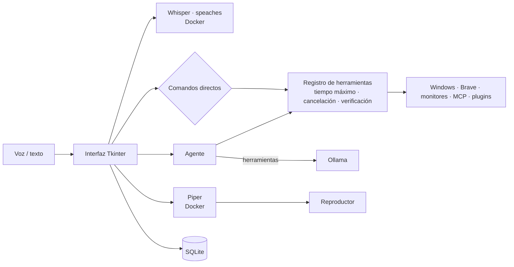

# J.A.R.V.I.S. — Asistente local por voz y texto

[](https://github.com/Ezequiel-Sale/Jarvis-asistente-local/actions/workflows/tests.yml)

Asistente de escritorio para **Windows**, en **español**, que funciona **100 % en tu equipo**: la voz se transcribe con Whisper, las respuestas las genera un modelo de [Ollama](https://ollama.com) y la voz sintetizada la produce Piper. Nada de lo que dices se envía a la nube.

Puedes hablarle (diciendo «Hey Jarvis», con F9 o con el botón del micrófono) o escribirle, y además de conversar controla el equipo: volumen, salida de audio, navegador, YouTube, juegos, monitores, rutinas automáticas y más.

## Funciones

| Área | Ejemplos |
|---|---|
| **Conversación con memoria** | «Recuerda que prefiero Brave», «¿qué recuerdas sobre mi navegador?». Busca recuerdos por significado y **aprende solo** de las conversaciones («¿qué aprendiste de mí?», «desactiva el aprendizaje automático») |
| **Control del equipo** | «Sube el volumen al 30 %», «cambia la salida a auriculares», «abre una pestaña», «busca en YouTube…», «abre Sekiro» |
| **Consultas del sistema** (solo lectura) | «¿Qué hora es?», «¿qué día es hoy?», «¿Qué aplicaciones tengo abiertas?», «¿qué consume más memoria?», «¿cómo está el equipo?» |
| **Multimedia** | «Reanuda el vídeo del monitor 2», «pausa el vídeo del monitor 1 y reanuda el del monitor 2», «dale play al vídeo de la segunda pantalla», «silencia la pestaña que suena», «mutea YouTube», «devuélvele el sonido al vídeo», «Pausa la música», «siguiente canción», «la anterior», «¿qué está sonando?», «pon el volumen de Spotify al 30», «silencia Discord» |
| **Temporizadores y recordatorios** | «Pon un temporizador de 10 minutos», «recuérdame en 20 minutos sacar la ropa», «recuérdame mañana a las 9 pagar la luz», «pon una alarma a las 7», «¿qué recordatorios tengo?», «cancela el temporizador» |
| **Auriculares G533** | «¿Cuánta batería tienen los auriculares?»; aviso automático cuando baja del 15 % |
| **Comandos personalizados** | Desde ⏱ RUTINAS → «+ NUEVA»: elige una frase propia («modo juego») y las acciones (abrir un programa, cambiar la salida, pausar la música, volumen por app, monitores, apagar…); luego basta con decirla |
| **Rutinas y automatizaciones** | «Programa una rutina llamada Inicio a las 09:00 de lunes a viernes y pon el volumen al 30 %», «apaga el equipo a las 2», «suspende el equipo todos los días a las 23:30», «programa una rutina llamada Noche a las 23:00, pausa la música y bloquea el equipo», «cuando conecte los auriculares, cambia la salida a auriculares automáticamente» (detecta cuando enciendes o apagas el G533, sin quitar el receptor) |
| **Energía** | «Apaga el equipo», «reinicia la PC», «suspende el equipo», «bloquea la pantalla», «cancela el apagado» |
| **Monitores** | «Desactiva el monitor 3», «extiende el monitor 3», «duplica los monitores 1 y 3», «pon el monitor 3 como principal», «arregla el escalado del monitor 3» (si la barra de tareas de la TV se ve mal: baja la escala al 200 % y la vuelve a subir) |
| **Clic en pantalla** | «Haz clic en el vídeo que dice Me enamoré del monitor 1», «pulsa Aceptar en el monitor 2», «escribe "hola" en el buscador del monitor 3» (siempre muestra dónde va a hacer clic y espera tu «sí») |
| **Visión de pantalla** | «Mira el monitor 2 y dime qué error sale» (con vista previa y confirmación) |
| **Integraciones** | Clima (Open-Meteo, sin cuenta) y lectura de archivos de Documentos vía [MCP](https://modelcontextprotocol.io) |
| **Voz** | «Hey Jarvis… sube el volumen», «desactiva la palabra de activación», «deja de escucharme» |
| **Diagnóstico** | «Diagnóstico», «historial de acciones», «¿cuál fue la última acción?» |

## Seguridad y privacidad

- **Todo local**: Whisper, Ollama y Piper corren en tu PC. Solo el plugin de clima consulta un servicio externo (envía únicamente el nombre de la ciudad).
- **Permisos según el riesgo**: las acciones delicadas (navegar, abrir juegos, gestionar ventanas o monitores) piden confirmación cuando las propone el asistente; los planes de varios pasos se aprueban completos antes de ejecutarse. Para responder cualquier confirmación basta con decir «sí» o «no», sin «Hey Jarvis».
- **Automatizaciones**: solo pueden ejecutarse sin preguntar si todas sus acciones son de riesgo bajo.
- **Palabra de activación**: la escucha de «Hey Jarvis» es local y se queda en memoria; solo se transcribe lo que dices después. Se desactiva con «deja de escucharme».
- **Rutinas que apagan, reinician o suspenden**: al llegar la hora avisan por voz con 60 s de cuenta atrás y se cancelan con un clic o diciendo «cancela».
- **Apagar, reiniciar y suspender**: siempre piden confirmación (con botones o diciendo «sí»/«no»), aunque lo digas directamente; apagar y reiniciar esperan 10 s para que puedas decir «cancela el apagado».
- **Cambios de monitores**: se validan antes de aplicarse y se revierten solos a los 15 s si no los confirmas (con el botón, ENTER o diciendo «sí»/«no»).
- **Visión**: solo captura cuando lo pides, muestra una vista previa y la imagen nunca se guarda en disco.
- **Archivos (MCP)**: solo lectura y solo dentro de la carpeta configurada.
- **Seguimiento**: cada acción tiene tiempo máximo, se puede cancelar (botón *Cancelar* o Esc), se verifica cuando es posible y queda en un historial.
- **Aprendizaje automático**: solo guarda datos duraderos que tú dijiste, nunca contraseñas, datos bancarios, documentos ni salud; te avisa en el chat de cada cosa que aprende y puedes borrarla o apagar la función.
- **Datos mínimos**: los registros no guardan lo que dices; solo se conservan los últimos 30 audios y puedes borrar el historial con «borra el historial de conversaciones».

## Arquitectura



## Requisitos

- Windows 10/11
- Python 3.13
- [Docker Desktop](https://www.docker.com/products/docker-desktop/) (servicios de voz a texto y texto a voz)
- [Ollama](https://ollama.com) abierto, con los modelos:
  ```bash
  ollama pull qwen2.5-coder:14b
  ```
  ```bash
  ollama pull qwen3-vl:8b-instruct-q8_0
  ```
  ```bash
  ollama pull embeddinggemma
  ```
  (el segundo solo es necesario para la visión de pantalla; el tercero, para buscar recuerdos por significado)
- [Node.js](https://nodejs.org) (para el servidor MCP de archivos)
- Opcional: navegador Brave para las funciones web

## Instalación

1. Clonar el repositorio y crear el entorno virtual:
   ```bash
   git clone https://github.com/Ezequiel-Sale/Jarvis-asistente-local.git
   ```
   ```bash
   cd Jarvis-asistente-local
   ```
   ```bash
   python -m venv .venv313
   ```
   ```bash
   .venv313/Scripts/python.exe -m pip install -r requirements.txt
   ```
2. Copiar `.env.example` como `.env` y elegir una contraseña para Grafana.
3. Colocar la voz de Piper `es_ES-davefx-medium` (`.onnx` y `.onnx.json`, de [rhasspy/piper-voices](https://huggingface.co/rhasspy/piper-voices)) en `piper-voices/`.
4. Descargar el modelo de la palabra de activación:
   ```bash
   .venv313/Scripts/python.exe -c "from openwakeword import utils; utils.download_models(model_names=['hey_jarvis'])"
   ```
   (modelos de [openWakeWord](https://github.com/dscripka/openWakeWord), licencia CC BY-NC-SA 4.0: uso personal, no comercial).
5. El contenedor de voz a texto ([speaches](https://github.com/speaches-ai/speaches)) usa `whisper-models/` como caché de modelos de Hugging Face; Jarvis pide el modelo `Systran/faster-whisper-small`.

## Uso

```bash
.venv313/Scripts/python.exe jarvis_app.py
```

Jarvis inicia solo los contenedores de voz con Docker, aparece en la bandeja del sistema y solo permite una instancia abierta. La versión instalada **se inicia con Windows** (oculta en la bandeja); se desactiva en **⚙ Ajustes**, con la opción «Iniciar con Windows» del menú de la bandeja o diciendo «desactiva el inicio con Windows». Di **«Hey Jarvis»** seguido de tu orden, pulsa **F9** para hablar o escribe en el chat. Todo está en **una sola ventana**: la barra lateral tiene el orbe y las secciones **Chat**, **Rutinas** (lista y formulario de rutinas) y **Ajustes** (voz, «Hey Jarvis», inicio con Windows y modelos en uso).

Las integraciones se configuran en `integraciones.json`, que se crea solo al arrancar.

## Tests y compilación

```bash
.venv313/Scripts/python.exe -m unittest discover -s tests
```

Los tests también se ejecutan automáticamente en GitHub (Windows, Python 3.13) en cada cambio.

Para compilar, instala primero PyInstaller:

```bash
.venv313/Scripts/python.exe -m pip install -r requirements-dev.txt
```

```bash
.venv313/Scripts/pyinstaller.exe --noconfirm Jarvis.spec
```

El ejecutable queda en `dist/Jarvis/Jarvis.exe`.

## Documentación técnica

La arquitectura, los módulos, la base de datos, las convenciones y las decisiones de diseño están en [PROJECT_CONTEXT.md](PROJECT_CONTEXT.md).
